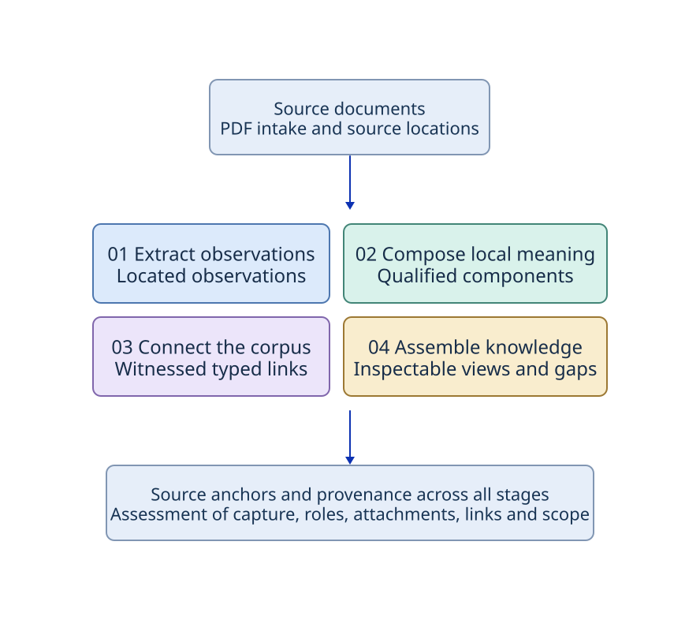

# Corpus Structure

**From documents to connected, source-grounded knowledge.**

Corpus Structure is a document-intelligence pipeline for finding structure in a collection
of documents. It locates definitions and predicate roles, attaches conditions, resolves
references, and assembles related material into views that retain their source evidence.

The central idea is **progressive enrichment**. A located observation or supported connection
can be useful while a larger interpretation is still unresolved. The system preserves those
differences so a reader can inspect what was observed, what was selected, and what has been
assessed.

[Documentation](https://paul-heyse.github.io/corpus-structure/) · [See an example](docs/examples/README.md) · [Explore the architecture](docs/design/README.md) · [Read the evaluation](docs/design_review/evidence/2026-11-08_nce-full-book/review/README.md) · [Run locally](#run-locally)

## How it works

The pipeline locates observations in source material, composes local meaning by attaching
roles and qualifiers, connects related material through typed links, and assembles
comparisons and dossiers. Source locations stay attached throughout. Assessment can focus on
capture, roles, attachments, links, or scope.

## A real result

On physical page 260 of Grinstead and Snell’s *Introduction to Probability*, the text
refers to **Section 5.1**. The pipeline retained that occurrence and selected a
`cites-section` edge to **Important Distributions** on physical page 191. The edge carries
an explicit source-cue witness. The dated output review checked the cue and target
against the printed book.

[Follow the citation to both source pages and the retained evidence](docs/examples/README.md#a-printed-reference-becomes-a-typed-link).

## What you can inspect

| Capability | Inspectable result |
| --- | --- |
| Source capture | Native document items, projected passages, and source locations |
| Extraction | Defining expressions, predicate roles, conditions, and modality |
| Contextual linking | A located cue, the selected typed connection, and its witness |
| Comparison and assembly | Differences between qualified readings and dossiers organized around a selected root |
| Granular evaluation | Separate assessments of source capture, attachments, links, and applicability |

The development corpus includes all **518 physical pages** of the book, with **29 selected
source views** for downstream work. The contextual review checked nine retained section
citations and separately identified four additional printed references that did not enter
retrieval. Coverage and maturity vary by operation. The [output review](docs/design_review/evidence/2026-11-08_nce-full-book/review/README.md)
and [current checkpoint](STATUS.md) document the boundaries.

## Engineering approach

- **Preserve local meaning.** A role or condition can remain independently useful before the whole passage is interpreted.
- **Keep relationships typed.** Similarity, citation, identity, and applicability support different operations.
- **Retain source evidence.** A result can be followed back to its supporting occurrences and the published source.
- **Assess the operation being improved.** Capture, interpretation, attachment, and link selection can be examined separately.

The [architecture map](docs/design/README.md) connects these choices to design and code. The
[examples](docs/examples/README.md) also show a positive-variance condition and what happens
when a candidate link lacks sufficient support.

## Run locally

Start with the [static examples](docs/examples/README.md) to inspect results directly. The
[reproduction guide](docs/examples/README.md#reproduce-the-contextual-example) lists the
source, matching release, and environment needed to rebuild the contextual result.

For a development checkout, see [AGENTS.md](AGENTS.md). Run `bash scripts/setup-env` to prepare
the checkout, then use `uv run ci doctor` to inspect installed tools. The
[ci skill](.claude/skills/ci/SKILL.md) documents the supported CLI routes, and the
[shared agent roles](.agents/roles/README.md) describe contributor workflows.

For a local documentation preview, run `just bootstrap-docs` and then `just docs-serve`.
See [publishing operations](docs/publishing.md) for checks and authoring.

Built by Paul Heyse as part of an ongoing exploration of structured document intelligence.
