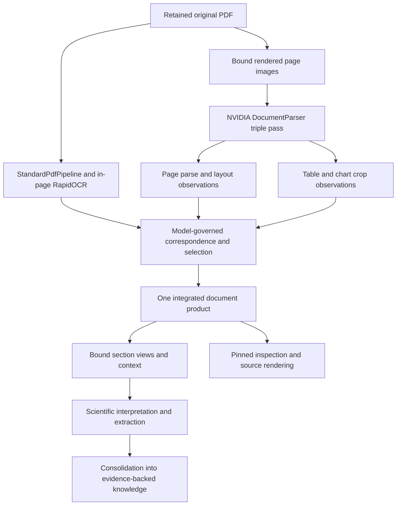

# Integrated document interpretation: Docling, RapidOCR and Nemotron

**2026-10-31 · Proposed target · Not implemented or locally qualified.**
Companion to the [functional review](docling-nemotron-triple-pass_2026-10-31.md).
The user's clarification is part of this target: downstream stages consume **one integrated document
model**, not separate recognizer documents that every consumer must merge independently.

## One consumer model, multiple evidence sources

Recommend an application-owned **IntegratedDocument** contract whose content graph is a native
DoclingDocument and whose typed companion relations carry input provenance, correspondence,
selection and coverage. This is a descriptive target concept, not a new production class already
present. Both components form one immutable selected product; its public reader returns one coherent
contract. Nemotron contributes content and structural hypotheses before this publication boundary.
Downstream methods do not choose a recognizer, rerun matching, or reconstruct a merge.

The content graph retains Docling's sections, ordered items, tables, formulas, pictures and chart
metadata. The companion is part of the document contract, not an optional detached audit file.
It supplies distinctions neither upstream content schema adequately models: multi-input custody,
recognition outcomes, precise address spaces, alternatives and selection justifications. Docling
continues to own its embedded upstream schema; LinkML owns the application contract and behavior.

| Candidate singular output | Assessment and disposition |
|---|---|
| Plain DoclingDocument only | Best existing rich content shape, but cannot alone represent the complete pass/merge/selection/evidence lifecycle. Reject as the entire application contract. |
| Nemotron blocks/Markdown only | Preserves recognizer-native serialization but loses native PDF/cell grounding and rich existing consumer hierarchy. Retain as source evidence, not selected consumer model. |
| IntegratedDocument: Docling content graph plus mandatory typed companion | **Recommended.** Combines both recognizers while reusing existing storage/readers, typed table/chart/formula structures and native interchange. Companion relations add semantics without forking upstream Docling classes. |
| New application-owned hybrid content schema replacing both | Could represent richer chart panels, overlapping reading orders or structural alternatives natively, but requires replacing hierarchy, scientific inputs, serialization, rendering, query and evaluation contracts. No inspected requirement establishes that these must replace the content graph rather than be companion relations. Defer a new content schema unless a concrete consumer cannot receive needed semantics faithfully through the recommended contract. |

This choice does not privilege Docling recognition as always correct. Nemotron-derived text, formulas,
heading structure, tables and charts can become selected content under the governing policy. It
privileges a useful common content representation and one selection boundary. Raw recognizer output
remains unchanged; its shape does not dictate what later stages see.

If mapping reveals a material content distinction that Docling cannot express, preserve it in a typed
companion relation first and assess the consuming operation. A hybrid content replacement is warranted
only if that creates repeated reconstruction, loses required meaning, or makes core operations
unnaturally expensive. Decide on an end-to-end example, not on schema novelty alone.

## Processing and authority

Recognition outputs are assertions about source content. Correspondence relates occurrences;
selection creates a usable document; consolidation establishes claims within the knowledge model.
These operations have different contracts even when physically grouped in one task.

| Semantic owner | Owned decisions | Execution mechanism |
|---|---|---|
| Application LinkML/execution model | Operation applicability, input roles, outcome and coverage meanings, permitted transitions, effects, policy bindings and evidence requirements | Existing preparation/compiler, domain kernels and fenced database operations |
| Docling | Upstream content shape, native parsing/OCR/layout/table/formula and supported content mapping | Full Docling with requested extras; StandardPdfPipeline and native mapper |
| NVIDIA parser | Supported multipass mechanics, crop preparation and provider merge algorithm | Pinned `DocumentParser`, serving backend and raw serialization |
| Reconciliation domain operation | Cross-provider correspondence, content selection, uncertainty and derivation | Narrow specialized algorithms behind the owned contract |
| PostgreSQL | Immutable custody, qualified relationships, transactional visibility and admitted reads | Existing SQLAlchemy Core metadata and protected publication |
| Consolidation | Knowledge entity/claim identity, evidence and confidence rules | Existing consolidation/validation operations |

The model describes supported behavior; it does not turn every tensor operation, crop helper or
internal loop into a database row. Additional recipes, provider bindings and policy instances become
rows where the semantic concepts already suffice; genuinely new meanings extend the authoritative model.

## Contract, relations and identity

The following are logical roles to integrate into current owners, not a prescribed parallel registry.

| Concept | Required semantics and relationships |
|---|---|
| Original | Immutable source artifact digest, PDF page identity and supported source scope. |
| Recognition recipe | Provider/package/source and weight/tokenizer revisions; prompt and decoding identities; rendering/crop/merge settings; result-affecting runtime choices. |
| Submitted image | Original/page, image digest, dimensions, pixel encoding, render scale/page box/rotation and exact transform; crop image relates to its submitted page image. |
| Recognition request and observation | Pass role A/B/C, page/crop scope, recipe, actual effective settings, response artifact, finish reason, usage and outcome. A page has two page requests plus a variable number of crop requests. |
| Provider occurrence | Product-qualified block/item/cell/formula/chart identity, raw label/text/coordinates and ordered containment. Equal content in different places is not identical occurrence. |
| Product input | Child, qualified input product pin and role. Multiple inputs from both recognizers are required for integrated lineage. |
| Correspondence | Own identity, typed endpoint sets, supporting geometry/text assessments, method and policy, matched/ambiguous/unmatched outcome. |
| Comparison | Separate text, reading-order, grid/header, parsed-math or symbolic comparison result. No scalar similarity stands in for all meanings. |
| Selection decision | Selected output occurrence/structure, source observations, action, governing rule, alternatives and reason. Many source observations can support one output. |
| Coverage | Scope and content family, recognition/discovery policy, examined/capped/unrequested/unresolved portions and applicable completion meaning. |
| Integrated document | One selected content graph and companion relation set, complete input pins, archived schema/release/policy identities and structural/health/coverage reports. |

Addresses name their representation: original PDF page/point region; submitted page/crop pixels;
raw response offset/token; recognized block text offset; selected Docling item/range; or projected
analysis text. A recognized-text offset is not a PDF glyph position. A mapped `(0,0)` provenance
placeholder has unknown character precision. A selected inline formula may have an exact range in
recognized text and only a coarse enclosing page-region witness.

Input relations form an acyclic graph. Keep an optional structural base-parent pointer if useful,
but validate/read the full input graph. Direct input and derivation rows carry qualified foreign keys;
no ambient latest-product lookup resolves evidence. Archive schemas and semantic releases alongside
producer context so older products retain their original meaning.

Do not assign precise TableFormer cell boxes to generated Nemotron cells just because their parent
table overlaps. Any transferred geometry needs an explicit validated cell correspondence; otherwise
use coarse table grounding. Chart values carry visual-inference attribution and associated axis,
series, caption and unit context where recognized.

## Lifecycle and executable behavior

Reuse current run/task/attempt states and fences. Add domain outcomes without creating another task
scheduler. The following logical stages may be fused or batched where their invariants permit.

| Operation | Preconditions and output | Failure / transition behavior |
|---|---|---|
| Recognize page | Bound original/render recipe and admitted runtime; A/B/C observations and request receipts | Inference exception/truncation is retained as failed/partial recognition; successful earlier requests survive a later failure. No successful empty result substitutes for unavailable service. |
| Map provider output | Retained raw response, versioned mapper and coordinate contract; provider-native content projection and loss report | Malformed/unknown/dropped blocks retain raw identity and disposition; invalid graph is not admitted as valid content. |
| Assess correspondence | Qualified observations from the same admitted original/scope; sparse candidate relations and typed comparison results | Ambiguous/unmatched stays explicit. Cross-source or unverifiable frame correspondence is refused or unresolved. |
| Integrate/select | Admitted provider observations, comparison results and policy release; one content graph with decisions/alternatives | Partial scope can produce a deliberately partial selection if allowed. Required unresolved content prevents a complete label; it need not delete useful observations. |
| Publish and bind | Validated integrated graph, companion endpoints, input DAG and current attempt fence | Short atomic publication of product/projections/relations; stale attempt cannot replace selected views. |
| Consume/inspect | Selected exact product and release, admitted project/run scope | Native reads and evidence rendering do not initialize inference. Incompatible selections require a new binding. |

The effective policy specifies which observations can be selected and on what basis. It is compiled
and consumed by the operation rather than reconstructed in adapters, CLI and SQL independently.
A domain function may own a specialized selection algorithm; its inputs, invariants and effects
remain attached to the model. Generator gaps require an owned implementation of the missing invariant,
not an assumption that emitting LinkML/SHACL automatically enforces it.

Keep execution health, content coverage, structural consistency, correspondence precision and source
fidelity distinct. Request completion means the request finished over its declared scope. It does
not certify all author content was found. A/B/C share a model family; agreement is correlated evidence.

## Library composition and finite execution

Use `nemotron_parse.inference.DocumentParser.parse_triple(image, triple_regions="union")`;
use `parse_many` or `prepare`/`parse_prepared` when bounded page scheduling benefits. Explicitly set
triple mode on general/batch APIs. Start from the public `merge_policy="alternatives"` to retain
competing interpretations; the repository's separate integration policy selects consumer content.
Do not silently substitute guarded merge or treat the alternatives benchmark's best-table selection
as a production accuracy guarantee.

Use the custom backend contract `backend(image, *, prompt, stage, settings)` or an observed supplied
client to retain response custody before later passes can fail. Retain useful raw response and image
identity once, reference them from decisions, and avoid duplicating full payloads per relationship.
Store raw request responses/partial receipts through existing admitted artifact/attempt mechanisms;
publication of a structurally usable integrated document remains a separate effect.

For Docling mapping, use `parse_nemotron_parse_v3_5` before HTML chart rendering; retain Markdown chart
tables needed by the mapper. Map per page with heading normalization deferred, concatenate, then
normalize document-wide. Record clamping, normalization, deduplication and lost provenance explicitly.
Run `validate_document`/`validate_tree` plus archived-schema and application invariant validation at
admission; consumers reuse the admitted result rather than repeating whole-document validation.

Keep StandardPdfPipeline and RapidOCR distinct from Nemotron: placing the latter under the existing
PDF-first OCR merge could discard the very missing glyphs it should recover. Retain compact native
OCR words/heading evidence already available. Compare Standard's chart enrichment only as a bounded
alternative; do not activate another generative chart pass by default alongside Nemotron.

Recommend isolated pinned Nemotron runtime and a finite DB-free controller worker using the existing
method ownership protocol, with local external vLLM. Inspect the package's exported API/version first.
Blackwell startup, plugin, MTP and actual effective backend need qualification. GPU use initially
phases across native CUDA, Nemotron and other model services. Configuration distinguishes operational
endpoint locations from model identity and result-affecting settings actually served.

Rendering and model preparation should be reused over their valid scope. Page/crop parallelism and
queue depth share one capacity policy. The public HTTP `parse_many` path eagerly prepares its
input batch; bound the supplied page batch or use finite per-page calls. Its request-concurrency
setting does not bound all hydrated/encoded page inputs. Retain one page image until its dependent crops finish, then
release it; do not hold a full book's hydrated pages. Identity must allow deterministic reconstruction
of submitted pixels, or retain exact submitted bytes where reconstruction cannot guarantee that.
Separate internal page batching from intact semantic section units.

SQLAlchemy Core and short database transactions publish direct relations and useful item/region
projections. Bulk COPY is appropriate when it eliminates a real transport bottleneck, not a reason
to introduce Arrow conversion. No DB transaction/connection spans GPU work. Alembic migrations update
multi-input lineage and backfill historical parent edges without falsely claiming historical products
used additional recognizers. Current archived read contracts remain supported explicitly.

## Consumer behavior and closure scenarios

Every later method receives one IntegratedDocument/SourceView pin through the existing consumer
boundary. The reader exposes selected hierarchy/content, alternatives on demand, admitted LaTeX,
coverage and trace handles. A method does not need separate NVIDIA and Docling adapters.

A disputed table cell citation resolves to its integrated occurrence, selection decision, both
recognizers' observations and source pixels. A chart-derived value includes its chart/series context
and inference status. A symbol retains recognized-text identity even when its original glyph box is
unknown. Section/context selection remains intact without chunking.

CLI/MCP, exports and reference frames share this contract and full input ancestry. Integrated-document JSON export
includes the companion; native Docling JSON remains available as an explicitly content-only
export, whose omissions are clear. Historical citations retain their old product/release pin. A changed
selection invalidates dependent extraction inputs while reusing unchanged recognition evidence.

Before implementation is claimed delivered, demonstrate:

- A real A/B/C page journey, plus a page legitimately producing no crop requests.
- A useful Nemotron contribution selected into the singular document and consumed in extraction.
- Preserved alternatives, repeated occurrences and a deliberate unresolved correspondence.
- A merged-header table or chart/panel retaining structural semantics after mapping and export.
- CropBox/rotation transforms checked against independent geometry, without fabricated fine offsets.
- A later-pass failure preserving earlier raw evidence, and policy-only remapping without inference.
- Pinned CLI/MCP/render/claim trace across both input routes, and historical reads after a new selection.

These are proposed acceptance scenarios, **not_run** here. Local recognition quality and capacity are
unestablished. The review's investigation table owns remaining feasibility recommendations; subsequent
approved plans will own selected execution and acceptance scope. No existing plan, ADR or audit premise
is changed by this target.
