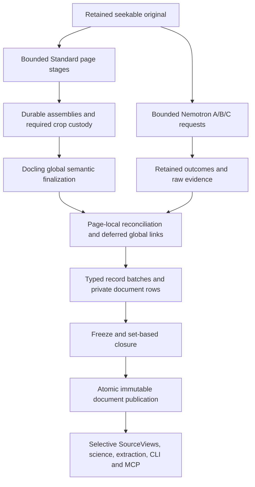

# Target: incrementally realized, immutable PDF documents

**Proposed · 2026-11-01.** Companion to the [functional-extension review](pdf-streaming-and-storage_2026-11-01.md). This describes the recommended target, not deployed behavior. Current0060/0061 and accepted ADRs retain their existing meaning until the normal decision/planning route adopts a change. No pipeline implementation or database migration is performed by this review.

## 1. Logical model and physical realization

A document remains one qualified original and one selected integrated content model with mandatory recognition lineage, alternatives, decisions, precision and coverage. Pages, semantic sections, transport batches, artifact byte parts and published snapshots are different things. Physical batching never creates a new original, invented section or semantic chunk.

PostgreSQL owns custody, immutable instances, visibility and transitions. The semantic release owns types, relationships, permitted operations, invariants and native-schema mappings. Docling's pinned native model remains the interoperability contract for content; the integrated companion supplies additional evidence semantics. Arrow is a typed interchange/computation realization, not a competing editable model.

Recommended relation families extend existing fixed tables:

| Family | Meaning and relationships |
|---|---|
| Document revision/header | Original artifact, producer/configuration, semantic/native schema, policy, input pins and logical revision identity. Small header; inventories are rows. |
| Native records | Qualified logical node identity, native class/discriminator, admitted scalar fields and bounded schema-qualified extension detail. Preserve isolates and fields outside selected analysis sections. |
| Ordered memberships | Document collections, parent/child, rich-cell children, captions/footnotes/references, page membership and explicit ordinal. Ordered arrays remain ordered even when delivery is reordered. |
| Native address mapping | Logical node/cell/reference identity to native collection/pointer in an immutable revision. No batch-local `#/texts/0` may resolve against another batch. |
| Provenance and content details | Text/original/formula representations, original pages, dimensions, frames, charspans, geometry and precision; table/grid/cell records and repeated metadata preserve their actual structure. |
| Integration companion | Existing inputs, independent relationships/endpoints, selected occurrences, alternatives, mapping reports, governing decisions and attributable coverage. |
| Artifacts and parts | Exact original/raw/subtree/export byte streams, ordered parts, total lengths and cryptographic integrity, with ownership and schema-qualified links to represented values. |
| Build membership | Existing task/attempt/holder authority, immutable admitted batch inventory, freeze identity and publication state. |
| Optional scoped snapshots | Immutable section membership, context/dependency closure, coverage and link to the eventual document revision. Never impersonates completed whole-document coverage. |

These are responsibilities, not a demand for a table per upstream class or a new generic graph/EAV framework. The existing physical-model compiler should select fixed typed tables/relations and derive their mappings from authoritative declarations. Generic mechanisms handle bytes and batches; domain operations decide what they mean.

Shared immutable policy/configuration and identical custody-qualified comparison context are
referenced once; independent per-occurrence decisions retain their own identity. Equality of text
or endpoints alone is never permission to merge evidence. This factorization changes the new
representation, not the preserved bytes or identities of historical products.

The supported-native-schema mapping is total: headers, body/furniture, all collections, pages, list metadata, rich cells, image references, optional values, declared extension fields and every reference-bearing location must round-trip. Native scalar/record payloads can use bounded JSONB when it serves fidelity and selective access. Repeating structures must not be hidden in indefinitely growing per-item JSON. A huge table uses cell/membership rows; an oversized opaque subtree or scalar uses schema-qualified ordered artifact bytes and a reconstruction rule. The reader must not silently truncate, stringify structured values or claim a primitive becomes queryable merely because its bytes are retained.

Lossless coverage is assessed against the pinned native schema, including required cross-field rules. Unknown *unsupported* schema changes refuse admission with a precise mapping diagnostic. Optional/empty/null/default distinctions use explicit presence where meaningful; a nullable Arrow column alone cannot encode them all.

## 2. Identity and custody

Keep three independent contracts:

1. Original/raw artifact identity: exact bytes, length and digest, regardless of physical part boundaries.
2. Logical product/revision identity: governed definitions, content and qualified occurrences, independent of transport batch size, compression and storage layout.
3. Exact export/retained serialization identity: digest of a particular byte stream, not an alias for semantic equality.

Current `content_digest` means the complete canonical envelope's byte hash. Preserve that interpretation for retained products. A new streaming contract has an explicit version and declares its identity encoding; do not silently relabel a manifest digest as the old content hash. Existing retained canonical bytes can be ingested as ordered artifact parts without needing a single database value. Export can reproduce those bytes exactly where promised, or generate a separately identified deterministic native serialization.

Stable logical node IDs are allocated independently of delivery order. Freeze derives native ordered collection addresses and binds them through explicit mappings. No public citation is issued against a mutable address map. A private structural correction can change a provisional native address without changing the logical occurrence; after publication it creates a successor revision. Equal text, equal formulas and repeated endpoints do not collapse independent occurrences or relations.

The compact manifest binds contract/schema/release, original/input identities, relation families, counts and logical root. Large membership lists and per-record hashes remain indexed rows. Logical encoding uses a specified canonical scalar/record profile, deterministic ordering and length-delimited domain separation; ordered membership preserves ordinals and unordered records sort by stable semantic keys. Use producer-guaranteed key order or an external sort, never a required whole-document Python sort. Server enforcement verifies the actual records and their exact-byte correspondence under that profile. I03 must settle this protocol before code, including collisions/refusals, duplicate semantics and physical-batch-independent results; file hashes alone cannot establish it.

## 3. Build, freeze and publish

Use one PDF-specific accumulation boundary under the existing task lifecycle. The proposed states are **open/private → frozen/private → published/immutable**, plus **abandoned** before publication. These definitions, transitions and effects belong in the semantic operation/lifecycle model, not duplicated conditionals in adapters.

| Operation | Preconditions and effects |
|---|---|
| Begin | Existing authorized source task, immutable original/input pins, current attempt/holder, declared contract and producer recipe. Establish private revision. |
| Append | Open revision and current fence; validate closed record shape, exact wire type/schema, owned artifact parts and batch replay identity. Persist only private records. |
| Freeze | Current owner atomically fixes membership and prevents all subsequent mutation. Outstanding writers cannot add records afterward. |
| Validate | Read the fixed union; check local and global obligations, recording the exact revision/contract on which the result depends. No model inference under publication locks. |
| Publish | Short protected transaction rechecks owner, lease/run/task state, pinned inputs and unchanged validated frozen union; expose one immutable product atomically. |
| Abandon | Reject further admission/publication, preserve independently committed valid observations and required failure evidence. Owned private staging follows an explicit retention/cleanup policy. |
| Resume/adopt | Existing lifecycle explicitly reuses an identical frozen inventory after checking custody/contracts; never mixes attempts implicitly. |

Uploads use short SQLAlchemy-owned transactions. Binary COPY stages a bounded transfer into session-local scratch, and a protected operation validates/adopts it into private durable records. Temporary tables alone cannot provide cross-connection resumability. Neither transport success nor successful local validation makes content public.

Identical batch-key replay is idempotent; changed payload under that key refuses. Distinguish delivery order from logical order. A client disconnect during seal queries the same revision to recover the outcome. Cancellation/lease loss stops admission and fences stale workers, drains owned work and leaves no visible partial completed document.

Read authority must close raw-table and function bypasses: public readers join a published revision or admitted sealed scope; writer grants permit only the protected staging operations. Reuse current project/source/release custody, restricted privileges and fixed function search paths. Ordinary cross-reference and companion graphs may contain legitimate cycles; only containment and product-input dependencies require their declared acyclicity. Internal document forward references can wait privately for closure; external product inputs remain already-admitted immutable dependencies. Do not weaken existing self/cyclic product-dependency protection to accommodate ordinary intra-document references.

## 4. Validation placement

| Boundary | Required guarantee | Mechanism |
|---|---|---|
| Release preparation | Schema/operation/mapping definitions are coherent and pinned. | Existing LinkML/compiler, imported native schema, JSON Schema meta-validation and archived descriptors. |
| Record admission | Complete record, supported native fields, precise type/presence/lexical values and owned bytes. | Reused Pydantic adapters/schema validators plus independent native constraints and actual wire correspondence. |
| Batch adoption | Qualified IDs/order, unique keys, exact artifact-part ranges and replay identity. | Protected SQL operation over COPY scratch, constraints and immutable inventory. |
| Frozen document | Full universe, endpoints, parent/child agreement, containment tree/acyclicity/order, provenance frames, rich-cell inventory, decisions, qualified input dependencies and scoped coverage. | Indexed set operations/native validators over the fixed union. No giant JSON reconstruction as an invariant oracle. |
| Seal | Still-current owner and frozen validation premises. | Existing task fences and atomic visibility transaction. |
| Read/export | Exact immutable pin, supported projection and truthful completeness/precision. | Shared reader contract, selective relational access, streamed exports and qualified continuations. |

Local checking cannot prove a later target exists; global checking need not revalidate unchanged primitive fields without a changed trust premise. A frozen immutable revision allows expensive graph validation without holding run/task locks throughout. Its validity must remain protected from all mutations and stale contract changes until seal.

Preserve substantive native behavior: expected-versus-actual inventories, relationship multiplicity, missing/ambiguous targets, parent/backpointer agreement, cell and occurrence coverage, governing selection decisions and exact raw input/artifact custody.0061's set-based child predicate is a useful correction, not a replacement for this union.

Reusable `Draft202012Validator` with an explicitly populated `referencing.Registry` avoids repeated schema checks and ambient network resolution. `TypeAdapter.validate_python`/`validate_json` applies to complete records. Do not admit partial JSON tails through `experimental_allow_partial`, omit invalid values through permissive adapters, or substitute unvalidated `model_construct` for actual boundary admission. Diagnostics retain record/native address and invariant paths and name an actionable existing operation: resume missing upload, resolve mapping, remap retained responses or rebuild under a named recipe.

## 5. Execution and resources

The diagram expresses dependencies, not concurrent GPU residency. Start with existing phase ownership: Standard CUDA work releases resources before Nemotron wakes. Both phases persist progress incrementally. A disk-backed original supports repeated page rendering where needed; a PDF file is not assumed to be decodable from an incomplete forward-only byte stream.

Standard's page pipeline retains successful pages for global reading order/heading inference. Some enrichments prepare images only after assembly. The preferred adapter spools heavy assemblies/crops and separates that global reasoning from bulk content. Preserve native paragraph merges, dehyphenation/charspans, captions/footnotes and document-wide heading evidence; keep heading-relevant parsed lines where the native model already does so. Re-rendering exact crops is acceptable under an explicit deterministic frame recipe when cheaper/simpler than retaining all images. Moving enrichment earlier needs equivalence evidence for item selection, geometry, ordering and attachment.

Pipeline-class injection is supported, but no stable public Standard per-page document sink was established in the inspected API. Confine any version-sensitive private seam to one adapter and track its exact dependency. A progress event is not a page payload. Complete global native hydration may remain an initial limitation until I01 is solved; that is not strict end-to-end bounded processing. Page-range conversion and concatenation are not the substitute default.

Nemotron recognition is more naturally page-local. Keep A page parsing, B layout, C union Table/Chart crops, exact prompts/frames/recipes/raw outcomes and valid zero-C states. Use the existing finite page worker rather than the reference driver's whole-pass gathers/lists. Preserve public native finalization semantics: the pinned reference adds crop content before guarded replacement, then deduplicates/repairs; do not replace it with an exclusive replace-or-add rule. Integration policy remains the repository's separate authoritative selection, with alternatives retained.

Bound producer allocations, page/crop sizes, pending batches, downstream queues, connections, decoded images, backend/model state and spooling together. A row-count batch limit does not bound bytes, and a sliced batch can retain its original large buffers. Release backing resources only after their last borrower. Spill/unavailable-disk and oversized-value behavior must have defined failure/cleanup outcomes; guardrails do not substitute for a feasible normal-book route.

## 6. Arrow and database composition

The common stage interface is a schema-bound reader of relation batches plus immutable replay ownership, not a mandatory in-memory `Table`. Derive field order, native type, nullability and semantic metadata from the release's admitted physical mapping. Where structural nested types exceed pgpq's actual support, flatten into modeled child relations and qualified keys rather than stringify or silently coerce them.

| Mechanism | Role / limit |
|---|---|
| `RecordBatchReader.from_batches`, Arrow compute | Incremental handoff, batch-local predicates/projections. Reader is one-shot; durable replay owns separate immutable spool. |
| IPC stream/file; `memory_map` | Sequential movement or seekable exact Arrow replay. C Stream is in-process only; compression/type conversions can allocate. |
| Parquet writer/iter_batches, Dataset scanner | Existing compressed detached capture and selective analytical scans; decoding allocates and consumers may not preserve all Arrow metadata. |
| Acero | Suitable native compositions when operator state fits; order-by is not a larger-than-memory sorter. |
| DuckDB | Existing relational engine for eligible global sorting/joins/aggregations and spill. Streaming result reads and `memory_limit` do not guarantee bounded process memory or spill for every aggregate. |
| pgpq + Psycopg COPY | Exact binary wire encoding into protected scratch on the SQLAlchemy driver connection; explicit column/type profile and native validation. |
| ADBC | Snapshot-consistent bulk readers using the existing exported/imported snapshot route; separate write connection only if explicitly modeled. |
| SQLAlchemy / pool | SQLAlchemy retains transaction and pool ownership on publication. Do not wrap that connection in an independent Psycopg-pool lifecycle. |

Reuse `capture_storage.py` incremental Parquet ownership and `analytics.py` snapshot/reader/spooled paths where their contracts fit. Replace the full-table freezing/canonical-body path in `AppendPublication` for this new transport; retaining it under a reader facade would preserve the principal amplification. Use `pglast` and the existing migration authoring to reproduce the complete current helper/constraint/admission inventory. Alembic changes are new forward revisions, never edits to frozen SQL, including committed but undeployed0061.

## 7. Readers, exports and optional progressive scopes

Atomic document readers keep current public semantics: a pin identifies a published immutable complete logical document and companion. Extend the existing reader port with selective native record/relation iteration and batch reading. SourceViews, science, packets, references/evaluation, exports and CLI/MCP use the same authority. Page- and section-local reads must retain explicit broader required context.

Stream native JSON by ordered collection iteration into a sink, with bounded per-record serialization and incremental hashing. Stream integrated companion records similarly; SQL `jsonb_agg` and Pydantic full-model serialization are not the required path. A full DoclingDocument object is explicit caller-requested hydration with its own memory cost. Preserve exact original canonical artifacts separately when required: value-equivalent JSON is not byte-identical replay.

Progressive scope mode is a proposed later capability sharing those records. A scope seal fixes membership, order, required ancestor context, input/decision inventory, native address mapping and attributable fact-family coverage. It has an admitted immutable scope pin distinct from the unfinished document's unknown final digest. Whole-document completeness is explicitly unavailable. References outside the scope resolve to included pinned dependencies or retain typed unresolved/pending status under the declared contract.

Section-end detection does not prove independence from global heading inference or later enrichment. Consumers requiring those results wait. If later information changes a previously sealed interpretation, create a successor scope/product and use existing dependency invalidation; never mutate earlier citations or label provisional source content as complete knowledge.

## 8. Adoption and delivery evidence

Adoption requires a new ADR superseding the affected accepted single-native-value/canonical-envelope decision and amendments to its owning architecture, plus semantic/physical release and forward migration changes. Preserve current retained raw observations, canonical artifacts and old product identities. Migration can use ordered artifact parts and streamed parsing into new records; it must not regenerate expensive recognition merely for storage conversion. Current operational defaults stay unchanged until actual qualified completed-result adoption.

First settle the review's I01–I05 and establish the normalized document/record/identity/seal contracts. Connect producer staging and selective readers before removing the old required payload. Then validate retained-book replay and current downstream journeys. O07 progressive scopes require I06 separately. No need to build an external object store, extra scheduler or a generalized fragment engine.

Delivery evidence must include full supported-native-field reconstruction, exact retained-byte replay where promised, correct semantic identity across rebatching/reordering, oversized individual-value handling, and independently expected graph/coverage failures. Exercise concurrent append/freeze, stale attempts, cancellation, ambiguous commit and visibility restrictions. Demonstrate selective consumer use and complete streamed exports over the retained book. Provider/grading results remain distinct from transport correctness. Measure representative end-to-end resource/runtime behavior before claiming efficiency gains.

**Evidence strength:** all architecture here remains Proposed. Source inspection supports specific existing mechanisms and barriers; it does not establish implementation, native equivalence, bounded total memory or improved corpus fidelity. The [principal review](pdf-streaming-and-storage_2026-11-01.md) retains sources, tradeoffs, investigation IDs and capability opportunities.
