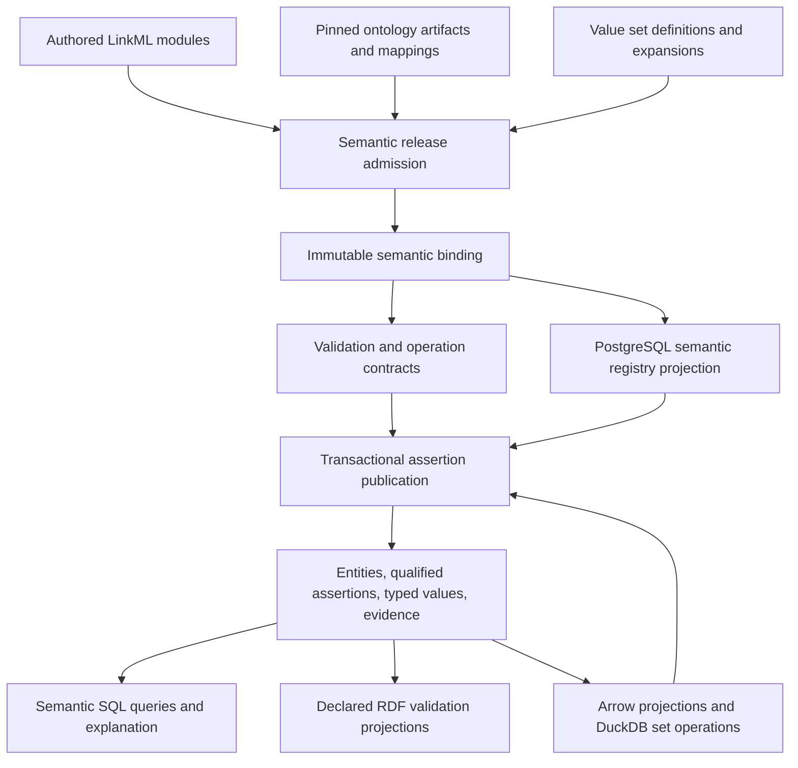

# Target model: semantic PostgreSQL governed by LinkML

**Proposed · 2026-10-29.** Companion to the [functional-extension review](semantic-postgresql-model_2026-10-29.md). This is the recommended target, not implemented behavior or a substitute for ADR/DESIGN adoption. Names below specify responsibilities; final SQL names and exact DDL belong in implementation planning.

## 1. Authority and overall flow

A semantic release identifies authored LinkML source, its import closure, ontology artifact identities, prefix interpretation, value-set definitions and resolved memberships, identity policy, rule profile and compiler identities. Its prepared runtime binding is immutable. A separate data snapshot identifies which corpus/run facts are visible. Together they determine interpretation; an active-project pointer is neither a release identity nor a data snapshot.

Local classes, slots, constraints, mapping choices and operation declarations are authored in the LinkML model. External ontologies own their terms/axioms; the release fixes their admitted use. PostgreSQL owns admitted instance state. Registry rows, generated boundary models, SQL mappings, SHACL/OWL and Arrow schemas are derived realizations. No writable ontology sidecar duplicates local definitions.

For formal ontology, use named IRIs for application concepts and declared external term bindings, class/property hierarchy and a bounded relational inference profile. Reuse PROV-O, SKOS, RDF/RDFS and appropriate domain vocabularies where their exact meaning fits. A scientific document's assertion and an ontology axiom are different kinds. The ontology is required even when a particular extraction batch contains no external vocabulary values.

This establishes scoped authority without claiming all ontology axioms can be losslessly expressed as LinkML structural constraints. The release declares which imported axioms govern executable operations. Retain the complete pinned ontology artifacts, but expose axioms outside that admitted executable scope as unexecuted, not as supported entailments. Unsupported axioms required by the admitted scope refuse activation; their mere presence elsewhere in a source ontology does not. A later ontology-first authoring change would need its own explicit authority decision.

## 2. Semantic release and extension lifecycle

1. **Propose.** Author or submit a candidate LinkML extension against a named parent. Extractors may propose a type or mapping; observations cannot silently activate it.
2. **Resolve.** Load the complete schema/import closure with LinkML facilities and immutable local ontology artifacts. Reject ambiguous namespace interpretation, unresolved definitions and conflicting local ownership.
3. **Check coverage.** Resolve induced slots, ranges, cardinalities, identity roles, qualification and supported rules. Every behavior-affecting construct must have a faithful realization or an explicit refusal. Ordinary descriptions and annotations need no executable interpretation unless an operation consumes them.
4. **Prepare.** Validate term references and ontology mappings, expand admitted value sets, prepare structural/graph validators, and compile normalized registry/query/interchange artifacts. Generate only representations with consumers.
5. **Publish release.** Store source/dependency identities and artifacts atomically, compare content on identity conflicts, and activate only after preparation succeeds. Physical schema compatibility is checked separately.
6. **Bind operations.** Resolve a release once and reuse its prepared immutable binding. Operations do not consult mutable live ontology endpoints. A request cannot silently switch releases halfway through.

Use LinkML metamodel and `SchemaView` resolution instead of a second schema parser. Boundary validation may use LinkML Validator plugins and dynamic Pydantic models prepared per release; do not execute newly generated Python source for every discovery. Static generated classes remain suitable for the stable system model. Pydantic coercion, defaults and serialization must honor the admitted datatype/missing-value policy; they cannot normalize away meaningful distinctions.

Ontology/value-set dependencies are acquired during preparation. A materialized membership snapshot records its source ontology, predicate/direction, roots, inclusion/exclusion rules and result. Failure to acquire required dependencies prevents activation. Distinguish permitted, excluded and unchecked membership. Checks requiring unavailable ontology metadata remain unchecked, including the Term Validator offline Not4Curation limitation; policy cannot report all term checks passed just because cached membership is available. See [plugin reference](https://linkml.io/linkml-term-validator/plugin-reference/).

A new semantic release may change meanings deliberately but cannot reinterpret existing assertions in place. Regenerate or explicitly revalidate data into a new realization. No legacy reader/upcaster is required for pre-pivot data. Concurrent candidate releases may both exist; activation uses an expected-parent conflict check so one operator action cannot unknowingly replace another.

## 3. Logical entities and physical representation

The stable physical core represents concepts that recur across domains. New domain class/property identifiers become rows. Stable operational tables for projects, source documents, spans, tasks and publication still use ordinary model-generated relational storage.

| Relation family | Meaning and required structure |
|---|---|
| Semantic release and definitions | Immutable source/dependencies and projected class, property, datatype, constraint, rule, vocabulary and mapping definitions, keyed within a release |
| Entity | Independent persistent entity identity within a corpus realization; survives isolation and need not have an outgoing relationship |
| Entity classification | Asserted or admitted class memberships, with release, scope and supporting provenance; separate from display labels and ontology class hierarchy |
| Assertion occurrence | Independent identity, subject, predicate, object binding, modality, polarity, attribution, condition/validity context, establishment kind, release and data scope |
| Role/value bindings | Typed role slots for n-ary relationships and recursive values, including ordering/multiplicity where declared |
| Typed value | Discriminated scalar, quantity, interval, structured record, collection, expression or entity/reference value as admitted by the model |
| Evidence and derivation | Source/span references, provider/method/run, premise assertions, rule/operation revision and outcomes; no evidence encoded only in display text |
| Coverage and unresolved references | Fact-family/scope coverage and explicit external, unresolved, excluded or unanalysed endpoints with reasons |

A relationship is an assertion with its own identity, not the tuple `(subject, predicate, object)`. Two sources, conditions or occurrences may share all three endpoints. An identity/fusion policy may relate or consolidate them, but the relational layout never removes them merely through an endpoint uniqueness constraint.

Binary edge and simple attribute views are convenient projections. An n-ary relation retains named roles rather than being fragmented into independent binary claims. Qualifications and evidence can themselves refer to entities or typed structured values. Nested entity references remain relationally addressable; they are not stranded as opaque IDs in JSON.

Store exact frequently queried scalar primitives in native columns under a row-local discriminator and consistency constraints. Use native entity FKs for references, and a recursive value/role relation for ordered collections or nested structure requiring identity, references or queries. JSONB is appropriate for declared opaque payloads and lossless auxiliary syntax; it is not a universal alternative to typed references. Bound value-tree depth and diagnose unsupported recursive value cycles; cyclic entity relationships remain permitted according to their semantics.

Retain numeric kind, lexical representation where significant, scale/precision, unit identity and canonical value semantics. PostgreSQL NUMERIC and Arrow/DuckDB decimals have bounds; an exact value outside a projection's supported range must retain a lossless representation or fail that projection. Do not silently map decimal to float. Missing, explicit null, unknown, not applicable and invalid are distinct where the model requires them; SQL NULL alone cannot represent all states.

Entity labels, local identifiers, normalized IRIs, ontology mappings and corpus identity remain distinct. Ontology equivalence does not automatically establish identity of document-reported objects. Identity policy specifies which attributes and context identify an entity, how unresolved references behave and when resolution creates a link rather than rewriting an identifier. Existing key scheme 1 is not preserved by default.

## 4. PostgreSQL configuration and enforcement

No semantic PostgreSQL extension is required for this target. Use the dedicated PostgreSQL 18 service, namespaces separating definitions, observations, admitted knowledge and operational state, native constraints and workload-shaped indexes. An AGE extension, external triple store or OAK SQL adapter is not a prerequisite.

Model-generated system metadata describes the stable tables, indexes and physical projections. SQLAlchemy Core builds expressions and DDL metadata; psycopg executes transactions and COPY. Alembic manages deliberate physical revisions. Model admission is data publication, not an Alembic revision per domain type. Prepared semantic bindings map class/property handles to the fixed relational representation; consumers do not interpolate user-provided identifiers into SQL.

### Enforcement placement

| Invariant | Selected enforcement point |
|---|---|
| Row identity, endpoint existence, same release/scope references | Native primary/composite foreign keys and uniqueness |
| Value discriminator, required structural columns, scalar row consistency | Native CHECK/NOT NULL constraints, with explicit null semantics |
| Class applicability, declared range, allowed property, value-set membership | Release-aware set validation in publication, using immutable projected definitions |
| Cardinality, qualified uniqueness, cross-assertion rules | Publication validation over candidate plus visible admitted state, within the enforcing transaction |
| Inference applicability and qualification propagation | Selected rule/operation evaluator over a declared eligible projection |
| Graph constraints | SHACL for model/preparation and declared graph diagnostics; required database integrity rules also need faithful transactional SQL/native enforcement or refuse activation |
| Source meaning, confidence and symbolic/numerical correctness | Explicit domain operations; schema conformance is insufficient |

The actual number of asserted claims is not automatically an integrity cardinality. Multiple providers may legitimately disagree about a property whose accepted interpretation is single-valued. Declare whether each constraint applies to source observations, assertion occurrences, selected accepted values, or a particular attribution/context. Store conflicting source assertions and attach violations/selection outcomes rather than rejecting evidence because it conflicts with another source. Structural invalidity can reject a submission; domain conflict is represented data.

### One publication contract

Prepare a candidate batch using the pinned release outside the write transaction when useful. Required external resources are already resolved. Stage data with psycopg COPY into transaction-local tables, including batch identity and typed references. Validate object structure and the candidate's internal references with shared production validators.

Publish in one SERIALIZABLE transaction: verify the release/snapshot premises, read relevant admitted rows, validate all model-dependent constraints for the declared scope, and insert entities, bindings, assertions and evidence atomically. A changed premise or serialization failure aborts the complete publication; retry the whole operation under one bounded owner, with a fresh data snapshot and renewed affected checks. Batch idempotency compares the same publication identity and content, not just an arbitrary idempotency token. Do not commit staging and facts as separately visible knowledge states.

The application writer role cannot perform unrestricted DML on admitted base tables. A narrow database publication entry point owns final mutation and necessary set-based checks; its underlying implementation is deployed with the physical schema. Immutable definition projections prevent concurrent rule mutation. Owners/migration credentials stay out of ordinary ingest/agent paths. This is one enforcement boundary, not separate rule implementations for every caller. The initial admission profile permits database integrity constraints only when they have a faithful SQL/native enforcement lowering in that entry point. PySHACL remains a model/preparation and diagnostic validator, not an unenforced database guarantee. A graph constraint without such a lowering refuses activation as a required integrity rule; supporting it later requires an explicit publication architecture decision. This avoids treating an application-supplied validation flag as trustworthy enforcement.

Serializable isolation protects checks only when the publisher actually reads the state capable of violating them. A validator that inspects only candidate rows is insufficient. Native constraints remain preferable where they establish the guarantee directly. A SHACL result prepared against a stale graph is not final admission evidence. Initial graph constraints must have a dependency-closed publication scope; arbitrary whole-corpus asynchronous validation cannot authorize an immediate accepted write.

Transactions do not hold scarce connections while downloading ontologies or running unrelated LLM work. Long global checks may deliberately publish at a larger batch boundary; do not promise cheap per-row global conformance. On failure there is no admitted partial batch. One connection-pool owner bounds concurrent operations; avoid nesting psycopg-pool beneath an existing SQLAlchemy pool.

### Physical optimizations

Start with indexes covering scoped identity, property plus subject, property plus entity object, class membership, typed filter values and evidence references. Select exact keys and ordering from the query workloads; no index per discovered class by default. Composite keys include the release/realization scope required to prevent cross-context references.

Promote important properties to typed views, expression indexes, generated projections or specialized tables when useful. These are derived from the canonical assertion/value core. Their definition names the semantic input and visibility scope; writers cannot update them as independent meaning. Publish rebuilt projections coherently, and retain the old realization while a reader depends on it if concurrent replacement is supported. This preserves future reproducibility without requiring historical pre-pivot compatibility.

## 5. Validation and inference semantics

Structural conformance, ontology entailment and corpus truth are separate. An OWL cardinality axiom under open-world semantics is not a SQL uniqueness constraint. A SHACL missing-property report describes nonconformance within its validation graph; it does not prove that the document asserts a negative.

Use RDFLib to construct declared RDF projections, with stable IRIs for assertions and referenced objects. Reify source assertions or export explicit assertion resources with qualifications. Do not automatically add every assertion's bare subject–predicate–object triple as an unconditional fact. Named graphs group statements but do not by themselves preserve occurrence identity, attribution or validity. RDF triple sets cannot represent parallel assertion occurrences through duplicate triples. [RDF reification semantics](https://www.w3.org/TR/rdf11-mt/#reification).

SHACL validation receives a declared data scope, shapes and pinned ontology graph. Scope includes required referenced nodes and stored context, not merely the returned output subset. Set inference explicitly (`none` by default for conformance); an RDFS/OWL-RL expansion used for checking belongs to that projection and cannot silently insert corpus knowledge. Keep unsupported or unchecked constructs visible in preparation diagnostics. Do not claim complete OWL DL, arbitrary SHACL recursion or lossless generator coverage.

### Initial inference profile

- Named-class/subproperty hierarchy closure over admitted ontology definitions.
- Declared inverse/symmetric relations over explicitly eligible assertions, with direction and qualification propagation specified by the rule. Negative assertions are not automatically eligible.
- Declared transitivity only over positive assertions whose modality and establishment kind authorize them as premises in the selected context. Require compatible scope, attribution, validity and conditions; initially require the same qualification context. Matching negative polarities never establish transitive negation. Wider condition composition needs an explicit supported domain rule.
- Positive, finite set-based closure with cycle termination by semantic fact identity, not unbounded enumeration of paths. Keep occurrence assertions distinct while deriving a defined semantic conclusion with supporting premises.
- No automatic reasoning from arbitrary ontology restrictions, entity-equivalence merging, or absence over incomplete coverage.

Use recursive/set SQL for this bounded profile. Preserve a derived conclusion's operation/rule version and premise references. Recursive provenance may reference a compact derivation graph; do not promise enumeration of every proof path or manufacture an acyclic proof where the semantics allow cycles. Derived results do not overwrite asserted inputs. Retraction or a changed rule creates a new evaluated realization; the initial implementation can recompute the affected declared scope rather than build a general incremental truth-maintenance engine.

A rule beyond this profile is not silently dropped. If required for an admitted workflow, it needs an explicit supported domain evaluator or a qualified extension such as LinkML-Datalog/Soufflé. The latter must preserve numeric types, occurrence identity, qualification, completion and derivation lineage before selection. RDF conversion alone cannot establish those properties. The main review records why it is not the initial mandatory dependency.

## 6. Public operation contracts and consumer integration

The following names illustrate the proposed interfaces, not compatibility promises:

| Contract | Input and responsibility | Output/failure |
|---|---|---|
| Admit model | Candidate LinkML sources, expected parent, pinned ontology/vocabulary inputs | Immutable release and prepared binding; unsupported/unresolved/conflicting definition diagnostics |
| Bind interpretation | Release identity and required capabilities | Immutable normalized definitions, validators and query handles; unavailable capability refusal |
| Submit observations | Source frame, provider/run, release, observed structures | Recorded observations and typed parse/validation outcomes; no automatic knowledge acceptance |
| Publish assertions | Candidate batch, release, data premises and consolidation policy | Atomic publication identity or typed invalid/conflict/retry-exhausted result |
| Query | Binding, data snapshot, typed class/property handles, filters, inference selection and demand | Typed results with qualifiers/evidence, coverage, completion and continuation context |
| Derive | Binding, eligible projection, rule/operation and data snapshot | Derived assertions with premises or explicit failed/partial/unsupported outcome |
| Explain | Assertion identity in the same interpretation and snapshot | Source evidence, qualification and derivation, including unavailable/unknown references |

Use SQLAlchemy expressions and ordinary functions for query composition. These contracts do not require a custom general query language, graph service, optimizer or operation scheduler. A new domain property resolves through the same compiled handle path; a novel algorithm can add an explicit domain operation.

Extraction/agent packets contain the admitted type/property schema, permissible terms and source frame. Submissions name the same binding. Consolidation consumes typed candidates, identity and policy definitions under that release; it owns selection/fusion policy, not merely SQL insertion. Interventions use the same publication contract and preserve their provenance.

Serving pins interpretation and data separately. A typed unresolved entity is not silently dropped from a join. Empty answers carry coverage sufficient to distinguish absence from unknown. Pagination tokens bind semantic release, data snapshot, query parameters, ordering and inference policy; materialization changes cannot alter an ongoing answer's meaning. Limits constrain work as well as returned rows, and partial/truncated remains distinct from complete. Global analyses retain their full required universe even if the user selects a few output entities.

Evaluation uses the same semantic binding but independent reference data and expectations. Scientific equivalence, identity policy, ontology mappings and string equality are separate operations. Independent controls test the validator/model itself; shared production validation may check consumers without becoming its own oracle. Gold/reference data remain inaccessible to extraction and consolidation inputs.

## 7. Arrow and DuckDB realization

Arrow is a typed interchange and computation boundary. Compile operation-shaped schemas with scalar/decimal/quantity/reference fields and qualification columns where consumed. Preserve explicit missingness; use a lossless structured or JSON representation for shapes without a faithful native columnar lowering. Ordinary columns remain preferable for joins and filters rather than decoding full objects.

A projection identifies semantic release, class/property mapping, compiler/projection revision and data snapshot. Result-changing context belongs in the operation binding even when repeated per-field metadata would be wasteful. Arrow metadata can be replaced or lost through operators. Re-establish output schema against its known projection; metadata copied onto arbitrary bytes is not validation. Out-of-range integers/decimals, timestamp precision, units and absent/null distinctions have explicit refusal or lossless fallback policies.

DuckDB consumes Arrow relations for set reconciliation, candidate grouping, analytical joins and evaluation where moving data is worthwhile. PostgreSQL handles authoritative filtering, indexed lookups and transactional publication. Do not transfer the whole corpus simply because DuckDB is available; conversely, do not force all numerical or batch work into PostgreSQL because it stores the definitions.

Load mutually dependent facts from a coherent data snapshot. The existing pool's REPEATABLE READ transaction is a useful starting point. Reading definitions through a separate connection requires an immutable pinned binding; mutable live facts spanning connections require an explicit shared-snapshot mechanism rather than a timestamp convention.

A streaming Arrow reader owns its producing connection and registrations until consumed, closed or cancelled; consumers cannot outlive them. Operations requiring grouping may still materialize or spill. Bound total live input/intermediate state across active operations, not only batch size. No latency, memory or throughput improvement is claimed without measurement.

## 8. Representative journeys and proposed acceptance

| Scenario | Expected target behavior | Independent assessment |
|---|---|---|
| New class, scalar property and relation type | New release; extraction, storage and typed query become usable without domain DDL or regenerated import modules | Compare definitions and results; inspect physical schema unchanged |
| Two sources assert the same endpoints under different conditions | Separate assertion identities and evidence; no accidental endpoint deduplication | Explicit expected occurrence set and qualifications |
| One source disputes a single-valued property | Evidence retained; accepted-value policy reports conflict rather than pretending every occurrence violates storage cardinality | Independently specified source/accepted scope expectations |
| N-ary relation and nested entity value | Roles, order and reference identity preserved through SQL, RDF projection and Arrow | Round-trip plus independently authored expected roles and IDs |
| Unresolved endpoint and empty incomplete query | Explicit unknown/reference status; no dropped edge or false absence | Known partial coverage fixture |
| Concurrent publications violate accepted-value uniqueness | At most a conforming accepted state; loser aborts/retries with renewed checks | Real PostgreSQL transactions, including COPY path and forbidden direct DML |
| Ontology is unavailable or term checks are incomplete | Activation fails or explicitly narrowed supported checking; no fabricated invalid-term answer | Deliberate unavailable artifact and unchecked metadata inputs |
| Ontology/value-set/rule revision changes | New binding and derived realization; old pinned answer retains interpretation while supported | Different expected memberships/derived outcomes by release |
| Inverse/transitive inference with conditions and cycles | Eligible closure terminates; context retained; no broader unconditional assertion | Small independent premise/conclusion fixtures, including incompatible contexts |
| Decimal, unit, null/absent crosses engines | Exact meaning retained or explicit projection refusal | Independent numerical/lexical values at boundary limits |
| Selective query on a highly connected node | Indexed eligible scope, explicit intermediate universe, honest completion status | Correctness plus physical-plan inspection if a genuine access-path question remains |
| Cancel a batch stream | Reader/connection/registration released; no partial publication | Actual lifecycle failure injection |
| Promote a property to a typed index/projection | Same semantic answer and evidence under the same binding/snapshot | Compare against a simple independently specified canonical query |
| Regenerate statistics and a transfer-domain example | All operations use the new semantic model, including evidence-backed query and independent evaluation | End-to-end native workflow; no compatibility shim |

These are proposed implementation acceptance scenarios, not tests run by this review. Use statistics and an ownership/inspection transfer fixture to exercise units, validity and attributed relations; do not expand production corpus scope merely to demonstrate genericity. Global constraints, unsupported ontology axioms or graph mappings that cannot honor these expectations must narrow the offered capability explicitly.

## 9. Adoption and limits

Adoption requires ADR/DESIGN decisions identified by the main review, then a coherent replacement plan for the affected phase 0 production scope. Build a fresh realization and regenerate observations/knowledge under the selected model; no historical-run migration, upcaster inventory or old API compatibility is required. Preserve existing plans/evidence and unrelated dirty work. Any actual database disposal is a separately bounded action, not implicit in this proposal.

The design is complete as a recommended bounded architecture. Exact physical DDL, local ontology modules, constraint-lowering code and pinned integration choices remain implementation-planning work. Unsupported ontology expressivity, faithful graph qualification mapping, exact datatype conversions and publisher race safety need native verification before an implemented claim. No complete-stack compatibility or product qualification has been established on 2026-10-29.
