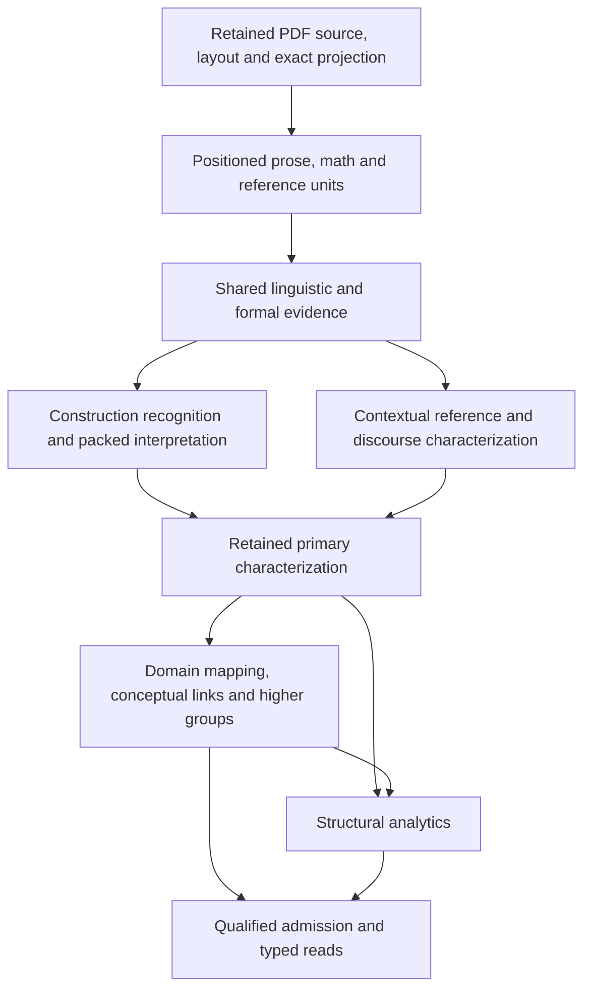

# Integrated primary text characterization: functional review and target design

**Proposed · 2026-11-10.** Select a shared, context-aware primary characterization product,
realized by native linguistic models, declarative constructions and ambiguity-preserving grammar
processing. Subsequent domain interpretation and analytics consume this product. This is a
substantial replacement of today's distribution of language interpretation across consumers.

The selected architecture is **hybrid, with grammar/forest processing as a primary semantic
construction mechanism**. spaCy supplies source-bound working views, morphology, native structural
queries and overlapping rule evidence. HanLP supplies complementary constituency and semantic-role
evidence. Lark supplies recursive construction recognition, positioned formal syntax and direct
computation over grammatical alternatives. Maverick and Dipo supply referential and discourse
evidence at their appropriate contextual scopes. A typed, factorized characterization model joins
these results while preserving their native meanings. No one library object becomes the universal
serialized representation.

This review finalizes a recommendation, not an accepted architectural decision or production
implementation. All proposed benefits remain qualitative. The existing PM2/WCE plans retain their
execution and qualification dispositions.

## Basis, scope and evidence

The input is the complete [discovery collection](../library_leverage/libraries/text-characterization/briefing.md),
including all seven topic documents and their feature-level recommendations. The two original
[spaCy](../libraries/parsing/spacy.md) and [Lark](../libraries/parsing/lark.md) guides were read end
to end in the preceding discovery engagement; this review consumes its corrections and investigates
the contracts consequential to selection. Section [feature dispositions](#feature-dispositions)
accounts for the recommendations and conditional capabilities, including choices displaced by
existing providers. Discovery judgments are inputs, not adoption mandates.

Repository baseline: `ab07dc9858ddbf2241ecf3712b51a05b360d461c`, 2026-11-10. Concurrent CLI/model
command and test changes are excluded from source assessment and preserved. Selected library
baseline remains spaCy3.8.18/en_core_web_sm3.8.0, Lark1.3.1 and SymPy1.14.0. Existing [PM2 provider
profiles](../plans/production-milestone-two_2026-11-08.md) and their exact artifact identities remain
with their owning plan; their native execution
evidence does not establish superiority on the new characterization tasks.

Source inspection includes retained annotations/views, named rules, predicate and procedure frames,
HanLP product projection, native source-contribution validation, formal grammars and the installed
Lark parser frontend/forest implementations. Fresh official documentation checks cover
[SPPF processing](https://lark-parser.readthedocs.io/en/stable/forest.html),
[custom object lexing](https://lark-parser.readthedocs.io/en/stable/examples/advanced/custom_lexer.html)
and [span categorization](https://spacy.io/api/spancategorizer). Release-sensitive decisions also use
[Lark1.3.1 frontend source](https://github.com/lark-parser/lark/blob/1.3.1/lark/parser_frontends.py),
[forest source](https://github.com/lark-parser/lark/blob/1.3.1/lark/parsers/earley_forest.py) and the
installed spaCy3.8.18 source observations documented in discovery. Its missing upstream source tag
is not replaced with an invented release URL.

Apply [standard.toml](../design_review/design_principles/standard.toml): core3.3, efficient-architecture
heuristics and the code-intelligence1.4 profile/binding. FP-04 requires an executable semantic model;
FP-03/06 favor composable, locally understandable operations; FP-07 favors shared preparation and
factorized alternatives. CI-01–04/11 require attributed interpretations, faithful labels, distinct
relationship identities, explicit unknowns and evidence closure. These shape the choice without
initiating a diagnostic audit or a benchmark campaign.

The proving population is all518 physical pages of Grinstead–Snell under
[ADR-0070](../adr/0070-full-book-method-development.md). Language constructions remain reusable
across domains; book/page identities never dispatch linguistic behavior. A second-vocabulary
fixture checks generality without claiming another corpus qualified.

## Current strengths and the change in capability

[Annotations](../../python/corpus-structure/src/corpus_structure/ingest/annotations.py) already retain
source-bound tokens, lemmas, POS/tags/morphology, dependencies, sentence membership and availability.
[Native views](../../python/corpus-structure/src/corpus_structure/ingest/annotation_views.py) restore
them without inference or retokenization. The existing system does not rerun a prose model per rule.

[Named rules](../../python/corpus-structure/src/corpus_structure/methods/annotation_rules.py),
[predicate frames](../../python/corpus-structure/src/corpus_structure/methods/predicate_frames.py)
and [procedure roles](../../python/corpus-structure/src/corpus_structure/methods/structural_roles.py)
nonetheless establish related role, coordination, modality and scope decisions in separate code.
[HanLP projection](../../python/corpus-structure/src/corpus_structure/methods/pm2_hanlp_products.py)
adds another scheme-specific frame/cue projection. [Native admission](../../python/corpus-structure/src/corpus_structure/semantic/sql/source_contributions.sql)
checks exact annotation origins and reconstructs expected role/reading support. Its validation
purpose must survive a producer redesign; agreement with the producer alone would not validate meaning.

The functional gain is an inspectable answer to “what structures and supported readings does this
source contain?” before a definition, procedure, comparison or concept-link consumer interprets it.
It enables one new construction to improve several consumers, independent assessment of a scope or
argument, and analytics over units that never form a complete accepted record. This extends
[ADR-0062](../adr/0062-progressive-contributions.md), rather than reintroducing whole-record gating.

## Alternatives and selection

| Complete realization | Strengths | Material limitations and judgment |
| --- | --- | --- |
| Broad grammar-led characterization over lexical/linguistic input, with one SPPF foundation | Explicit recursive language, composable semantics, correlated derivations and shared computation; a strong fit for formal syntax and recurring constructions | Grammar/lexicon and semantic coverage must be supplied. Model disagreements and cross-sentence reference do not become grammatical derivations automatically. A single custom-lexer token stream loses overlapping token classifications unless represented separately. **Do not select as the sole broad-English foundation.** Select its construction/forest mechanisms inside the integrated target. Revisit a wider grammar-led front end when it preserves useful readings beyond the selected hybrid on the same source opportunities. |
| Model-led syntax/SRL/coreference/discourse followed by classifiers and record adapters | Broad linguistic predictions and reusable existing provider operation infrastructure | A predicted tree, SRL inventory or span label does not formalize quantifier interaction, scope, source function and joint alternatives. Private interpretation would persist in adapters. **Reject as the complete target.** Retain its native evidence producers. |
| Shared native evidence + construction grammars + factorized typed semantics + contextual characterization | Preserves broad model evidence and formal recursive meaning; supports simultaneous layers, joint alternatives, partial results and reusable consumers | Requires an authored characterization model and construction inventory, source mappings and coordinated consumer migration. **Selected.** The additional semantic machinery represents required phenomena, rather than recreating parser/model infrastructure. |

There is no demonstrated task-quality winner between spaCy and HanLP syntax in this review. The
selected full profile retains both attributed schemes because spaCy supplies morphology and the
existing construction vocabulary while HanLP supplies constituency/SRL evidence; neither is relabelled
as the other. Consumers request the common characterized meaning and can inspect either premise.
Removing either native analysis requires preserving the affected product promises, not merely
observing that both emit dependencies. This is a deliberate functional choice, not a permanent
requirement to run every available model.

## Target pipeline and responsibility boundaries

These are semantic responsibilities, not mandatory processes, transactions or durable tasks per box.
A contextual pass may depend on earlier construction output; operation dependencies express that
ordering. Primary completion is relative to an explicit source scope and characterization profile.

## O01 · Shared positioned units and native evidence

**Selected, Proposed.** Extend the existing atom-preserving preparation, retaining exact text,
whitespace, punctuation, source-piece order, formula/reference occurrences and token/sentence maps.
Keep source identity independent of analysis identity. Every alternative tokenization or provider
projection has an explicit correspondence to those units; approximate alignment never changes an
exact source witness.

Use spaCy `Doc`/`Token`/`Span`, rich lexical flags, tagger/AttributeRuler/lemmatizer and dependency
annotations as working structures. Preserve useful lexical properties as reproducible views of
pinned lexical resources rather than blindly persisting every native property. Noun chunks,
subtrees and conjunction traversal provide constituent evidence, not final semantic scope.

Run the existing HanLP native POS/lemma/dependency/constituency/SRL heads as a shared evidence
operation. Retain complete located constituents and continuation/reference argument labels, rather
than narrowing the output immediately to today's `_Frame` fields. Native PTB, UD, PropBank and spaCy
labels remain distinct. In particular, PropBank `ARG0` is not universally an actor; normalized
semantic roles need explicit mappings and evidence. Additional SDP heads are conditional on an identified meaning they preserve
that this selected evidence cannot represent; they are not default duplicate graph producers.

The full characterization profile includes lexical, morphological and syntactic availability.
Boundary-only requests retain a cheaper explicit profile and cannot satisfy a full-characterization
dependency. No retokenization occurs after token-bound publication; a changed layout creates new
analysis identities and regenerates affected products.

## O02 · Construction recognition as a shared primary capability

**Selected, Proposed.** Replace scattered language extraction with one construction owner,
composed from native matchers and Lark grammar modules. This is ordinary domain modules/resources
and functions under existing operations, not a universal rules engine.

Use `PhraseMatcher` for known terms and multiword cues, `Matcher` for token sequences and morphology,
and `DependencyMatcher` for named-node structural configurations. Keep matched roles, actual token
membership, mechanism and declaration identity. Use unfiltered `SpanRuler` groups for located raw
proposals; classification and reconciliation create separate output layers. They never overwrite
the only record of a rival candidate.

Use Lark recursive productions, aliases, templates, imports, `%declare/%extend/%override`, multiple
starts and composed semantic handlers for clause/nominal/operator constructions and formal fields.
Grammar families cover verbal/copular/adjectival/nominal predication; complements and relative
clauses; coordination and shared participants; conditional/temporal/causal/concessive/comparative/
exception constructions; negation/modality/quantification; reporting/quotation; naming, definition,
question and instruction forms. Language rules own linguistic meanings; domain data supplies
technical lexicons and mappings without embedding textbook-specific phrases in the engine.

**Input choice:** prose construction grammars consume the original positioned source regions with
Earley/dynamic when lexical/construction alternatives matter. Native syntax and candidate annotations
constrain or support the semantic handlers without being converted into a falsely unique token
classification. Candidate regions include complete clauses/sentences and structurally related
neighbors, not only regions nominated by a final record extractor. Grammar terminals must admit a protected math/reference occurrence as a complete opaque atom.
Check each derivation against the retained atom intervals before emitting prose semantics; reject
any derivation that splits or crosses an atom incompatibly. Mathematical/formal parsers expose
interiors through their separately positioned products. Source annotations alone do not enforce
this lexical constraint. A no-match leaves native evidence and explicit construction coverage
available.

Custom positioned-token lexers are selected for deterministic typed formal inputs and already
unambiguous construction inputs. They are not a general overlapping-token lattice. Keep competing
input projections separate with their premises; do not enumerate every combination of model spans.
LALR/contextual handles deterministic fields/declarations; basic lexical-only grammars expose formal
units. `dynamic_complete` is reserved for explicit boundary-ambiguity families where shorter matches
change a supported reading; broad catch-all terminals are not the default prose grammar.

## O03 · Formal sentence meanings and correlated alternatives

**Selected, Proposed.** Primary characterization includes the following first-class meanings.
Their evidence can be partial, competing or unavailable; an absent role is not invented.

| Meaning | Required structure |
| --- | --- |
| Predication and participants | Located predicate sense proposal; overt/implicit/unresolved role status; grammatical function separate from semantic role; complement and modifier links; discontinuous membership; nominal/copular forms |
| Voice, tense, aspect, mood | Overt auxiliaries/morphology and normalized proposals with separate support; active/passive participant correspondence without assuming subject means actor |
| Coordination and ellipsis | Conjunct identity, connective, local versus inherited participant, inheritance witness, collective/distributive choices and unresolved gaps |
| Negation and modality | Operator, target, source cue and possible scope; epistemic/deontic/etc. type proposals; preserve nested operators rather than one sentence-wide flag |
| Quantification | Quantifier, bound participant/variable, restrictor, body, cardinality/range and relative scope alternatives |
| Clause relations | Located antecedent/consequent, temporal order, causal/concessive/comparative/exception roles with explicit evidential basis; source causal wording does not prove causality |
| Attribution and embedding | Reporter/source mention, content, stance and nested scope; reported proposition distinct from the author's assertion |
| Function and reference | Located assertion/question/instruction/definition/assumption/example/etc. labels, overlapping functions, mention occurrences, referential hypotheses and contextual dependencies |

The retained semantic model has **occurrences**, **attributed analyses**, **construction instances**,
**role/attachment assertions**, **operator/scope nodes**, **choice groups** and **coverage results**.
Names here describe required concepts; executable release declarations own eventual field spelling.
Occurrence identity binds source and ordered extents. Analysis identity binds producer/revision/input;
construction identity includes roles, scope, premises and construction revision. Equal spelling or
identical endpoints does not merge separate occurrences or relation evidence.

Source semantic disjunction (the text saying “A or B”) is an operator in a reading, distinct from
analytical uncertainty about which reading applies. Underspecified scope may remain a partial order
without enumerating every order. No general constraint-solving framework is selected.

A choice group declares whether members are mutually exclusive, coexisting or unresolved in their
compatibility, and which other choices/premises each requires. A reading is a supported root plus
its dependent choices. Combining arbitrary independent label sets is forbidden. Unresolved
compatibility remains unresolved, not an implied cross-product of valid complete readings.

**Forest realization:** use Earley `ambiguity="forest"` and `ForestTransformer` to construct
factorized semantic objects directly. Within a packed derivation, children compose conjunctively;
across a symbol's derivations they form alternatives. Preserve rule/constituent/source identities,
shared children and choice dependencies. Empty constituents carry an insertion boundary and
synthetic/nonliteral status, not an invented quoted extent. Intermediate nodes derive extents from
their actual children; token-stream chart indices use an explicit token-to-character map. Handler results reference shared children rather than
expand all complete trees. Native forest structure is transient; its selected semantics and
reconstructible derivation references are retained. `TreeForestTransformer` with
`resolve_ambiguity=False` and `@handles_ambiguity` is selected only for deliberately bounded
tree-shaped outputs. It performs intermediate expansion and can discard cyclic families; it does
not guarantee packed semantic output. Use `ForestTransformer` for the primary compact semantics.

Select two semantic phases: native `ForestTransformer` builds context-independent symbolic terms
and explicit binder/scope sites from packed derivations; the primary contextual operation resolves
reference and scope over those retained terms. That operation keys any reused result by semantic
node plus inherited environment. Lark's bottom-up transformer does not supply an environment-keyed
evaluator. Use `single_visit`/native caches only for pure context-independent forest work.
Reject non-consuming recursive grammar cycles from the supported construction set during authoring;
an encountered cycle yields incomplete interpretation with a diagnostic, while independent evidence
survives. No fixed-point semantics or infinite semantic inventory is required by the intended
language constructions.

For unambiguous positioned trees, use typed AST constructors (`Ast`, `WithMeta`, `AsList` where
appropriate), postparse `Transformer_NonRecursive`, `Visitor` and explicit contextual `Interpreter`
passes. Freeze source extents into retained objects rather than share mutable `Meta`. Ranking is a
separate attributed preference over preserved choices. Stable ordering is selected; grammar priorities
and native scores are not probabilities or scientific truth. Initial ambiguous construction
profiles select `priority=None` and `ordered_sets=True`; a changed preference policy is explicit. `resolve` and `CollapseAmbiguities`
are bounded projections for an explicit consumer, never the only primary record.

## O04 · Contextual characterization before conceptual assembly

**Selected, Proposed.** Characterization is not restricted to one sentence. Use source hierarchy,
headings, list membership and quotation boundaries together with Maverick mention/cluster evidence
and Dipo EDU/discourse evidence. Preserve exact source membership and inspected cross-boundary
coverage. Separate mention detection from clustering and native discourse relation from an accepted
semantic relation. A failed contextual provider leaves sentence-local characterizations useful.

The primary layer owns source-level reference hypotheses, attribution, inherited grammatical
arguments/qualifiers and discourse-function proposals. Cross-sentence and cross-block attachments
are formalized with their located witnesses. Concept identity across works, domain predicate mapping,
scientific binding/assessment, retrieved conceptual links and higher thematic grouping remain later
operations. A local variable declaration's linguistic binding and a scientific symbol-resolution
operation have related but distinct contracts. Primary linguistic bindings use source/evidence only;
later scientific resolution consumes them. Accepted conceptual answers never feed back as evidence for the original source reading.

Select the existing Maverick and Dipo owners rather than add experimental spaCy coreference or a
parallel discourse model. Select GLiNER's existing located extraction/classification and bounded d1
source-first characterization for complementary proposals. Preserve source-first d1 discovery so
errors in prior models do not suppress every alternative. Its language-characterization questions
are primary operations; domain-specific selection questions are downstream operations even if they
share one physical provider. The full profile selects source-first d1 questions for modal force,
quantifier/negation scope, attribution and sentence/passage function, plus candidate-centered host
and referent questions where unresolved candidates exist. These are new versioned task definitions,
not claims about today's finite statistics prompts. GLiNER supplies the selected located term/cue
and passage-function proposal tasks. Optional calls mean extra challenger/repair modes, not silently
skipping baseline family attempts. Failed required calls retain incomplete family coverage; no
unselected provider is invoked as a hidden fallback.

New spaCy `SpanCategorizer` tasks are conditional extensions for exact overlapping linguistic labels
that current providers cannot adequately supply. The selected extension route requires explicit label semantics, supervision coverage and proposal
coverage when that condition is met; deterministic construction formalization proceeds independently.
`SpanFinder` is conditional on boundary proposal being the missing capability. Passage classifiers
cannot replace located predicate/scope structures. This retains learning as a useful option without
running multiple equivalent classifiers in the default profile.

## O05 · Retained primary products, operations and consumption

**Selected, Proposed.** Extend the existing released product/operation model; do not add a parallel
observation database, workflow engine or provider runtime. Primary products carry exact input scope,
selected source identity, annotation/construction/model revisions, native and semantic assertions,
choice dependencies, source extents, retained evidence and availability per characterization family.

The full profile schedules O01–O04 over the selected natural sections, sharing linguistic inference,
prepared matchers and grammar resources. It does not depend on whether a downstream record extractor
has nominated a definition. Context windows retain their examined scope; operational truncation is
partial coverage. Families can complete independently. “Primary complete” means the selected
operations settled for the declared profile and scope, with family outcomes; it never asserts all
possible English meanings have been recovered. A successful analysis can retain unknown meaning.

Use native batching (`nlp.pipe` with prepared Docs/context), existing resident provider boundaries
and stable preparation. A logical distinction need not create its own process or persistent task.
Separate reusable model inference from revised construction interpretation: changing a scope rule
recomputes affected semantic products from retained evidence without rerunning unchanged models.
A tokenization/model/prompt/context change invalidates the relevant inference determinants. Changes
in primary products invalidate dependent analytics through actual dependency identities.

Persist queryable unit/assertion/choice/coverage relations under the semantic model and existing
PostgreSQL custody. Retain larger native syntax/forest-derived payloads through existing typed report
and artifact placement. Native objects are working views. `DocBin` is selected for training/evaluation
exchange, not random-access analytics. Keep explicit codecs for durable positions, scores, group
metadata and choice references. `Doc.to_json()` alone is insufficient for span scores/IDs; generic
Tree/Token copy/pickle is insufficient for all position/sharing fields. Parser save/cache is not
result retention. These limits are established in the discovery's
[retention account](../library_leverage/libraries/text-characterization/execution-retention-and-tools.md).

Readers expose units, constructions, scopes and alternative families by source and operation;
consumers select required products rather than receive a live mutable Doc. Rebuild consumer-local
native views where useful. Displayed bounds do not silently shrink the examined evidence universe.
Native/semantic scores, preference, assessment and public standing remain separate fields.

## O06 · Consumer replacement and domain enrichment

**Selected, Proposed.** A definition extractor reads characterized predication, naming/definition
function, roles and conditions. A procedure extractor reads action/participant/operator structures
and instruction-function evidence. A comparison operation reads characterized operands, dimensions
and scopes. Contextual linking reads mention, definition/applicability and referential evidence;
it adds a selected conceptual relationship rather than privately recognizing the same sentence again.

Domain enrichment may combine these products to infer schema-defined roles, entities, claims,
relationships and higher groups. It must label that inference and cite its actual premises. A new
language distinction missing from the retained product becomes a versioned primary characterization
extension and dependency, rather than an inline recognizer inside one downstream consumer.

Migration includes source preparation/annotations/views; rule preparation and predicate/procedure
frame producers; HanLP frame/cue projections; qualifier recipes and assertion qualification;
mathematical/field syntax consumers; contribution assembly; native admission; assessment and typed
reads/exports. Keep native provider observations and faithful source mapping; replace duplicated
interpretation authorities. Remove superseded rule/recipe branches, ad-hoc frame reconstruction and
mechanism-specific tests after consumers migrate. Preserve independent expected results and deliberate
invalid-input cases.

Native admission must authenticate source/producer/release membership and enforce declared invariants.
Move language-producing policy into the shared model/construction authority; compile mechanical checks
or validate retained typed structures at the appropriate boundary. Do not remove independent source
witness checks merely because they resemble extraction, and do not validate semantic correctness by
calling the same producer for expected and actual values. Review the existing SQL role reconstruction
against these distinct responsibilities during implementation planning.

## O07 · Evaluation and extension without another pipeline

**Selected, Proposed.** Extend existing operation-level assessment to token/constituent capture,
role correctness, scope/attachment, alternative compatibility, contextual coverage and retained-read
fidelity. Keep source-first omission questions separate from output-first support questions. Native
spaCy scorers cover their supported annotation tasks; independent expected semantic structures assess
operators and correlations that those scorers do not understand.

If learned characterization is selected later, use native `Example`/Alignment/readers, shared
Tok2Vec listeners, sourced/frozen components and the ordinary model artifact owner. Train on the
actual proposal/tokenization path. Sparse positives do not imply unknown-label masking for spancat;
NER and textcat annotation states have different semantics. The review selects this extension route,
not a new default custom model or an unqualified assumption that pretraining supplies semantic labels.

## Implementation ordering and architectural impacts

1. Declare the characterization concepts, operation promises, coverage and choice semantics; define
   independent example expectations and native/source mappings. Extend executable release artifacts
   and retained reads together. Preserve source capture and admitted scientific semantics.
2. Integrate native evidence and shared matcher/grammar constructions, including direct forest
   semantics and positioned ASTs. Move general predicate/qualifier/coordination interpretation here.
3. Integrate contextual characterization and source-first model proposals with explicit dependencies.
   Deliver full-profile primary products and operation-level inspection/assessment.
4. Migrate all affected enrichment, admission and query consumers, then remove superseded machinery.
   Qualify native providers, retained replay and representative full-book behavior before adoption.

[D1](../design/D1-knowledge-representation.md) owns new meanings and identity;
[D2](../design/D2-schema-and-guidelines.md) their executable declarations;
[D3](../design/D3-database.md) persistence;
[D4](../design/D4-method-catalog.md) producer contracts;
[D5](../design/D5-consolidation-identity-confidence.md) conceptual selection/admission;
[D6](../design/D6-orchestration-metrics-policies.md) dependencies/profiles/reuse;
[D7](../design/D7-evaluation-goldens-outer-loop.md) assessment; and
[D8](../design/D8-agent-and-query-interfaces.md) inspection/read contracts.

Adoption needs an ADR for primary-characterization authority/choice semantics and the changed
producer/consumer boundary, with the owning sections amended together. Existing source custody,
observation-versus-knowledge ownership and independent contributions survive. This review does not
amend accepted ADRs or silently reschedule PM2/WCE. Detailed packages belong in the subsequent
implementation plan, citing O01–O07 and the feature choices below.

## Representative design checks and remaining qualification

These are reasoned contract checks, **Proposed**, not executed efficacy results. Synthetic examples
illustrate semantics; they are not claimed textbook quotations or protected reference annotations.

| Case | Required target behavior and consequence |
| --- | --- |
| Repeated identical symbols/formulas and an embedded reference | Independent exact occurrences; one protected atom in prose views; positioned formal constituents; no first-string-match resolution |
| “The values were estimated and reported by the analyst” | Passive evidence and separate predications; explicit shared-role witness, not unconditional copying to every conjunct |
| Copular/nominal predicate and a relative clause with a gap | Predicate kind and complement preserved; inferred/unknown participant explicitly represented; subtree bounding interval cannot replace discontinuous membership |
| “Not every trial succeeds” | Negation and quantifier nodes, cue extents and supported scope; no flattening to one negative Boolean |
| A modal clause with an ambiguous PP attachment | Correlated attachment/scope choices with premises; ranking keeps unselected readings and never creates unsupported cross-products |
| “The author denies that the result must hold” | Reporting/stance, embedded necessity and their distinct targets; denial does not silently turn the embedded proposition into a scientific falsehood |
| A heading/list note qualifying several later items | Structural context and located inheritance/attachment; context-sensitive pass declares that scope rather than force a sentence-only decision |
| Pronoun across a sentence/section boundary | Mention retained independently of referent selection; examined/unexamined cross-boundary pairs distinguish partial coverage from no antecedent |
| A source fragment not admitted by a construction grammar | Native tokens/syntax and formal units survive; unsupported construction is explicit; absence of a recognized frame does not imply absence of meaning |
| One failed provider; conflicting syntax/SRL; exhausted ambiguity work | Settled siblings remain usable; scheme-native disagreements survive; affected family partial/failed; no fabricated unique reading |
| Definition and procedure consumers use one negation construction | Both read the same operator/attachment identities; changing its rule recomputes shared characterization and affected consumers, not duplicate private matchers |
| Comparison or retrieval consumes a retained characterization | No linguistic inference on read; exact extents, choices, scores and source dependencies survive serialization and detached replay |

No central architecture choice is deferred: hybrid evidence/construction ownership, factorized
semantic retention, native forest computation, contextual primary passes and consumer replacement
are selected. Remaining obligations are language-construction implementation/coverage, model task
quality, exact provider/runtime compatibility for any changed profile, persistence roundtrips and
normal-workload execution fit. These are implementation/qualification obligations, not measured gains.
The selected existing provider artifacts need not be replaced to begin that work. Run performance
experiments only if ambiguity growth, model residency or a concrete supported input creates serious
uncertainty; a protective limit alone does not qualify the normal workload.

Product/provider tests, model training, runtime probes and benchmarks: **not_run** in this review.
Source/reference inspection supports mechanism selection and qualitative design reasoning. Publication
checks and independent advice are recorded below after integration; neither establishes extraction
accuracy or complete corpus coverage.

## Feature dispositions

The following crosswalk retains recognizable functionality and selection reasons. Each topic link
owns detailed prerequisites, source observations and further primary references. **Selected** means
part of the proposed target; **Supporting** means a bounded implementation/development facility;
**Conditional** means excluded from the default target with a concrete revisit condition;
**Rejected** means unsuitable for the stated use. Conditional model choices do not block the selected
primary product or leave the overall architecture undecided.

| Key | Discovery source |
|---|---|
| S1 | [Prose boundaries and technical atoms](../library_leverage/libraries/text-characterization/segmentation-and-lexical-analysis.md#prose-boundaries-and-technical-atoms) |
| S2 | [Lexical, grammatical and normalized token attributes](../library_leverage/libraries/text-characterization/segmentation-and-lexical-analysis.md#lexical-grammatical-and-normalized-token-attributes) |
| S3 | [Grammar-defined lexical views](../library_leverage/libraries/text-characterization/segmentation-and-lexical-analysis.md#grammar-defined-lexical-views) |
| N1 | [Native syntax and structural queries](../library_leverage/libraries/text-characterization/sentence-structure-and-interpretation.md#native-syntax-and-structural-queries) |
| N2 | [Formalizing constructions and their interpretation](../library_leverage/libraries/text-characterization/sentence-structure-and-interpretation.md#formalizing-constructions-and-their-interpretation) |
| N3 | [Sentence readings worth exposing](../library_leverage/libraries/text-characterization/sentence-structure-and-interpretation.md#sentence-readings-worth-exposing) |
| A1 | [Lark representations of alternatives](../library_leverage/libraries/text-characterization/ambiguity-and-alternative-interpretations.md#lark-representations-of-alternatives) |
| A2 | [Direct computation over a forest](../library_leverage/libraries/text-characterization/ambiguity-and-alternative-interpretations.md#direct-computation-over-a-forest) |
| A3 | [Ranking, retention and inspection](../library_leverage/libraries/text-characterization/ambiguity-and-alternative-interpretations.md#ranking-retention-and-inspection) |
| A4 | [spaCy parallel candidates and annotation states](../library_leverage/libraries/text-characterization/ambiguity-and-alternative-interpretations.md#spacy-parallel-candidates-and-annotation-states) |
| X1 | [Deterministic extraction](../library_leverage/libraries/text-characterization/extraction-classification-and-normalization.md#deterministic-extraction) |
| X2 | [Learned proposal and classification](../library_leverage/libraries/text-characterization/extraction-classification-and-normalization.md#learned-proposal-and-classification) |
| X3 | [Normalization and identity](../library_leverage/libraries/text-characterization/extraction-classification-and-normalization.md#normalization-and-identity) |
| R1 | [spaCy's native annotation model](../library_leverage/libraries/text-characterization/representations-and-composition.md#spacys-native-annotation-model) |
| R2 | [Lark syntax, tokens and extents](../library_leverage/libraries/text-characterization/representations-and-composition.md#lark-syntax-tokens-and-extents) |
| R3 | [Transformation and typed interpretation](../library_leverage/libraries/text-characterization/representations-and-composition.md#transformation-and-typed-interpretation) |
| R4 | [Inspection, rewriting and ownership](../library_leverage/libraries/text-characterization/representations-and-composition.md#inspection-rewriting-and-ownership) |
| R5 | [Composition within and across the libraries](../library_leverage/libraries/text-characterization/representations-and-composition.md#composition-within-and-across-the-libraries) |
| M1 | [Representations and trainable tasks](../library_leverage/libraries/text-characterization/models-supervision-and-evaluation.md#representations-and-trainable-tasks) |
| M2 | [Supervision and evaluation](../library_leverage/libraries/text-characterization/models-supervision-and-evaluation.md#supervision-and-evaluation) |
| M3 | [Companion models and integrations](../library_leverage/libraries/text-characterization/models-supervision-and-evaluation.md#companion-models-and-integrations) |
| E1 | [Pipeline composition and execution](../library_leverage/libraries/text-characterization/execution-retention-and-tools.md#pipeline-composition-and-execution) |
| E2 | [Retaining and exchanging the useful result](../library_leverage/libraries/text-characterization/execution-retention-and-tools.md#retaining-and-exchanging-the-useful-result) |
| E3 | [Grammar preparation, diagnostics and deployment](../library_leverage/libraries/text-characterization/execution-retention-and-tools.md#grammar-preparation-diagnostics-and-deployment) |
| E4 | [Diagnostics, model tooling and ecosystem delivery](../library_leverage/libraries/text-characterization/execution-retention-and-tools.md#diagnostics-model-tooling-and-ecosystem-delivery) |

### Segmentation and lexical characterization

| Feature/API family | Disposition and reason | Sources |
|---|---|---|
| `Tokenizer`, language `Defaults`, prefix/suffix/infix searches | **Selected:** positioned technical words, punctuation and abbreviations, bound to original source and atom layout. | S1; [Tokenizer](https://spacy.io/api/tokenizer) |
| `token_match`, `url_match`, `add_special_case()`, factories; `Tokenizer.explain()` | **Selected:** technical exceptions and inspectable boundaries. Whole-tokenizer replacement is **Conditional** when customization cannot express the required boundary population. | S1; [tokenization](https://spacy.io/usage/linguistic-features#tokenization) |
| `Doc(vocab, words, spaces)`, `Token.idx`, span character extents, `Doc.char_span()` | **Selected:** preserve exact text, whitespace and native atoms. Keep original intervals if strict alignment fails or snapping changes extent. | S1/R1; [Doc](https://spacy.io/api/doc) |
| `Doc.retokenize().merge()/split()` | **Supporting:** intended boundary changes before publication or with regeneration of affected token-bound products; unnecessary for a parallel semantic layer. | S1/R1; [retokenization](https://spacy.io/api/doc#retokenize) |
| `Alignment` | **Selected:** combine compatible alternate tokenizations and supervision without assuming equal indices; does not infer arbitrary OCR equivalence. | S1/R1; [Alignment](https://spacy.io/api/alignment) |
| Parser sentence breaks; preset `Token.is_sent_start` | **Selected:** joint syntax/boundary analysis respecting genuine block/atom constraints. Hard constraints remain fallible policy. | S1; [DependencyParser](https://spacy.io/api/dependencyparser) |
| `senter` / `SentenceRecognizer`, `overwrite` | **Supporting** sentence-only route; **Rejected** as a duplicate mandatory predictor when parser syntax already supplies boundaries. | S1; [SentenceRecognizer](https://spacy.io/api/sentencerecognizer) |
| `sentencizer`, `punct_chars`, custom boundary components | **Supporting:** deterministic source conventions and boundary-only operation; not equivalent prose interpretation. | S1; [Sentencizer](https://spacy.io/api/sentencizer) |
| `DependencyParser(learn_tokens=True)` | **Conditional:** learned merging when recurring useful technical/noisy boundaries cannot be adequately expressed by stable exceptions. Not general learned splitting/tokenization. | S1/N1 |
| Token/Lexeme flags; `shape_`, `lower_`, `norm_`, prefixes/suffixes | **Selected:** reusable lexical evidence alongside spelling. Numeric likeness and stop-word status do not authorize semantic conclusions or deletion. | S2; [Token](https://spacy.io/api/token) |
| `tagger`, `morphologizer`, `MorphAnalysis.get()` | **Selected:** tags/POS/available morphology. Morphologizer is **Conditional** as an alternative when selected tagger/mapping lacks required coverage or quality, not another automatic pass. | S2; [Morphologizer](https://spacy.io/api/morphologizer) |
| `AttributeRuler.add`, `add_patterns`, mapping loaders | **Selected:** settled contextual corrections with provenance/order. Preserve unresolved interpretations in parallel instead of overwriting evidence. | S2/X3; [AttributeRuler](https://spacy.io/api/attributeruler) |
| Lookup/rule `lemmatizer`; language POS-conditioned modes | **Selected:** lemma distinct from spelling, with upstream requirements and existing-annotation policy. | S2; [Lemmatizer](https://spacy.io/api/lemmatizer) |
| `trainable_lemmatizer` / `EditTreeLemmatizer` | **Conditional:** learned edits for a required recurring form population inadequately served by rules/tables. Acquiring supervision is an investment, not a rejection reason. | S2; [EditTreeLemmatizer](https://spacy.io/api/edittreelemmatizer) |
| `Vocab`, `StringStore`, `Lookups`, `lex_attr_getters` | **Supporting:** shared lexical state/resources; distinguish type-level properties from contextual meaning and preserve readable string recovery. | S2/R1; [Vocab](https://spacy.io/api/vocab) |
| `parser=None, lexer="basic"`, `Lark.lex()` | **Selected:** reusable positioned terminal vocabularies for formal fragments; explicit basic mode for selected-release lexer-only operation. | S3; [Lark.lex](https://lark-parser.readthedocs.io/en/stable/classes.html#lark.Lark.lex) |
| Basic versus LALR contextual lexing | **Selected:** independent lexical inventories versus grammar-conditioned deterministic fragments. Standalone lexing cannot reproduce contextual decisions. | S3; [parsers](https://lark-parser.readthedocs.io/en/stable/parsers.html) |
| Earley `dynamic` | **Selected:** raw-source construction parsing with competing terminal types and packed derivations. Longest match per terminal remains a recognition condition. | S3/A1 |
| Earley `dynamic_complete` | **Conditional:** a required construction has meaningful shorter-regex/boundary alternatives that ordinary dynamic misses. Avoid exhaustive broad catch-all terminals. | S3; [example](https://lark-parser.readthedocs.io/en/stable/examples/advanced/dynamic_complete.html) |
| Terminal strings/ranges/regexes, flags/priorities, `g_regex_flags`, `regex=True`, `unicode.lark` | **Selected:** explicit notation alphabets and needed Unicode properties. Priority is recognition policy, not confidence; Unicode categories are not morphology. | S3; [terminals](https://lark-parser.readthedocs.io/en/stable/grammar.html#terminals) |
| `lexer_callbacks`, `Token.update`, `Token.new_borrow_pos` | **Supporting:** positioned normalization/adaptation, keeping replacement value distinct from original spelling/extent; callbacks require basic/contextual lexing. | S3/R2; [Token source](https://github.com/lark-parser/lark/blob/1.3.1/lark/lexer.py) |
| `%ignore`, `lex(dont_ignore=True)`, `keep_all_tokens` | **Selected:** explicit retention of meaningful punctuation/trivia. Tree retention cannot undo lexical ignore. | S3/R2 |
| Custom `Lexer`, arbitrary input, `%declare`, `feed_token` | **Supporting** deterministic typed-token/formal inputs; **Rejected** as the assumed ambiguity-preserving prose front end. Raw-source Earley input avoids pretending custom input supplies a native lattice. | S3/R5; [custom lexer](https://lark-parser.readthedocs.io/en/stable/examples/advanced/custom_lexer.html) |
| `postlex.process`, `always_accept`, `edit_terminals`, `get_terminal` | **Supporting:** useful lexical transformations/inspection; postlex excludes dynamic lexing, so preserve selected construction route. | S3 |
| `Indenter`, `PythonIndenter` | **Supporting** genuine pseudocode/outline indentation; **Rejected** for recovering lost PDF geometry from reflowed prose. | S3 |
| `TextSlice`; `use_bytes=True` | **Supporting:** source-region views for basic/contextual parsers; bytes only for actual byte input with explicit character conversion. Dynamic Earley does not accept TextSlice. | S3/R2 |

### Syntax, constructions and meaning

| Feature/API family | Disposition and reason | Sources |
|---|---|---|
| Dependency heads/labels; `children`, `lefts`, `rights`, counts | **Selected:** shared syntactic evidence and native traversal, retaining provider label schemes; syntax is not universal semantic-role evidence. | N1; [Token](https://spacy.io/api/token) |
| `ancestors`, `is_ancestor`, `subtree`, edges, `Span.root` | **Selected:** governing context and phrase/clause membership; preserve actual membership for discontinuity/nonprojectivity rather than enclosing interval alone. | N1 |
| `Token.conjuncts`, `Span.conjuncts` | **Selected:** coordination evidence, with explicit shared-argument, ellipsis, distribution and scope interpretation. | N1 |
| `noun_chunks`, syntax iterators | **Supporting:** base nominal candidates. Existing HanLP constituency supplies richer constituent evidence; chunks are not a substitute. | N1 |
| `get_lca_matrix()` | **Supporting:** genuinely dense selected-scope queries; native traversal for sparse paths. Common ancestry is not a semantic relation. | N1 |
| `DependencyMatcher`, named nodes/attributes/relations, callbacks/validation | **Selected:** declarative construction recognition and role bindings; validation checks pattern form, not linguistic truth. | N1; [DependencyMatcher](https://spacy.io/api/dependencymatcher) |
| Operators `>/<`, `>>/<<`, `./;`, `.* / ;*`, `$+/$-`, `$++/$--`, `>+/>-`, `>++/>--`, `<+/<-`, `<++/<--` | **Selected/Supporting:** native direct, ancestry, ordered, sibling and directional constraints. Preserve tree-boundary/adjacency distinctions instead of a parallel bespoke query engine. | N1 operator table; [operators](https://spacy.io/api/dependencymatcher#operators) |
| Recursive rules, alternatives, EBNF, repetitions, `[item]` | **Selected:** nested construction languages; grammar acceptance remains distinct from agreement, reference and semantic admissibility. | N2; [grammar](https://lark-parser.readthedocs.io/en/stable/grammar.html) |
| Templates, `%import`, namespaces/aliases, `import_paths`, `source_path`, package loading | **Selected:** reusable clause/nominal/qualifier/formal fragments paired with handlers; ignore policy is not imported automatically. | N2/R5 |
| `%declare`, `%extend`, `%override` | **Selected:** terminal contracts and controlled language extensions; overrides explicitly change recognized language/meaning. | N2/R5 |
| Multiple `start`, `parse(start=...)`, rule aliases/priorities | **Selected:** reusable entry points and construction names; ranking policy stays separate from semantic confidence. | N2 |
| LALR/contextual; Earley/dynamic; CYK | **Selected:** deterministic fragment/recipe and ambiguity-preserving construction engines respectively. **Rejected:** CYK as default where no stronger fit is established. | N2 |
| `_rule`, `?rule`, `!rule`, named/hidden terminals, placeholders, `tree_class` | **Selected:** grammar-directed shape/retention; custom containers **Supporting** only useful local needs. Keep meaningful scope and punctuation. | N2/R2 |
| Broad universal grammar as sole prose front end | **Rejected:** one grammar does not establish broad interpretation coverage or replace native linguistic evidence. Revisit only with a concrete superior language/semantic coverage proposition. | N2/N3 |
| Predicate inventory, explicit/implicit roles | **Selected:** verbal/copular/adjectival/nominal predicates and alternative attachments. Reuse HanLP SRL/constituency/dependencies plus authored interpretation instead of duplicate broad spaCy SRL. | N3 |
| Voice, tense, aspect, mood, agreement | **Selected:** overt grammar and normalized role proposals with meaningful distinctions preserved. | N3/S2 |
| Polarity/negation scope | **Selected:** explicit operators and correlated alternatives, including quantifier interaction; cue matching alone is insufficient. | N3 |
| Modality/evidential status | **Selected:** typed modal/evidential targets. A learned contextual task is **Conditional** where construction/provider evidence cannot distinguish required epistemic/deontic or other readings. | N3 |
| Quantification/cardinality/distribution | **Selected:** quantifier/restrictor/body, binding identity, bounds and collective/distributive/scope alternatives; binding semantics remain characterization-owned. | N3 |
| Conditional/temporal/causal/concessive/comparative/exception structure | **Selected:** separate relationship meanings and scopes, composed with Dipo where fit; RST predictions are not automatically logical connectives. | N3 |
| Attribution/quotation/propositional embedding | **Selected:** source, content, nesting and stance, using HanLP and Maverick evidence where fit. Quote flags do not identify speaker or parse quotations. | N3 |
| Assertion/question/instruction/definition/naming/assumption/example/explanation/hypothesis/contrast/description | **Selected:** overlapping sentence/passage functions with located support/context. New labels/models are **Conditional** where current GLiNER/d1/Dipo outputs lack the required distinction. | N3/X2 |
| Reference/shared participants/pronouns/ellipsis | **Selected:** mentions, unresolved bindings and Maverick cluster evidence. New implicit-role/ellipsis tasks are **Conditional** when required bindings are not expressed by existing providers/constructions. | N3 |
| Competing/incomplete readings | **Selected:** explicit attachments, argument bindings, scope/function alternatives and unknowns, without requiring a complete universal logical form before retaining useful structure. | N3/A1–A4 |

### Ambiguity and forest semantics

| Feature/API family | Disposition and reason | Sources |
|---|---|---|
| Earley `ambiguity="forest"` | **Selected:** compact correlated alternatives for authored raw-source constructions; not a claim to enumerate every natural-language meaning. | A1; [forest API](https://github.com/lark-parser/lark/blob/1.3.1/docs/forest.rst) |
| `ambiguity="explicit"`, `_ambig` | **Supporting:** bounded alternative trees and existing conventional consumers; not universal retention requiring expansion. | A1 |
| `ambiguity="resolve"` | **Supporting** declared selected projections; **Rejected** as sole primary record where meaningful alternatives would disappear. | A1 |
| `SymbolNode`, intermediate LR(0) nodes, `PackedNode` | **Selected:** shared constituents and correlated production choices. Hide scaffolding in domain views; assign durable identity separately. | A1 |
| `ForestVisitor` callbacks/scheduling | **Selected:** traversal/annotation without tree enumeration. | A2 |
| `single_visit=True` | **Supporting:** context-independent shared-node work, not inherited-binding evaluation keyed only by constituent. | A2 |
| `ForestTransformer` node callbacks | **Selected:** phase one constructs compact symbolic semantic packing; phase two interprets inherited context/bindings. Conjunction, alternatives, equivalence and provenance have explicit domain semantics. | A2 |
| `TreeForestTransformer` | **Supporting only** bounded tree-shaped outputs/inspection where sharing need not remain packed. **Rejected** as general compact semantic route if it expands alternatives. | A2 |
| `@handles_ambiguity`, `resolve_ambiguity=False` | **Supporting** bounded higher-level processing; preserve justification/correlation rather than merge equal surface labels. | A2 |
| Defaults and `__default_ambig__` | **Supporting:** retain unknown productions rather than silently treating them as interpreted. | A2 |
| `use_cache=True` | **Supporting:** pure context-independent symbolic results. Contextual phase includes environment in computation identity where relevant; hidden scope state invalidates cache reuse. | A2 |
| `on_cycle`, `get_cycle_in_path` | **Selected:** explicit unsupported-cycle/refusal outcomes. Fixed-point semantic handling is **Conditional** on deliberately supported cyclic constructions. Detection alone is not resolution. | A2 |
| Internal `ForestToParseTree` | **Supporting contract knowledge**, not preferred public extension API; conversion may remove cyclic families or expand sharing. | A2 |
| `CollapseAmbiguities` | **Supporting** small deliberate enumeration; **Rejected** as general primary computation/storage. | A2 |
| Forest extents/source mapping | **Selected:** explicit character/token/source mapping and empty/intermediate-node extent policy; TreeForestTransformer supplies no ordinary position propagation. | A2/R2 |
| Priorities `normal/invert/None`, `ForestSumVisitor` | **Supporting:** declared additive preference; use no priority when unjustified. Inversion also alters lexical policy; weights are not probabilities. | A3 |
| Custom `prioritizer=ForestVisitor` | **Conditional:** a concrete interpretation-selection policy needs evidence beyond native additive priority. Preserve admitted alternatives and support independently. | A3 |
| `ordered_sets=True`, `StableSymbolNode` | **Supporting:** inspectable reproducible order, not meaning preference. | A3 |
| `Doc.spans`, `SpanGroup.attrs` | **Selected:** overlapping/nested evidence. Complete-reading compatibility and correlations belong in typed semantic products. | A4; [SpanGroup](https://spacy.io/api/spangroup) |
| `Doc.ents` | **Supporting** conventional non-overlapping projection; **Rejected** as universal characterization store. | A4 |
| `set_ents(missing/outside/blocked/default="unmodified")`, `incorrect_spans_key` | **Supporting:** task-specific partial labels, explicit negatives and updates; not universal uncertainty/constraint semantics. | A4/M2 |
| `has_annotation(require_complete=True)` | **Selected:** actual availability distinction; complete columns do not establish interpretation accuracy or exhaustive semantic coverage. | A4/M2 |

### Extraction, classification and normalization

| Feature/API family | Disposition and reason | Sources |
|---|---|---|
| `Matcher` attributes/extensions | **Selected:** reusable lexical/construction evidence over prepared annotations, with required-attribute availability. | X1; [Matcher](https://spacy.io/api/matcher) |
| Membership/numeric/morphological-set predicates, repetition operators, greediness, `with_alignments` | **Selected/Supporting:** native expressive matching and role alignment. Greedy selection cannot silently discard required alternatives; `!` is not linguistic negation. | X1 |
| `REGEX`, `FUZZY`, `FUZZY1`…`9`, comparator | **Selected:** approximate OCR/lexical evidence with original spelling and explicit limits; not canonical identity. | X1 |
| `PhraseMatcher(attr=...)`, `as_spans` | **Selected:** terminology/idiom/alias/discourse inventories. Contextual attributes require annotated pattern Docs. | X1 |
| `SpanRuler` destination/filter/overwrite/fuzzy controls | **Selected:** overlapping rules with explicit writer ownership; preserve rule identity/role bindings beyond bare spans where meaningful. | X1 |
| `EntityRuler` | **Supporting:** conventional projection or NER correction; **Rejected** as replacement for richer overlapping candidates. | X1 |
| LALR/contextual structured-field grammars | **Selected:** comparators, values, intervals, identifiers, dates and unit syntax, with nomination coverage/domain validation separate. | X1/X3 |
| `ner` / `EntityRecognizer` | **Conditional:** conventional non-overlapping entity taxonomy has useful coverage/quality absent from selected GLiNER/current providers, or an independently justified replacement task. Not universal extraction. | X2; [EntityRecognizer](https://spacy.io/api/entityrecognizer) |
| `SpanFinder`, boundary scores/length policy | **Conditional:** required clause/term/qualifier boundary population is missed by rules, syntax, grammar and selected providers. Preserve boundary evidence; proposal policy governs recall/amplification. | X2; [SpanFinder](https://spacy.io/api/spanfinder) |
| `spancat`, `spancat_singlelabel`, full prediction scores | **Conditional:** required overlapping modal/scope/function/span labels lack an adequate existing provider/construction realization, or a trained replacement is substantively preferable. Distinguish scores from confidence/truth. | X2; [SpanCategorizer](https://spacy.io/api/spancategorizer) |
| N-gram/range/preset/custom suggesters, `set_candidates` | **Supporting:** if span classification is selected, union rule/syntax/grammar nominations with evidence identity rather than blind enumeration; recall remains bounded by proposals. | X2 |
| `textcat`, `textcat_multilabel`, `Doc.cats` | **Conditional:** region-level function taxonomy needs classification beyond current providers/constructions. Keep located support; categories cannot replace arguments/scope. | X2 |
| EntityRuler IDs, `ent_id_`, `kb_id_` | **Supporting:** known alias labels with distinct identity meanings; spelling does not resolve homonyms/binding. | X3 |
| `EntityLinker`, KB classes, candidates/retrieval/loading | **Conditional later vocabulary operation:** an authored stable vocabulary and contextual mention-to-ID requirement justify a linker. Not primary semantic identity or automatic mathematical binding. | X3; [EntityLinker](https://spacy.io/api/entitylinker) |
| Linker prior/context/window/threshold/overwrite/gold-boundary controls; `NIL` | **Supporting** that selected vocabulary task: separate candidate recall, ranking and rejection from authority; top rank is not resolved truth. | X3 |
| Positioned `Transformer`/`Interpreter` normalization | **Selected:** typed values plus original support and alternatives; grammar acceptance alone does not validate calendars/dimensions/domain applicability. | X3 |

### Representations, transformations and composition

| Feature/API family | Disposition and reason | Sources |
|---|---|---|
| `Doc`, `Token`, contiguous `Span`, `SpanGroup` | **Selected** native working forms with explicit limits; discontinuous roles, relations and correlated readings have additional typed structure. | R1 |
| Stored Doc/Token/Span extensions | **Supporting composition:** candidate IDs/typed views/source links with owned mutation/schema/serialization; not another editable semantic authority. | R1 |
| Extension getters/setters/methods; native hooks | **Supporting:** derived convenience/deliberate overrides. Prefer named additional meanings; avoid hidden repeated computation or broad semantic overrides. | R1 |
| `Tree`, positioned `Token`, `Meta`, position propagation/container extents | **Selected:** conventional syntax, source identity, visible/enclosing extents and DAG awareness. Forest source mapping remains distinct. | R2 |
| Callable propagation, `tree_class`, `__lark_meta__` | **Supporting:** concrete selective/custom metadata needs; less-public protocol adds coupling and is unnecessary when `WithMeta` fits. | R2 |
| `Transformer`, `Transformer_NonRecursive` | **Selected** ordinary-tree reduction, nonrecursive when depth is unbounded; not substitutes for forest computation. | R3 |
| In-place transformer variants | **Supporting:** privately owned normalization; destructive changes to shared/retained syntax require explicit ownership. | R3 |
| `Visitor`, recursive/top-down variants | **Supporting:** native inspection with deliberate depth and shared-node/occurrence semantics. | R3 |
| `Interpreter`, child visitation decorators | **Selected:** inherited-context phase for binding/scope. Describing conditions does not execute or discard them. | R3 |
| `v_args(inline/meta/tree/wrapper)` | **Supporting:** positioned postparse signatures and useful callback adaptation, respecting mode/internal-transformer restrictions. | R3 |
| Defaults, token visitation, `Discard`, transformation chains | **Supporting:** explicit coverage/ordered passes; uninterpreted meaningful text must not disappear as scaffolding. | R3 |
| Parse-time transformer; `VisitError.orig_exc` | **Supporting** fused deterministic fragments where syntax/positions are unnecessary; **Selected** recognition/semantic-failure distinction. **Rejected** universal parse-time reduction. | R3 |
| `Ast`, `WithMeta`, `AsList`, `create_transformer`, decorator factory | **Supporting** typed AST construction when grammar/constructor contracts agree; generated dispatch does not supply semantic validation. | R3 |
| `iter_subtrees`, top-down iteration, native find/scan methods, Python `match` | **Supporting:** native queries/local dispatch; preserve shared-node versus occurrence semantics. No 1.3.1 `Tree.match()`. | R4 |
| `expand_kids_by_data`, `Tree.set`, copying | **Supporting** owned local reshaping; **Rejected** as automatic provenance/isolation preservation. Explicit immutable fields preserve required metadata. | R4 |
| `TemplateConf`, template match/search/apply, translator | **Conditional:** a concrete authored equivalence/normalization rule benefits from structural templates. Preserve original syntax/alternatives and specify equivalence conditions. | R4; [templates](https://github.com/lark-parser/lark/blob/1.3.1/lark/tree_templates.py) |
| `Reconstructor`, postprocessing, retained grammar | **Supporting** generated readable syntax; **Rejected** original-text recovery. | R4 |
| `Span.as_doc`, `Doc.from_docs` | **Supporting:** justified scopes/recomposition with explicit rebasing/context loss; no recovery of cross-region dependencies/source continuity. | R5 |
| `%import` + `merge_transformers` | **Selected:** modular grammar/semantic composition with shared type/namespace/whitespace contracts. | R5 |
| spaCy → typed Lark lexer | **Supporting deterministic inputs only**; **Rejected** assumed prose ambiguity/lattice bridge. Raw-source Earley construction input is selected. | R5 |
| Positioned Lark → spans/extensions | **Selected:** source-coordinate attachment, retaining unaligned intervals instead of forcing every structure into one span. | R5 |
| Native views + AST/SPPF + typed semantic product | **Selected:** different physical forms under one meaning contract, with source/provider evidence, scope, derivation, alternatives and coverage. | R5 |

### Models, supervision and companions

| Feature/API family | Disposition and reason | Sources |
|---|---|---|
| Static vectors and pooled token/span/doc vectors | **Supporting:** lexical/statistical tasks; **Rejected** replacement for explicit meaning or assumed retrieval-trained embeddings. | M1 |
| Floret vectors | **Conditional:** required technical/subword representation coverage benefits an adopted task beyond available resources. Not disambiguation alone. | M1 |
| Custom `BaseVectors` | **Conditional:** a selected useful resource cannot be adequately served by built-in dense/floret storage; implement batch/device/persistence contracts. | M1 |
| MultiHashEmbed/CharacterEmbed/MaxoutWindowEncoder/HashEmbedCNN/Tok2Vec | **Supporting:** native architectures for selected tasks; no automatic transformer mandate. | M1 |
| `Tok2VecListener`, `Doc.tensor` | **Selected sharing** for compatible native heads, with batch/training ownership; not automatic sharing of unrelated external encoders. | M1 |
| Curated/HF transformers, listeners/windows | **Conditional:** selected contextual tasks need a better-suited representation than current encoders. Choose actual model/runtime/windows; longer input does not add output semantics. | M1 |
| Thinc models/combinators/PyTorchWrapper/architecture registry | **Supporting:** implement an adopted prediction gap with native infrastructure rather than another runtime. | M1 |
| `TrainablePipe` lifecycle | **Conditional:** required scope, modal, ellipsis or joint-reading distinctions lack adequate current realization, or a coherent trained replacement is preferable. Preserve output/loss/scoring contracts; missing gold alone is not rejection. | M1 |
| TextCatBOW/Ensemble/Reduce | **Supporting alternatives** for a selected function taxonomy; compare actual lexical/contextual needs rather than complexity. | M1 |
| `Example`, `Alignment`, Corpus/JsonlCorpus/readers | **Supporting adopted training:** native supervision with original coverage/source identity and real runtime segmentation. | M2 |
| Entity supervision states; exclusive/multilabel category gold | **Selected semantics when training:** unknown must not become false supervision; masking rules differ by task. | M2 |
| Sourced/frozen/annotating components, listener replacement | **Supporting:** explicit adaptation, shared-weight effects and intended runtime proposal behavior during training. | M2 |
| Initialize/resume/update/train | **Supporting:** native lifecycle; avoid reinitializing retained pretrained state indiscriminately. | M2 |
| Orthographic/custom augmentation | **Conditional:** identified technical variation can be generated without changing labels, with repaired alignment. Synthetic coverage is not authentic efficacy. | M2 |
| PretrainVectors/PretrainCharacters | **Conditional:** unlabeled domain adaptation addresses an adopted task's representation mismatch. Both objectives exist; neither supplies semantic gold. | M2 |
| `rehearse` | **Supporting:** component-qualified retention where domain adaptation risks useful old behavior; previous errors are a countercondition. | M2 |
| Scorer/native/custom scores; threshold search | **Selected task assessment**, **Supporting threshold optimization** with held-out references. Include proposal recall and independent scope/joint-reading/source expectations. | M2 |
| `hypothesis.extra.lark.from_lark` | **Supporting:** grammar-shaped syntax cases, not realistic linguistic gold/semantic truth. | M2 |
| spacy-stanza | **Conditional alternative:** required language/task quality supports changing linguistic provider while preserving source/atoms; not automatic duplicate analysis. | M3 |
| scispaCy models/AbbreviationDetector/linker | **Conditional:** recurring abbreviation/long-form needs or a genuinely matching biomedical task. Do not equate scientific naming with mathematical-domain fit. | M3 |
| Experimental coreference/SpanResolver | **Conditional alternative to Maverick:** demonstrated required task fit justifies replacement and compatible runtime. Published 0.6.4 spaCy<3.8 restriction blocks unqualified root use. | M3 |
| Experimental character tokenizers | **Conditional:** useful boundary population requires learned character segmentation; compatibility/source/atom projection must be established. | M3 |
| HF token/text pipes | **Conditional:** a specific pretrained task supplies missing useful characterization; reuse provider ownership and independently retain external model artifacts. | M3 |
| spacy-llm | **Conditional:** missing characterization/vocabulary discovery benefits a specified grounded task; compose through existing LLM ownership rather than duplicate it. | M3 |
| Lookups data | **Supporting:** required language tables not already shipped; no contextual disambiguation implied. | M3 |
| spaCyLayout | **Conditional:** wrapper demonstrably simplifies region/linguistic integration while preserving native source identity. **Rejected** duplicate PDF parsing only to obtain spans. | M3 |

### Execution, retention and tools

| Feature/API family | Disposition and reason | Sources |
|---|---|---|
| Factories/components/registry config/add_pipe | **Selected:** share native passes/resources without another workflow authority. | E1 |
| assigns/requires/retokenizes/analyze_pipes/metadata | **Supporting:** declared dependencies plus real availability; declarations do not prove meaning. | E1 |
| Exclude/disable/select/replace/remove pipes | **Supporting:** explicit execution profiles and preparation reuse; do not narrow the maximal semantic target. | E1 |
| `Language.pipe`, batching/context/Doc inputs/config | **Selected:** source-bound batches/shared preparation; retained outputs and discourse scopes govern actual memory. | E1 |
| Multiprocessing/CPU/GPU/CuPy | **Conditional:** selected models/workload benefit a compatible coordinated route. No gain inferred from switches. | E1 |
| Language extras ja/ko/th | **Conditional:** selected language needs dependencies; extras do not supply trained semantic models. | E1 |
| Error handlers | **Supporting:** attributable failures/partial results, not rollback/retry safety. | E1 |
| memory_zone | **Conditional:** long-lived worker lexical growth makes lifetime control useful and all native references can stay inside the zone. Escaping views can crash. | E1 |
| doc_cleaner | **Supporting:** after last tensor consumer when Docs retain substantial model state; detached output may already suffice. | E1 |
| Doc arrays | **Selected:** useful bulk numerical interchange with relative HEAD offsets/string recovery explicit. | E2 |
| Doc bytes/disk and pipeline serialization | **Supporting:** native interchange under source/semantic contract; custom code/external resources remain dependencies. | E2 |
| JSON export/import | **Supporting** inspection; **Rejected** complete canonical roundtrip because inspected release omits span-group attrs/scores and span IDs. | E2 |
| DocBin | **Supporting:** training/evaluation and selected native batch interchange; not whole semantic product/random-access analytics. | E2 |
| Explicit positioned syntax/AST/forest retention | **Selected:** source, identity, sharing/alternatives and interpreted structure; parser artifacts/generic copies are insufficient. | E2 |
| Resource grammar loading/terminal inspection | **Selected:** named reusable prepared grammar families. | E3 |
| LALR analysis cache/cache_grammar/save/load | **Supporting:** worthwhile startup/artifact reuse with code/config identity; not selected Earley caching. | E3 |
| Standalone/compression | **Conditional:** actual fixed deterministic independent delivery needs; **Rejected** default replacement for runtime composition/Earley. | E3 |
| strict/debug/interegular | **Supporting:** focused deterministic grammar-authoring diagnostics, not new gate or coverage proof. | E3 |
| Recognition exceptions/context/match_examples/callback errors | **Selected:** distinct recognized/failed/interpretation outcomes preserving original input. | E3 |
| Interactive parser feeding/accepts/choices/copy/resumption | **Supporting:** deterministic typed construction/branch inspection. **Rejected** edit-aware incremental-reparse claim. | E3 |
| on_error recovery | **Conditional:** explicitly supported noisy formal population needs authored repairs. Preserve edits/repaired status; acceptance is not source truth. | E3 |
| Regex/atomic-cache extras; lark-cython | **Supporting** actual selected needs; acceleration **Conditional** on material LALR performance uncertainty and compatible token/postlex contracts. | E3 |
| displaCy, pretty/Rich/pydot/Graphviz/forest visualization | **Supporting:** focused inspection, not completeness/correctness proof. | E4 |
| init/fill-config/labels/convert/assemble; debug/find-function | **Supporting:** native task setup and focused diagnostics under ci/just custody. | E4 |
| evaluate/benchmark/profile/apply | **Supporting:** actual quality/material performance questions; apply's DocBin does not replace application observations. | E4 |
| spaCy Projects | **Conditional:** bounded experiment removes more scripting than lifecycle duplication; **Rejected** second repository workflow owner. | E4 |
| Loggers/package/validate/info/Hub | **Supporting:** selected training/delivery; external publication needs separate authorization and establishes no scientific qualification. | E4 |
| Lark.js, Lerche, Nearley import | **Conditional:** actual independent client/Julia consumer or valuable existing grammar justifies port/migration. **Rejected** richer current Python engine substitution; version/algorithm/callback limits remain. | E4 |

## Review integration and publication

Independent architecture advice and a separate feature-coverage contribution were integrated on
2026-11-10. Material corrections distinguish forest symbolic construction from contextual evaluation,
bounded tree conversion from compact semantics, semantic disjunction from analytical uncertainty,
protected atoms from raw lexical splitting, and baseline characterization tasks from optional
challengers. These are source/design judgments, not a separate recommendation-audit or runtime result.

The crosswalk's seven topical groups map respectively to O01/O02, O02/O03/O04, O03, O02/O04/O06,
O01/O03/O05, O04/O07 and O05/O07. Shared rows group APIs only when their design disposition and
reason coincide; the linked discovery sections retain detailed capability contracts and sources.

Publication on 2026-11-10: `uv run ci docs check --json` **passed**, managed result
`b98835dbc9164bd5aa0e1f385f9ba824`, 858 canonical pages and zero link errors. `just turn-end`
**passed**. The final edits add receipt text only; product/provider tests, fitting, probes and
benchmarks remain **not_run** because this engagement selects a proposed design from source and
reference evidence rather than implements or qualifies extraction behavior.
