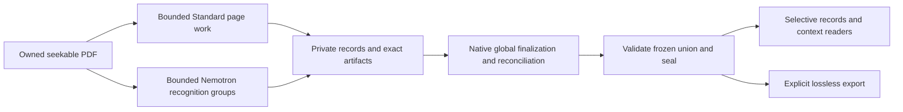

# PDF/Docling streaming improvements — functional-extension-focused plan review

**Date:** 2026-11-01. **Status: Proposed; source-inspected, not runtime-qualified.**
This is one plan-improvement review with a functional-extension focus. It assesses improvements
and useful additions to the [PDF series](../plans/pdf-docling-pipeline_2026-10-31.md), principally
PDF-20–25, conditional PDF-26 and affected PDF-10/11 acceptance. Implemented PDF-13–19 foundations
are considered where their integration changes. This document does not amend plans, acceptance,
ADRs, audit premises or production behavior. Existing coordinator O/I IDs retain their owner;
the I identifiers below are local recommendation references, not replacements for those IDs.

## Baseline and method

Inspected main `a742b5372a5ca3277fcbac8b332d50198f8c0e32`, including the three uncommitted library
references. Their SHA-256 fingerprints identify the reviewed text without committing the operator's edits:

| Reference | Added/removed lines against HEAD | SHA-256 |
|---|---:|---|
| [Docling](../libraries/primary_intake/docling.md) | +1091/−1 | `68669e693cdc08fe4ef7b0e734036d2320a8655fb38aea16a9744265a48b7db8` |
| [OCR](../libraries/primary_intake/docling_ocr.md) | +799/−0 | `7302b1aabeeacd626d92125f0311e7226b528a88d2558cff7579189b8f6253f9` |
| [Triple-pass reference](../libraries/primary_intake/docling_nemotron_triple_pass_reference.md) | +908/−0 | `b3726b25f161bf2c108a162a6fe7593fc4190f933c72110159f5c79ed11878f7` |

The additions and preceding capability material were examined across coordinator and focused
library/architecture investigations. Supporting inspection covered PyArrow §§2/4–9/14, vLLM
§§3/6/11, PostgreSQL transport/transaction references and decisive production paths. Context7 was
the first documentation lookup, followed by installed sources and exact upstream revisions.
The initial PyArrow lookup returned unrelated packages; resolving Apache Arrow supplied the
relevant documentation. General upstream documentation was not treated as proof of pinned support.

The standard is core3.3, efficient-architecture heuristics1.0, profile1.4 and the repository
binding, selected through [standard.toml](../design_review/design_principles/standard.toml).
FP-04/05 require modeled behavior and lifecycle; FP-07 and H4/H15–24 shape the physical design.
CI-01–04/08/11–13 constrain attribution, multiplicity, completeness and evidence closure.
This is not a diagnostic audit or a completion audit. No new checker, registry or proof system
is proposed. Functional/probe/provider/performance checks are **not_run**: source reasoning
settled the recommendations at this stage; no inference service, deployment or corpus rerun was needed.

### Current strengths and limits

ADR-0042 and PDF-17–19 already supply lossless record families, model-derived Core/Arrow/Pydantic
representations, versioned logical identities and exact artifact-part primitives.0060 remains
deployed;0061–0063 remain undeployed. These foundations do not yet replace the book-sized producer,
publication envelope or global native assembly. The prior394-case receipt remains historical
foundation evidence, not a test of these proposals.

[PDF-22/23](../plans/pdf-docling-pipeline/streaming-processing-and-arrow.md) already distinguish
page processing from global assembly, prescribe bounded batches and last-borrower ownership, and
reject page-range concatenation as presumed equivalence. [PDF-20/21](../plans/pdf-docling-pipeline/staged-publication-and-validation.md)
already prescribe private durable progress, independent native enforcement and atomic publication.
Those choices remain sound. The main improvement is to make their library realizations more
specific and exploit useful native seams before implementing surrounding machinery.

## Combined judgment and proposed target

**Keep one semantic document and its mandatory evidence companion, with several operation-shaped
physical representations.** Use an owned seekable original; bounded page/crop working sets;
model-bound records and durable replay; compact deferred global state; native semantic finalization;
and a short immutable-publication boundary. Downstream readers select records and dependency
context rather than rebuilding the book. Exact export remains a separate explicit demand.

The new material does **not** establish a public end-to-end streaming Docling document API.
It does establish better resource controls, a concrete compact heading seam, additional useful
native operations and a public NVIDIA scheduler worth qualifying. Native upstream Docling
multipass is not a transparent replacement for the current recognition/evidence contract.

Arrows describe data/dependency flow, not simultaneous GPU residency. Retain phase-sequential
Standard/Nemotron accelerator ownership unless an actual composed comparison justifies changing it.
New configuration, enrichment-result kinds and lifecycle variants must enter the existing release-bound operation/type model, with generated boundaries and PostgreSQL enforcement where applicable. Native schema upgrades must update the mapping, validator/callback obligations and archived implementation bindings together; opaque metadata is not an alternate authority for behavior.
Global finalization can still need structural state growing with document size. No constant-memory
or throughput claim follows from this target.

## I01 — Co-design parser, queue and consumer capacity under the existing recipe

**Recommend; PDF-22/23, supporting PDF-20/24.** Existing `PdfConverter` already sets
`parser_threads` and `max_concurrent_results` together and calls `result.input.release()` in
`finally` ([pdf.py](../../python/corpus-structure/src/corpus_structure/ingest/pdf.py)). Adding that
release call is not an improvement still to implement. Separate decoded-result prefetch from CPU
parallelism in the versioned recipe; expose the necessary stage queue/batch, render and native
release settings through the existing configuration owner rather than extra independent controls.

The OCR addendum H2 documents `ThreadedDoclingParseBackendOptions.max_concurrent_results`,
`render_scale`, `release_native_memory_every_n_pages` and pipeline `queue_max_size`.
Use these together with actual downstream batch/crop ownership. Keep a slow database or spool
consumer from causing an unbounded ready-output backlog. Include Arrow scanner `batch_readahead`,
`fragment_readahead` and native CPU pools when assessing the composed working set. No universal
resource-budget framework is needed; recipe declarations and existing operation ownership suffice.

Align parser render reuse with actual OCR/enrichment resolution where equivalent; do not equate
parser `render_scale`, OCR crop scale and output `images_scale`. `render_pages=False` is not an
OCR optimization when OCR needs those pixels. Periodic native release is a cache control, not a
bound on retained document state. Preserve required images until last use or retain exact crops.

**Benefit:** independent choices no longer multiply buffering or repeat rendering unnecessarily.
FP-05/07, H12/H17/H21. Retaining current coupled defaults is the simpler alternative if separating
them has no material workload benefit; no arbitrary new numeric defaults are selected by this review.
**Closure:** slow-consumer, high-resolution/skewed page, stalled output and cancellation cases,
with actual ownership inspection. Measure the composed path before making capacity claims.

## I02 — Make the compact native finalization seam the first producer integration

**Recommend early; PDF-22, existing coordinator I14.** Installed Docling2.145 already preserves
heading-relevant parsed lines in `StandardPdfPipeline._release_parsed_page` via
`HeadingHierarchyModel.retain_parsed_lines`. Its `assign_heading_levels(document, parsed_pages,
outline)` accepts compact parsed-page context and PDF bookmarks. Preserve those semantics instead
of retaining every native parsed glyph or recreating heading inference in SQL.

The precise source locations are `docling/pipeline/standard_pdf_pipeline.py:764–767` and
`docling/models/stages/heading_hierarchy/heading_hierarchy_model.py:563–657` in the installed
release. Bookmark promotion of list items precedes numbering/style fallback. Retaining only
already-labeled headings can therefore lose required input. This native seam is useful, but the
heading method still accepts a full `DoclingDocument`; it is not a complete external-memory assembler.

Spool page assemblies and compact heading/bookmark context under the new records. Keep reading
order, cross-page paragraph/dehyphenation, list, caption/footnote and enrichment dependencies in
one narrowly pinned adapter. Use pipeline-class injection; confine any necessary private output
seam there. Establish which native finalization operations can replay page assemblies and which
still require a whole graph before calling the producer bounded. Prefer a small upstream seam to
forking native algorithms. Page slices plus `concatenate` only rebase structure; they do not restore
cross-page inference that separate conversions never performed.

**Benefit:** a concrete path to releasing heavy state while retaining native semantics, rather
than merely relocating a full graph into Arrow. FP-02/04/07, H4/H15/H28.
**Closure:** bounded independent cases covering bookmarks/list promotion, cross-page prose,
headings and attachments, followed by retained-book structural replay. If a native full graph is
still necessary, keep I14 partial with that exact limit and remedy; do not weaken section semantics.

## I03 — Qualify public dependency-aware scheduling without replacing evidence custody

**Recommend a focused comparison before PDF-23's execution interface freezes.** The existing
[service worker](../../services/nemotron-parse/worker.py) already calls public
`DocumentParser(merge_policy="alternatives").parse_triple(..., triple_regions="union")`.
Its `RecordingBackend` and scoped geometry/union observations provide durable submitted images,
full HTTP outcomes and failure-path witnesses. It is incorrect to describe this as a wholly bespoke
recognizer waiting to be replaced by the public parser.

NVIDIA3.5.0.post7's `prepare`/`parse_prepared(schedule="pipelined")` adds a shared request window,
independent A/B overlap and crops dispatched as dependencies become ready. However, its
`prepare_images` eagerly collects decoded/encoded inputs, and the executor accumulates group-wide
results before returning. Use bounded physical page groups if selected, never the entire book.
[Exact inference API](https://huggingface.co/nvidia/Nemotron-3.5-Parse/blob/4035ffb1d8f8bafcdb867dfaf6f7514f101464f9/nemotron_parse/inference.py)
and [batch implementation](https://huggingface.co/nvidia/Nemotron-3.5-Parse/blob/4035ffb1d8f8bafcdb867dfaf6f7514f101464f9/nemotron_parse/batch.py)
establish these boundaries; no local throughput benefit was measured.

Compare two complete realizations:

| Realization | Value | Obligation/burden |
|---|---|---|
| Current public parser with completion-driven page replenishment | Removes oldest-future head-of-line admission delay while preserving page failure isolation | Keep durable completion separate from logical output ordering; refill only while downstream capacity permits |
| Public pipelined executor inside a finite owned child, bounded prepared group | Shares stage concurrency and overlaps dependent requests/preparation | Concurrent request/crop correlation, durable failure receipts, group failure/retry isolation and hard process settlement |

Current `_parallel_pages` waits for `pending[0]` before refilling. A later completed page cannot
refill its slot until that oldest future completes. Completion-driven staging is a worthwhile
small amendment even if the larger executor cannot discharge custody obligations. It must not
publish unstable page order or admit unbounded completed results behind one slow page.

For the public executor, prefer a narrow request/context observation seam, potentially upstream,
over reconstructing its scheduler locally. Existing mutable `backend.crop`, request lists and
process-global observations assume serial execution and cannot be reused concurrently unchanged.
The custom backend receives decoded crop images, while default HTTP batching uses prepared JPEG.
Current custody declares JPEG95 then PNG submission. Either preserve that through the backend or
make a deliberately new image recipe; never claim old predictions reusable under changed bytes.
A new recipe is a legitimate design choice, not a reason to reject public functionality.

Keep the owning subprocess boundary: the inspected public API has no cooperative cancellation
argument guaranteeing the present terminate/kill bound. Retain each successful request before a
later exception; successful batch return metadata is insufficient for interrupted history.
**Preference:** investigate the public scheduler first; adopt it only with these concrete seams.
If they remain unavailable, choose completion-driven pages and record the missing upstream seam.
Do not build a second generic scheduler. FP-03/07, H4/H21/H22/H24.
**Closure:** out-of-order pages, failed B/C, zero-C, simultaneous crops, interrupted groups,
image-byte/frame mapping and independent expected alternatives, then a representative measurement
only if making a performance claim. Request metrics and batch size are not GPU utilization.

## I04 — Keep native multipass a qualified alternative, not the default amendment

**Investigated; defer substitution.** The addendum's `NemotronParseOptions` is upstream functionality,
not installed Docling2.145. Exact inspected revision
[`764b5d4dc22b03ea87afd4c2207f510300b27a5b`](https://github.com/docling-project/docling/blob/764b5d4dc22b03ea87afd4c2207f510300b27a5b/docling/models/stages/vlm_convert/vlm_convert_model.py)
still performs full-page, detection and crop batches in stages. `crop_batch_size` is not a
whole-operation memory bound. It uses guarded refinement, optional-stage failure tolerance and
sampling defaults different from the admitted recipe. Its output text/usage summaries do not
retain the required raw-stage/full-HTTP/image/decision family.

A single native API could simplify conversion for a workflow accepting those semantics. It does
not currently replace the pipeline's evidence contract. Recognition alternatives and governed
repository selection remain distinct. Guarded merge can remove competing hypotheses that the
knowledge pipeline needs to inspect. Adopting it would require an explicit evidence/merge/failure
contract decision and potentially an ADR; an SDK upgrade alone cannot make that choice.
Upstream benchmark accuracy or H100 throughput is not a local measurement or parity guarantee.
**Revisit:** when the native path exposes the required receipt/context hooks, or a separately
selected workflow legitimately needs a narrower contract. FP-02/04, CI-01/02/04.

## I05 — Replace byte-heavy process envelopes with owned source and replay capabilities

**Recommend; PDF-20/22/23, affected PDF-18/19 integration.** `PreparedRecognitionSource.original`
and `ConvertRequest.original` currently carry full PDF bytes. `PdfWorker` returns a complete
`PdfConversion`; `publication_payload` reloads the native snapshot and accumulates traversal rows.
Those are real source/transport boundaries, not fixed by making the COPY loop incremental.

Use one immutable, digest-bound seekable file/spool with explicit owner and lifetime. Pass a
validated source capability to the native child; return bounded record/replay descriptors rather
than live Docling/backend/database objects or the entire converted book. The capability must bind
actual file contents and source/frame recipe, not trust a mutable path. Child/source access ends
only after crops, deferred enrichment and replay have finished. Source cleanup must survive lease
loss without deleting required evidence. Keep private staging as the durable progress owner.

Keep originals and exact exported bytes distinct. Neither `DocumentStream` nor HTTP input makes a
PDF a forward-only decodable stream. A shared mmap is a physical option, not an excuse to expose
an unowned file or assume resident memory vanishes. Model the source/replay references and operation
effects through existing semantic contracts, not a new asset authority. FP-04/05/07, H15–17/H24.
**Closure:** source replacement, early deletion, crash during output, corrupt spool and exact replay;
no large object is required to cross IPC on the ordinary producer path. Native global assembly
limitations from I02 remain visible independently.

## I06 — Use one model-bound batch path with selective readers and explicit hydration

**Recommend refinement of PDF-20/23/24, not a new analytical engine.** Reuse
`record_arrow_schema`, `RecordBatchReader.from_batches`, incremental IPC and existing
`capture_storage.store_relation`/`ParquetWriter.write_batch`. The current `AppendPublication`
constructs IPC bytes, calls `read_all`/`to_pylist`, sorts all rows and creates canonical bytes;
PDF-20 must replace that constructor's role, not keep it around a new iterator.

Use batch compute for suitable local projections and predicates. Select seekable IPC for exact
Arrow replay or Parquet/Dataset scanning for compressed selective access according to actual
consumers. Avoid mandatory duplicate permanent representations. Scanner projection/filter/readahead
can avoid decoding unrelated data; it does not govern document references or enforce semantic
constraints. Arrow null does not encode all absent/default/unknown states. Carry the PDF-18 presence
and scalar profiles explicitly, including JSON wire metadata and overflow-part bindings.
[Arrow streaming/IPC](https://arrow.apache.org/docs/python/ipc.html) and
[scanner API](https://arrow.apache.org/docs/python/generated/pyarrow.dataset.Scanner.html)
supply mechanisms, not an end-to-end bound.

Preserve one SQLAlchemy transaction owner for Psycopg binary COPY plus protected scratch adoption.
Retain the existing pgpq encoder where its exact physical types are supported. ADBC is appropriate
for the already modeled snapshot-bound reader route; it does not share the publisher's transaction
by naming the same database. For ordinary Core row readers, `execution_options(yield_per=...)`
and a closed streaming `Result` are an available simpler option when columnar capture adds no value.
[SQLAlchemy connection documentation](https://docs.sqlalchemy.org/en/20/core/connections.html)
describes this buffering boundary. Do not add psycopg-pool around an already pooled Core session.

Expose selective native/item/cell/relation reads under the same immutable product pin, preserving
necessary ancestor/scientific context. Keep complete native hydration as an explicit consumer demand.
Native serializer helpers can serve bounded views, not silently force book hydration for a small read.
**Benefit:** removes repeated full materialization while extending existing readers rather than
creating another authority. FP-03/04/07, H5/H8/H16/H19. **Closure:** independent wire/type controls,
slow/abandoned readers, stable pins/continuations, wrong-snapshot refusal and final-borrower cleanup.
No Arrow allocator metric alone establishes total process/GPU/mmap memory.

## I07 — Generalize the existing enrichment lifetime before enabling richer content

**Recommend shared prerequisite; enable individual capabilities on demand.** Docling addendum §6
supports `BaseEnrichmentModel.is_processable`, batched calls and enriching retained native documents.
OCR addendum A/B adds table-model alternatives, chart-data extraction, code/formula controls and
selective picture interpretation. These can improve evidence-backed quantities, tables and figures,
not merely OCR text. The actual converter currently refuses chart/picture/image flags because its
lifetime policy is formula-specific. Flipping options would violate a real ownership assumption.

Unify crop/source access and typed enrichment outcomes under the existing operation/recipe model.
Each demanded stage binds input product, native occurrence, frame, selected implementation,
parameters, output and failure/coverage state. Reuse retained source/crops and bounded stage batches;
results produce successor content/companion records rather than mutating cited snapshots.
Extend the existing `PdfRegionRenderer` rather than create a second renderer. Its fixed0.75-point padding differs from native formula crop expansion: keep those frame/render recipes explicit rather than assuming equivalence.
Do not introduce an eager universal enrichment pass. Native formula recognition, inline analysis,
cell enrichment and Nemotron crop parsing have overlapping but different coverage; remove an old
pass only when its actual consumers have a replacement.

Code enrichment is a particularly close optional extension: the already used `CodeFormulaVlmModel` can recognize `CodeItem` text/language. A selected code consumer needs typed code outcomes, retained prior text and independent examples; do not label code inference as formula health.

Before selecting another table/chart model, compare it with the already required Nemotron C output
and the knowledge consumer's needs: merged cells/header structure, chart values, units, legends,
panel identity, or picture text. A generative description is an attributed interpretation, not
source text or calibrated truth. Keep raw structure and cell provenance; DataFrame/Markdown flattening
is a view. This is a plausible useful extension to technical-document knowledge, not evidence that
all optional models should run. FP-01/03/04/07, H6/H12/H17.
**Closure:** delayed demand after initial parser release, multipanel figures, merged/rich cells,
inline versus display math, unavailable crop and repeated occurrence cases. Record coverage and
unavailable outcomes; no human grading or reference leakage is introduced.

## I08 — Prefer native semantic transformations and complete structural views

**Recommend qualified reuse; PDF-23/24 plus affected reconciliation.** Docling addendum §1 exposes
`iterate_items(root=..., with_groups=..., included_content_layers=..., traverse_pictures=...)`,
replacement/deletion/insertion APIs, table row operations and `validate_tree`/`validate_document`.
Use these on bounded native objects where they discharge reference/backpointer handling. Compare
with existing `pdf_bulk_remove.py` and hierarchy/reconciliation machinery before deleting anything;
a native convenience method is not automatically more efficient than the current indexed bulk path.
Do not hydrate a whole document merely to replace a working record-local operation.

For record-backed operations, retain the same native semantic contract, producing qualified address
mappings for changed structure and preserving original citations. `concatenate`, `filter(page_nrs)`
and `extract_items_range` can rebase identifiers or cut across sections; successful structural
validation does not preserve original citation meaning automatically. Validation can normalize
values; PDF-18's refusal of silent read repair remains binding.

Make selected serializers declare content layers, picture traversal and exclusions. The newly
documented default exclusion of picture-nested OCR from HybridChunker is a reminder to cover
those descendants in selected views; it is not a recommendation to adopt chunking. Native-only
exports still declare missing application companions. Integrated exports must preserve them.
**Benefit:** richer, more complete section/context views with less duplicate graph manipulation.
FP-02/04, CI-02/03/13. **Closure:** nested picture text, furniture, groups, repeated references,
old citations after transformation and independently expected complete view membership.

## I09 — Model recognition completion and diagnostics separately from knowledge confidence

**Recommend integration; PDF-20/21/23/24 and existing logging consumers.** The OCR addendum E and
triple-pass addendum E distinguish raw response, finish reason, partial generation, usage, parsed
structure and rendering. Bind them to page/stage/crop request records and the semantic recipe,
without embedding a giant per-page metadata map in the document body. Upstream
`body.meta.docling__nemotron_parse.pages` is a projection/source of metadata, not a reason to
reintroduce a book-sized JSONB value. Global counters do not replace per-decision lineage.

Preserve failure, partial, unrequested and successful zero-C states distinctly. `allow_partial`
is not recovery or proof of completeness; normal EOS is not fidelity. Optional token/logprob fields
remain unavailable when absent and never become calibrated transcription confidence. Keep original
stage predictions separate from `postprocess_document` text cleanup and HTML/Markdown rendering.
A table's rendered representation and chart summary need not preserve raw model structure.

Progress callbacks are observational and can run concurrently; their exceptions may be ignored.
Use typed events for the existing logging/diagnostic consumers, never for durable admission,
cancellation authority or page payload delivery. Reuse native visualizations for a demanded
page/occurrence investigation rather than retaining every diagnostic image eagerly.

`DocumentProfiler.profile_document` offers useful recognized-structure statistics; derive cheap
counts directly from record relations for normal reads. Use native profiling only where its richer
calculation is demanded and hydration already justified. Installed `profile_collection` retains
per-document distribution lists even with `include_individual_stats=False`; it is not a
constant-memory collection reducer. Statistics count recognized objects, not source truth.
FP-04/05/06, CI-01/04/06, H19/H26. **Closure:** truncated crop, absent usage, failed detector,
late callback, reordered events and a figure absent from a selected view, with explicit diagnostics.

## I10 — Reuse prepared images selectively; keep serving caches subordinate to custody

**Optional focused optimization; PDF-23 and runtime ownership.** The same full-page pixels may
serve A and B. Reuse decoded/prepared image work within a bounded live group where compatible,
without retaining the whole book or claiming prediction reuse. Reuse immutable rendered assets
across retries when the complete source/frame/render recipe matches.

vLLM0.26 supports multimodal processor caching and stable media identifiers, but these avoid
preprocessing work, not all encoder/decoder work. A content/frame/processor-bound identifier must
never refer to changed media. Cache-only requests can fail after eviction; retained bytes remain
the replay authority. The external Nemotron plugin/HTTP path must actually support a mechanism
before selecting it; generic Qwen examples do not establish that fact.
[Versioned vLLM optimization guide](https://github.com/vllm-project/vllm/blob/v0.26.0/docs/configuration/optimization.md)
and [media input guide](https://github.com/vllm-project/vllm/blob/v0.26.0/docs/features/multimodal_inputs.md)
are capability leads. Cache retention can cost more than reuse saves for once-used crops.

Retain explicit phase-sequential device ownership and existing sleep/wake where supported;
weights offloaded to CPU still consume memory and waking invalidates some caches. Do not add
interleaving, disaggregated serving or another backend merely to exercise a feature.
FP-07, H12/H14/H17/H21. **Closure:** exact image reuse keys, eviction/refill, sleep/wake and
failed cache reuse; choose only after a representative comparison identifies avoided work.

## I11 — Correct the table-matching premise before selecting a table alternative

**Source discrepancy; recommend correction during subsequent planning.** OCR addendum A.1's
claim that disabling `do_cell_matching` makes the table model supply its own text is contradicted
by installed Docling2.145. In `table_structure_model.py:316–324`, the disabled-matching branch
calls `page._backend.get_text_in_rect`. `table_structure_model_v2.py:490–517` likewise uses backend
text when disabled; matching enabled can use cluster/OCR text with backend fallback. Both files
are under `docling/models/stages/table_structure/` in the pinned installed sources.

Disabling matching therefore changes text assignment; it does not create independent visual
recognition and can lose OCR-only content on scans. Do not use it as the proposed repair for
missing visual symbols or misencoded native text. Keep the current matching baseline pending a
specific deficiency. Compare V2/other table models on merged cells, geometry, OCR-only cells and
broken native text, retaining original alternatives and recording the actual text source.

This is a correction to an investigative premise, not a measured claim that either setting always
wins. The operator's reference draft is unchanged by this review. Carry the corrected mechanism
into any plan adopting a table alternative; a later reference correction should cite the exact
version/branches. FP-02/04, CI-01/02; supports I07 and coordinator I15/I18 without changing their
current disposition. No runtime experiment was necessary to establish these explicit source calls.

## Capability coverage and deliberately separate opportunities

The full references include valuable topics beyond streaming. These dispositions keep them visible
without turning every available feature into accepted scope:

| Material considered | Result and rationale |
|---|---|
| Docling original pipeline/backend/OCR/layout/table/formula, schema/export, performance sections; OCR original §§2–18 | Retain as constraints on I01/02/05/07/08/09; advanced controls do not supersede OCR merge, precision or source-text limitations |
| Triple-pass original §§1–16 | Preserve exact geometry, A/B/C/union and alternatives; I03/04 update the execution comparison rather than discarding its contract |
| Docling addendum §§1–3,6,9–11 | I05/07/08/09: semantic transforms, selected inputs/views, enrichment, profiling and diagnostics; no mandatory document hydration for them |
| Docling addendum §4: serializers/chunk expanders | Reuse section/table/picture context ideas in selective views; token chunking and automatic expansion are not adopted. Whole sections remain semantic units |
| Docling addendum §5 and triple-pass F: remote client/NIM | Separately useful for a future remote operator workflow; defer. They add service/protocol/ownership obligations and do not establish streaming or required evidence on this local deployment |
| Docling addendum §§7–8,12: HTML/Office/iWork/EBCDIC/email/ASR | Defer new intake capabilities. A separate PDF-rendering acquisition workflow could have value, but does not justify reviving retired HTML runtime compatibility or expanding this PDF-only series |
| Docling addendum §13: TikZ execution | No current consumer requiring execution; retain original recognized notation. Any future renderer needs an explicit execution/resource contract, not recognition-time execution |
| Docling addendum §14: PII/translation | Potential derived-view workflows; defer until selected. Never mutate original evidence or label translated/redacted text as exact source text |
| OCR addendum A–C: table/chart/code/picture/layout controls | I02/07/08: selective rich structure and hierarchy. Alternative models remain comparison candidates, not automatic replacements |
| OCR addendum D/E/J: VLM engines, force_backend_text, multipass, completion/math fidelity | I03/04/07/09. Backend text substitution does not fill missing symbols or prove accuracy; new parser corrections require version-qualified conformance |
| OCR addendum F/G: native form extraction and native-only PDF pipeline | Optional demanded form-field extraction merits a future scoped recipe if actual documents need it. Native-only extraction is useful to diagnose text-layer encoding, not independent ground truth for visual content and not a replacement for Standard+RapidOCR |
| OCR addendum H/I and triple-pass G | I01/05/09: render/cache/release and diagnostics; existing input release is acknowledged, not counted as newly proposed work |
| Triple-pass A–E/H | I03/04/08/09: orchestration, merge, postprocessing, evidence and fidelity distinctions are evaluated together; throughput and model confidence remain separate |
| PyArrow Flight/CUDA/C Stream, new pools, PostgreSQL extensions, other servers | No new service/store justified. Use existing batch/file/transaction paths; C Stream is in-process interchange, not IPC transport |

## Priority, integration and decision consequences

**First consequential decisions:** I02's actual native finalization boundary and I03's scheduler/
receipt seam. Neither blocks publishing usable PDF-20 contracts, but their inputs must shape them
before producer interfaces harden. I01/I05/I06 are cross-cutting amendments that can remove large
transports and excessive live state. I07/I08/I09 add functional value using those same owners.
I10 is secondary until source/serialization/lifetime amplification is removed. I11 corrects a prerequisite assumption before any table-model experiment is selected.

Keep I14/I15/I16/I17/I18/I19 disposition in the existing coordinator. This review does not close
I14, activate PDF-26, change its conditional status or credit missing PDF-10/11 journeys. The
selected new opportunities should be incorporated into affected existing packages, with stable
links to these recommendations and concrete library methods retained. There is no need for a
second progress register or another plan series merely to hold these improvements.

**Rule impacts:** I01–03/05–10 can be developed within ADR-0042 if their outcomes preserve its
semantics. I04 native guarded merge in place of alternatives, changing mandatory recognition,
exposing incomplete scopes as complete, new non-PDF intake or replacing PostgreSQL authority would
require explicit selection and the existing ADR/architectural-owner route. Changed image/sampling
recipes need new bindings and affected qualification, not a historical rewrite. No such change is
adopted by publishing this review. Frozen migrations, raw artifacts and cited pins remain unchanged.

The best combined intervention removes full-book transfers, co-designs native finalization and
resource lifetimes, and delegates more scheduling where the library can preserve the evidence
contract. It does not buy simplification by losing hypotheses, suppressing failed requests or
calling a partially assembled document complete.

## Verification boundary and sources

**Source-inspected, 2026-11-01:** production paths linked above, installed Docling2.145/core2.105,
PyArrow26, SQLAlchemy2.1.5 and Psycopg3.3.6; exact NVIDIA/upstream revisions linked in I03/04.
Independent bounded library/architecture contributions were reconciled into this single account.
The three library references provide the broader primary-source maps and version boundaries.

**Not_run:** probes, functional/type/provider tests, full-book conversion, new inference,
performance measurement and deployment. This document makes no Tested or Measured product claim.
**Passed:** focused documentation discovery/staging, mdBook build and existing publisher target
resolution for the review, collection index and STATUS (`build/pdf-streaming-improvement-links.log`).
This used `scripts/docs.py` helpers from Python and `mdbook build` on a disposable candidate;
it was not full `just docs-check` or product qualification. Full documentation checking was
not rerun; the pre-existing link failures recorded in STATUS retain their original scope.
