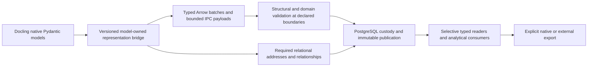

# PDF structured data — Arrow payloads, native models and PostgreSQL responsibilities

**Date:** 2026-11-01. **Status: Proposed; source-inspected with one bounded installed-library probe.**
This combined library-focused and principle-focused plan-improvement review covers the
[PDF series](../plans/pdf-docling-pipeline_2026-10-31.md), including materially affected completed
foundations and remaining publication, consumer and adoption work. Recommendations are not adopted
plan changes. No production code, database, ADR, grading policy or diagnostic audit was changed.

## Judgment

Adopt a **hybrid, model-governed representation**, beginning with page-scoped OCR/candidate
payloads: PostgreSQL owns transactional custody, identity, source/release bindings, lifecycle and
relationships used by SQL; Arrow preserves complex internal structures for typed consumers.
Keep genuinely joined document addresses, provenance, occurrence/relation endpoints, selections
and coverage relational. Extend this approach to rich native values only after establishing a
complete pinned Docling/Pydantic mapping and selective-access contract.

This is a stronger domain-model approach than requiring every nested datum to become a SQL type,
row or independently repeated SQL validation rule. It is also stronger than merely storing blobs:
payload validity, interpretation, relationships and allowed operations still need authoritative
contracts and an actual enforcement boundary. **Opaque to PostgreSQL does not mean unmodeled or
unvalidated in the application.** FP-04/05 and DP-01–03 permit this separation; FP-07 and H2–4/H15–20
require judging the complete operation rather than the apparent strength of one storage layer.

The main opportunity is removing conversions and unnecessary representations, not saving the
24.1MB of OCR metadata. A universal move to opaque Arrow or to PostgreSQL composites would lose
useful existing properties. Retaining JSON byte fields is a credible simpler alternative for data
that is only reconstructed as native objects and gains no useful columnar operations.

## Baseline, coverage and evidence

Inspected main `0878ba1b0ccb0051e04e87d6cd8c039a4b23e5ae`, the current architectural owners,
ADR-0042/43/44, the active coordinator/supporting targets and the
[recent execution receipts](../design_review/evidence/2026-11-01_pdf-publication-adoption/README.md).
Source ABI17/compiler4/core0.6.4 includes committed0065; the application remains0060. Scoped
publication/read/export controls passed; book migration, actual integrated book seal/export,
external journeys and complete adoption remain open. This is not a completion audit.

Inputs include the ten uncommitted PostgreSQL/Docling reference expansions and the new
[complex Arrow storage assessment](../libraries/postgresql/Storing_complex_PyArrow_schemas_and_data_in_postgresql.md).
Their contents were not changed or committed. The new assessment's SHA256 is
`8abf10426d996f04d3a31cb56a51d676b9fe4a41c2f3dea8940291b85acbf686`.
Supporting sources include [PyArrow](../libraries/analytical_infrastructure/pyarrow.md),
[Pydantic](../libraries/data_model/pydantic.md), [Settings](../libraries/data_model/pydantic-settings.md), the
[Docling](../libraries/primary_intake/docling.md), [OCR](../libraries/primary_intake/docling_ocr.md)
and [triple-pass](../libraries/primary_intake/docling_nemotron_triple_pass_reference.md) references,
and PostgreSQL transport, Core metadata and migration references. Version claims were checked
against installed APIs/source and primary documentation, not inferred from a newer reference.
Context7 was the first documentation route; unmatched/general material was followed by official
Arrow documentation and pinned installed sources.

The selected standard is core3.3, heuristics1.0, profile1.4 and the repository binding through
`standard.toml`. Relevant CI obligations include fidelity, relationship identity, unknown versus
absence, evidence closure and pinned projections. Product behavior is the review scope; prior
harness failures inform diagnosis but do not initiate a test-architecture review.

### What is established

- **Source-inspected:** `semantic/pdf_record_model.py:31–63` derives Arrow fields from SQLAlchemy
  column types. JSONB becomes `pa.string()` with a wire annotation. This is typed transport for
  SQL-shaped rows, not use of Arrow's nested schema as the payload representation.
- **Source-inspected:** OCR words feed math candidate discovery (`ingest/pdf_candidates.py:230`),
  alignment/enrichment and coverage. They are not validation-only, but these operations are largely
  page-local Python operations rather than arbitrary SQL predicates over OCR words.
- **Source-inspected:** `semantic/pdf_record_reader.py:227–290` supports metadata kind/pointer
  selection, but materializes all candidate pages and the document for native transformations.
  Page metadata lacks a page selector in this API. Paging SQL results does not bound that consumer.
- **Scoped Tested:** the [installed-library probe](../design_review/evidence/2026-11-01_pdf-structured-data/README.md)
  uses Arrow26.0.0/Pydantic2.14.1/Settings2.16.1. Arrow construction and `validate(full=True)` accepted
  null values under non-nullable top-level and nested fields. A confidence value outside bounds
  recorded only in field metadata also passed. Zstd IPC preserved schema metadata, NUL text and
  negative zero in the selected round trip. These cases establish neither universal type fidelity
  nor performance benefits.
- **not_run:** database storage comparisons, whole-book Arrow conversion, performance benchmarks,
  inference, deployment and provider/grading journeys. Recommendations below remain Proposed.

## Responsibility and placement

The unit of physical storage should follow the smallest useful retrieval/processing scope, not
one physical object per semantic distinction. Page payloads do not create semantic section chunks.

| Data family | Actual responsibility/access | Recommended placement and boundary |
|---|---|---|
| OCR regions, lines, words, candidate inventories | Page-local discovery, geometry/offset validation, alignment and later replay | Typed page payload; relational source/product/page/family/schema lookup; page-model validation plus explicit cross-field rules |
| Formula outcomes and full errors | Pointer-scoped inspection and section health | SQL-visible pointer/outcome/diagnostic reference; exact rich diagnostic payload outside JSONB traversal |
| Runtime reports, recipe/provider evidence | Reproduce and diagnose a producing operation | Immutable typed artifact under producing recipe/release; expose only fields used for actual selection |
| Document hierarchy, native addresses, item/page placement | Section selection, direct/descendant context, native pointers and frames | Relational address/ordering/containment access surface; native content authority remains Docling; rich item values are payload candidates |
| Tables, rich cells, picture/chart detail and native extensions | Select item/cell/context, reconstruct native values, perform technical analysis | Qualify typed payload mapping and necessary cell/reference projections; avoid flattening every internal scalar merely for persistence |
| Input products, occurrences, relations/endpoints, mappings and coverage | SQL joins, source qualification, evidence closure and selection | Retain relational identity and joinable semantics; factor repeated immutable definitions without collapsing distinct occurrences |
| Build/task state, leases, frozen membership, visibility | Atomic publication and recovery | PostgreSQL operations/constraints under the existing semantic execution model |
| Original PDF and raw provider bytes | Exact source evidence | Preserve existing exact-byte custody; an Arrow interpretation does not replace the original |

The relational core is supported by actual joins in `semantic/sql/pdf_record_context.sql:7–36`.
Its bounded selected-context JSON is not the same problem as a whole-book publication envelope.
The current metadata byte-field solution already fixes JSONB round-trip fidelity and current
exports already avoid per-field SQL round trips. Do not schedule those corrections again.

## Proposed coherent target

Docling remains the authority for its native content. The application semantic release owns
application classes, operations, relationships, mapping profiles and validation placement. Arrow
is a physical structural contract derived from those authorities; Settings acquires runtime
configuration. PostgreSQL need not interpret every payload interior to own its durable lifecycle.

## I01 — Declare payload placement and invariant ownership in the existing model

**Priority:** prerequisite; alignment improvement. **Packages:** PDF-18–21/24/25.

Replace the implicit rule “persisted structure must be independently reconstructed and checked
inside PostgreSQL” with explicit per-family contracts: semantic owner, logical schema, physical
encoding, retrieval key, invariant owner, validator, publication scope and derived projections.
Use existing release/dependency/artifact facilities; do not introduce a generic schema registry
merely because the reference document illustrates one.

The relevant question is whether SQL consumers or transactional relationships need a field, not
whether a field has a type. Candidate→OCR-word geometry must remain modeled even if it is checked
by a page-domain validator rather than a SQL join. Conversely, an input-product relation needed
for evidence closure must not disappear inside a payload that SQL can no longer join.

**Benefit:** one authority with deliberate execution placement; fewer independently maintained
representations. **Challenge/closure:** trace one candidate through its exact OCR word and original
pixels, and one selected claim through input relations. Every invariant must have an enforceable
owner; a schema-name annotation or payload hash alone is insufficient. References: FP-04/05,
DP-01–03/06–08, CI-01–05/11; H1–4.

## I02 — Introduce page-oriented typed Arrow payloads for OCR and candidates

**Priority:** first implementation candidate after decision. **Packages:** PDF-20/22–25.

Use a bounded, self-contained page or page-group IPC payload with typed nested regions, lines,
words and candidates. Keep document/product/release/schema/page identity and physical ordering
queryable in the outer envelope. Preserve original word indexes, text offsets, coordinate frame,
confidence, outcomes and candidate references. Group pages physically only when the supported
retrieval contract and memory bounds justify it.

Use `pa.struct`, explicit child `pa.field` definitions, `pa.list_`/appropriate large-offset types
and schema metadata; qualify unions/maps/dictionaries only when the actual payload needs them.
An explicit variant tag is required where native classes would otherwise be ambiguous. Do not
infer that arbitrary Pydantic validators or every native Python type can automatically become an
Arrow schema or kernel.

For a first version, prefer bounded self-contained `ipc.new_stream/open_stream` units when the
entire selected page is consumed. Compare `new_file/open_file/get_batch` only when indexed batch
access is a real need. PostgreSQL can store either as `bytea` or existing bounded parts; IPC file
random access does not make a fetched `bytea` a remote seekable file automatically.

**Alternative:** retain current exact JSON bytes if a family has no useful typed operations and
Arrow would only add another encode/decode step. **Benefit:** retain structure through persistence
and useful processing, rather than JSON→Python objects→SQL-shaped Arrow→bytes→JSON reconstruction.
**Challenge/closure:** select pages in a shuffled group and recover exactly the requested page and
word addresses without decoding unrelated book payloads. Native source sections remain intact.

## I03 — Compile one explicit Docling/Pydantic representation bridge

**Priority:** prerequisite for richer native payloads; immediate contract improvement.
**Packages:** PDF-18/19/22/24/25.

Derive structural mappings from pinned native model definitions and application definitions,
including validation versus serialization schema modes, aliases, explicit presence, null/default
behavior, model variants and computed output. Reuse prepared model validators and `TypeAdapter`
instances; avoid constructing adapters per row. Preserve native Docling methods for native
semantics rather than replacing them with shape-only schemas.

The recent computed-grid issue was a serialization-contract mismatch: a serialization output can
contain fields absent from a validation schema. The current checked derivation is correct for
retained data; new output should choose its contract before persistence so it does not need
migration-style repair on every ordinary read. Likewise, the explicit class inventory correctly
fixes the undiscriminated PageElement union. Generalize that successful contract into a stable
variant mapping; do not re-infer classes from whichever union branch validates first.

The new lowering already excludes computed fields by default through `_json_view(computed=False)`;
the checked grid derivation is a retained-data migration mechanism. Preserve that distinction:
this proposal does not identify ordinary grid repair as a current reader defect.

Do not assume `model_dump(mode='python')` is zero-copy or that `TypeAdapter` validates Arrow buffers
directly. Native model objects, typed dictionaries and columnar arrays serve different operations.
Convert at a named boundary only where the next consumer needs that representation.

**Challenge/closure:** a form containing a table retains its exact native class; a rich cell's
reference survives; computed-grid representation and absent/default/null distinctions round-trip
under the declared profile. Unsupported native schema changes produce a located refusal rather
than dropped fields. References: DP-02/06/15/24; H4/12/15/16.

## I04 — Make semantic validation complete, then place it at the necessary boundary

**Priority:** correctness prerequisite, not an optional optimization. **Packages:** PDF-20/21/24.

Arrow buffer validity, required-field validity, domain validity and whole-product closure are
different checks. The installed probe disproves using `validate(full=True)` or metadata constraints
as the entire validator. Reuse model-bound Pydantic/native validators for requiredness and custom
semantics; use Arrow kernels for genuinely batch-shaped rules only under equivalent contracts.

A specific coverage mismatch needs resolution before a new placement is accepted:
`semantic/pdf_contracts.py:434–437` invokes OCR geometry/offset/inventory and inline-report validators
for prepared envelopes. The new frozen capture in `pdf_publication.py:426–463` includes native
records/parts, while `_native_validation_child` reconstructs and validates the Docling document;
it does not capture the OCR metadata. Metadata admission in `pdf_publication_native.py:794–814`
checks released JSON Schema and lookup projections. Those checks do not establish all relationships
validated by `pdf_ocr_contracts.py`, such as word/line substring equality and crop-to-page geometry.
The new persisted-record path therefore needs an explicit equivalent enforcement route, not an
assumption that native callbacks or a successful schema check cover it. This is source-supported
validation-boundary work, not a claim that a malformed real book was published.
Upstream validation may establish a producer draft's validity; that must be distinguished from
checking cross-field correspondence against the actual frozen metadata. This finding does not
assert that OCR was never validated elsewhere in the pipeline.

Validate the actual immutable payload used for publication, bound to its schema/release and
frozen membership. Reuse the existing validation-result/freeze/seal mechanism where it suffices;
no independent certificate framework or caller-provided `validated=true` shortcut is warranted.
Reuse established validity while its premises remain unchanged, rather than revalidating every
unchanged word at every adapter and read.

For opaque Arrow interiors, PostgreSQL cannot independently prove payload/domain validity without
an Arrow-aware validator. Moving that responsibility to the model-bound runtime intentionally
changes the current independent-server assurance boundary. It can be a sound choice, but it is
not the same guarantee under a different encoding. If independent server interpretation remains
mandatory, retain the current route or qualify a server Arrow facility; do not claim equivalence.

**Challenge/closure:** structurally valid but semantically invalid payloads—bad word offsets,
out-of-page geometry, missing candidate targets, false complete coverage and wrong embedded
schema—must fail before public use at their declared boundary. References: DP-03/08/19, CI-04/11;
H18–20/23.

## I05 — Keep a small relational access surface and make projections rebuildable

**Priority:** co-design with I02; protects existing consumers. **Packages:** PDF-18/21/24.

Retain the relational families needed for section traversal, source placement, occurrence
identity, relation endpoints, input ancestry and coverage support. Deep table/chart/native values
can be payloads when their useful access boundary is an item or cell group, with necessary
references exposed through deliberate projections. Do not preserve every scalar-level row merely
because the existing universal lowering produces it; equally, do not replace proven joins with
whole-book payload scans.

Model each projection's derivation and consistency obligation. It is read-only/rebuildable from
its pinned authority, not another editable fact. A legitimate new SQL query over an interior field
can justify a new projection later; speculative queries do not justify flattening all OCR now.

**Challenge/closure:** section frames, repeated occurrences, cross-page references, rich-cell
placement and diagnostics resolve through the same qualified products after reconstruction.
Different occurrences remain distinct even when text, coordinates or endpoints repeat.
References: DP-04/07/21, CI-03/05/13; H5/8/9/15.

## I06 — Expose set-scoped typed reads and retain columnar data through useful work

**Priority:** immediate consumer improvement. **Packages:** PDF-22–25 and affected methods.

Add page/group selection and requested-field intent to the payload reader contract. Current
`native_metadata(kind, pointer=...)` cannot selectively request an OCR page by page number;
`native_product_values()` collects every kind and hydrates the whole document. The first reader
improvement is selecting useful data before decoding, not adding another cache.

Return owned batches/readers to Arrow-aware operations and reuse DuckDB/Acero where their
operators fit. Cross into native Docling/Pydantic objects only for native behavior, and into JSON
only for explicit external/native export. A batch method that internally calls `to_pylist()` for
all data can preserve the old amplification. The existing single-cursor exports are a strength,
not an unfixed N+1 issue.

**Challenge/closure:** one formula diagnostic, a page group, a large intact section and a full
export follow different appropriate scopes without hidden conversion of the entire book.
No zero-copy claim crosses database transfer, decompression or Python reconstruction without
measurement. References: FP-06/07, DP-10/13/14; H5–8/12/15–17.

## I07 — Simplify publication around validated payload units rather than nested JSON fields

**Priority:** depends on I01–05. **Packages:** PDF-19–21/25.

Retain durable private append, frozen membership, source/attempt fences, short seal and truthful
recovery. Replace field-by-field JSON schema compilation for selected opaque payload families
with validation of their typed payload at the declared runtime boundary. This can remove the
reason for a mandatory pg_jsonschema dependency for those families, rather than merely speeding
up repeated compilation. Audit its remaining consumers before proposing dependency removal.

Use bounded payload/batch uptake and grouped envelope operations. A Python executemany call does
not by itself make per-row schema compilation a batch validator. Reuse existing artifact parts,
byte folds and release inputs where they fit; preserve the distinction between exact payload
bytes and logical identity. Compression, dictionary encoding and batch layout can change IPC
bytes without changing domain meaning, so serialized-schema/payload hashes are not automatically
semantic identities. Keep old pins/bytes under their archived contracts.

**Challenge/closure:** interruption before/after append, freeze and seal; wrong schema/source;
conflicting replay; and changed projections cannot expose a falsely complete product. A replacement
must reduce machinery overall rather than add dual authoritative stores and another lifecycle.
References: DP-04/09/19/24; H1/2/18/23–27.

## I08 — Bind effective native options and choose image retention by later use

**Priority:** independent general improvement. **Packages:** PDF-20/22/23/25.

The correct1.67 raster-scale fix exposes a broader contract issue: requested configuration and
effective native execution settings can differ. Capture both from the actual prepared stages;
use the effective profile for crop/render/replay identity. Consolidate native-variant and
serialization profiles with this boundary instead of scattering library assumptions across
capture, replay and enrichment.

Use nested validated Settings models for resource/transport choices and explicit source
precedence. Resolve configuration before creating worker/model resources; producing settings that
can affect interpretation belong in the producing recipe. Domain schemas, recognition policy and
logical identity definitions remain release-owned, not ambient environment overrides.

Compare retaining every full-page raster with retaining required crops or exact on-demand
rerendering from the owned original. Retention purchases recovery and avoids repeated rendering;
rerendering can remove substantial persistent intermediates. Choose at the actual native
consumer seam with bounded image ownership, not by treating every page output as mandatory
permanent evidence. Preserve raw provider submissions under their original recipe regardless.

Native global assembly still combines page elements before reading-order and heading inference.
Page filters/concatenation rebase references and are not proof of equivalent whole-document
inference. Arrow page storage can reduce surrounding copies, but cannot independently remove that
global dependency. References: DP-05/10/15/18/20; H6/12/14/21/24–27.

## I09 — Reduce production authoring and reconstruction duplication

**Priority:** coherent supporting improvement. **Packages:** PDF-18–21/24/25.

The universal native-field lowering, JSON capture of SQL rows into Arrow strings, reconstruction
for native callbacks and later rehydration form several representations of the same document.
Select the canonical native/payload and relational-access contracts first, then remove replaced
reconstruction and SQL shape machinery. Retain one unavoidable native global object where native
algorithms require it; do not make each adapter reconstruct another whole document.

There is also a concrete memory candidate in `semantic/pdf_records.py:678–680`:
`validate_native_callbacks` deep-copies the document into both `original` and `private`, while
only the private copy is submitted to native validation. In the isolated validation child,
compare against the owned unchanged input rather than a second complete snapshot, provided its
immutability is established. Retain the private copy and mutation refusal. This removes a
candidate duplicate representation; savings and unchanged rejection behavior require a focused
fidelity check, not an assumed performance result.

A concrete earlier boundary is `ingest/pdf_streaming.py:89–106`: page capture calls
`page.model_dump_json()`, parses that JSON and serializes the enclosing wrapper again. Replace
that sequence with one model-owned envelope serialization that delegates native serializers.
This improvement can stand on its own while the richer Arrow bridge is qualified; a raw walk of
model fields is not an equivalent shortcut when native custom serializers matter.

The PL/pgSQL CASE failures were genuine authoring mistakes; outer SQL parsing did not compile
procedure bodies in their actual catalog context. Use pglast for its actual AST/signature tasks,
SQLAlchemy Core for suitable relational expressions, and a controlled actual PostgreSQL compile
boundary for generated routines. Do not mistake parser success for installed enforcement.
Reducing generated interior validators is preferable to adding more alignment lint or proof
machinery around them. The four stale harness assumptions are not evidence for a production
storage redesign and are not rescheduled here.

**Challenge/closure:** one schema/variant change propagates through its authoritative bridge and
required projections, rather than new hand-maintained rules in serializer, row codec, validator
and consumer. References: FP-01/03/06, DP-06/13–17; H4/15/16/26–28.

## Mechanism comparison and limits

### Where native PostgreSQL complex types fit

Native composites are a real alternative for small, stable SQL-used structures, such as a
qualified coordinate/frame value. `CREATE TYPE ... AS` provides named typed fields; a domain over
that composite can carry reusable `CHECK` constraints. Composite declarations alone do not provide
field `NOT NULL` or inherit constraints from a table's row type. Arrays preserve ordered SQL values,
but intended dimensions/cardinality and nested reference integrity still need explicit enforcement.
Use those facilities when SQL actually consumes the structure, rather than converting opaque
page inventories into catalog types solely to obtain a second structural owner.

This option requires qualified SQLAlchemy bind/result typing and Psycopg composite adaptation
(`CompositeInfo`/`register_composite`), plus array/enum/domain round-trip and migration checks.
An existing Arrow-to-COPY or ADBC path does not imply support for every nested composite. Catalog
type evolution and connection-local adapters become part of the compatibility surface. PostgreSQL
text fields still cannot represent embedded NUL; replacing them with binary fields changes the
queryable text contract. For the OCR observation payload, composites therefore do not remove the
specific impedance mismatch that motivates this review.
SQLAlchemy ORM `composite()` groups mapped columns into a Python value object; it is not itself
support for a PostgreSQL catalog composite type. Keep those two options distinct during implementation.

**Judgment:** use normalized relations for independently referenced/updated facts; consider native
composite domains for cohesive SQL-operated values; prefer typed payloads for deep immutable
observation structures retrieved as a unit. This is a per-family choice, not a ranking by nesting depth.

| Option | Useful when | Why it is not the universal answer |
|---|---|---|
| Current exact JSON byte fields + native JSON Schema | Native reconstruction is the main consumer and independent SQL validation is required | JSON materialization and per-row schema compilation remain; no nested Arrow computation |
| Arrow IPC in relational envelope | Rich immutable values are consumed by typed page/item operations | Requires explicit domain validators and changes server-side assurance; codec/interoperability must be qualified |
| PostgreSQL composites + domains/arrays | Stable nested SQL-used values benefit from native operators | Composite declarations alone do not carry table constraints; nested refs still need modeled enforcement; text/NUL and catalog migration coupling remain |
| Normalized relational rows | Cross-product identities, joins and publication invariants need SQL visibility | Universal scalar decomposition introduces rows, codecs and reconstruction that some families do not need |
| Parquet | Large analytical scans benefit from column selection/compression | Not a universal exact Arrow representation; unions/extensions/dictionaries and metadata round trips need qualification |
| Large Objects/custom range readers/columnar PG extensions | A demonstrated large-object or SQL analytical requirement warrants them | Extra lifecycle or integration burden; not justified by24.1MB of page-oriented OCR alone |

Start with ordinary bounded payloads and existing custody. `bytea` has an approximately1GiB value
limit; do not move the whole-book limit into one giant IPC value. TOAST `EXTERNAL` can make partial
substring retrieval useful for uncompressed values, but IPC footer/dictionary handling and a
range adapter are still work. Compression may require buffer allocation; PostgreSQL transfer is
not an end-to-end zero-copy path. Compare IPC compression and TOAST behavior together.

ADBC/pgpq can transport suitable columns and batches; they do not automatically store arbitrary
nested Arrow schemas as native PostgreSQL structures. Keep the current transaction/pool owner
unless a concrete capability requires another path. No new database, Flight service, worker
framework or general graph engine is selected.

## Priority, integration and rule impacts

First settle I01 and I04: representation authority and complete enforcement. Then qualify I02/I03
on OCR/candidates and I05/I06 on one genuine selected-source journey. Apply I07/I09 to remove the
mechanisms this replaces. I08 can improve effective configuration/image ownership independently.
Broader native payload replacement follows a total mapping and actual selective-reader proof;
it is not a prerequisite to making OCR storage better.

These amendments fit the remaining PDF-20–25/10/11 undertaking because the data contracts,
publication boundary and consumers are already being integrated. Completed PDF-18/19 code is
not exempt from redesign where it causes those costs. The PostgreSQL leverage series is an
adjacent dependency, not authorization for unrelated upgrades. No speculative system-wide
migration or new compatibility framework is recommended.

**Proposed rule impacts requiring explicit adoption:**

- Qualify/supersede ADR-0042's universal record/interior-independent-server-enforcement realization
  for selected payload families. Preserve complete modeled semantics while assigning enforcement
  deliberately. This is a real assurance-boundary change, not a claim of unchanged SQL guarantees.
- Revisit ADR-0044's mandatory native JSON-schema path where payload interiors no longer need SQL
  interpretation; preserve it for remaining consumers if useful. Provisioning already performed is
  not evidence that retaining the dependency is the best future design.
- Preserve ADR-0043's separate exact-byte/logical/export identities, current PDF-only direction,
  one integrated document, intact sections, independent automated grading and qualified provenance.
- All committed migrations through0065 remain frozen. An accepted replacement requires a new
  forward revision/release and explicit retained-data derivation. No current defaults change merely
  because a representation probe succeeds.

### Decision-changing investigations before implementation

1. Establish the minimum complete Docling/application→Arrow type profile, including presence,
   variants, map/array ordering, arbitrary native extension values and cross-language needs.
2. Demonstrate page/candidate semantic validation against the exact persisted candidate, including
   the new-route cross-field coverage mismatch described in I04.
3. Qualify selective payload retrieval and the necessary relational projections; compare current
   exact JSON bytes when Arrow offers no computational consumer advantage.
4. Compare complete encode/store/retrieve/validate/use operations before claiming speed or memory
   improvements. A synthetic IPC-only timing cannot establish end-to-end benefit.
5. Decide image retention from actual enrichment/recovery demand, and native-global lifetime from
   pinned native algorithms; neither is settled by introducing a streaming serialization format.

No numerical SLA, generic cost model, new alignment gate, full-corpus rerun or grading-policy change
is introduced by this review. Plan amendments, decisions and implementation remain subsequent work.

## Primary capability references

- [Arrow IPC stream/file behavior](https://arrow.apache.org/docs/python/ipc.html),
  [nested data model](https://arrow.apache.org/docs/python/data.html),
  [extension types](https://arrow.apache.org/docs/python/extending_types.html).
- [PostgreSQL18 TOAST](https://www.postgresql.org/docs/18/storage-toast.html),
  [composites and domains](https://www.postgresql.org/docs/18/rowtypes.html),
  [binary values](https://www.postgresql.org/docs/18/datatype-binary.html),
  [Large Objects](https://www.postgresql.org/docs/18/lo-intro.html).
- [Pydantic TypeAdapter](https://pydantic.dev/docs/validation/latest/concepts/type_adapter/),
  [performance](https://pydantic.dev/docs/validation/latest/concepts/performance/),
  [serialization](https://pydantic.dev/docs/validation/latest/concepts/serialization/).
- [Pydantic Settings](https://github.com/pydantic/pydantic-settings),
  [Docling core document implementation](https://github.com/docling-project/docling-core/blob/main/docling_core/types/doc/document.py).
  General main/latest documentation is orientation; the inspected installed versions and explicit
  probe delimit the actual version-qualified claims above.
