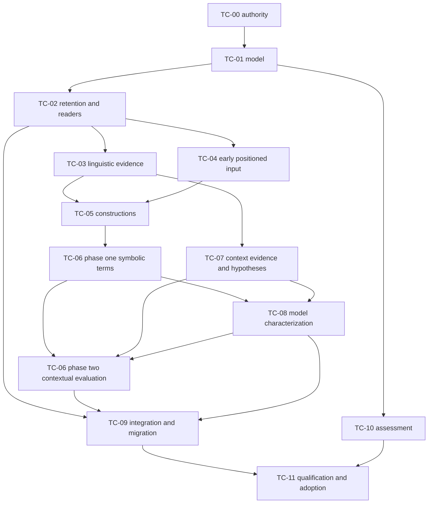

# Enriched-document text characterization implementation series

**Status: completion audit 2026-11-12 reopened TC-03, TC-05, TC-07, TC-08 and TC-09; TC-10 partially delivered and paused; TC-11 not delivered.**
This coordinator owns TC-00–TC-11, TC-I01–09, O01–O07 disposition and combined completion.
Supporting plans own package design; this page owns current package state. The [Completion audit](#completion-audit) is the current judgment: producers and the retained frame are implemented, consumer migration and retirement are incomplete (TC-E08–E11), and part of the provider acceptance was never exercised (TC-E12). The 2026-11-11 functional union remains dated evidence for its own source; it does not qualify the current source. Activation/selection retains its explicit final effect authority; conditional branches remain trigger-driven.

## Completion audit

**Interface-checked by source inspection · 2026-11-12.** Audited committed main
`54d6d66591f372bc51474e1af0d67dc4a9272570`: the TC implementation (`e9025e949`, `088cf9fdd`, last
TC commit `4d0ca7eb7`) as it stands beneath 17 later commits, chiefly the
[BEP series](book-processing-efficiency-and-parallelism_2026-11-11.md). Uncommitted concurrent BEP
work was read only where it bears on a judgment and is not part of this baseline. Three fresh,
read-only implementation reviewers independently assessed frame and consumers (TC-01/02/09), the
deterministic producer chain (TC-03–05 and TC-06 phase one) and contextual/model characterization
plus BEP drift (TC-07/08 and TC-06 phase two). The coordinator read the decisive source for every
gap recorded here. No test, provider, migration or book run was started for this audit. This
section is the current combined judgment; the [execution-findings table](#execution-findings) is
the single disposition owner. Dated sections below keep their receipts at their original scope.

The claimed boundary was TC-00–09 "Complete, Tested", producer-review F01–F04 closed, O01–O06
delivered and TC-E01–E07 bounded Tested. TC-10/11 were not claimed complete; their state is
accounted below, not certified.

**Implementation.** The released model, retention and combined reads (TC-01/02), all thirteen native
families, positioned formal syntax, shared constructions, packed symbolic terms, the single
contextual evaluator and the eight question families (TC-03–08) are implemented as accepted, and
F01–F04 hold for the admission and codec obligations they name. **The claimed boundary is
nevertheless incomplete at TC-09 and at the retirement obligations of TC-03 and TC-05:** the
default `ci run` route never reaches primary characterization (TC-E08), the HanLP projector's
private frame/cue interpretation was not retired and still has current consumers (TC-E09),
contextual query still reads the private parser products (TC-E10), and two consumers still
recognize language from raw native columns (TC-E11). These are accepted obligations of the
migration inventory and retirement text, present in the TC-era source. They are not newly
preferred architecture and BEP did not introduce them.

**Layering with BEP.** A TC mechanism replaced under accepted BEP scope is an authorized change,
not a TC gap, and this plan's older wording about it is historical:

- Layer and view publication/read bound: 8 MiB replaced by 64 MiB (BEP-E01, ADR-0087), after the
  actual book failed the 8 MiB layer contract. Membership/node pages keep 1000 rows and 8 MiB.
- d1 device: the TC-era CPU default exceeded its 120 s bound on real prose and produced failed
  coverage (BEP-E02). d1 is now CUDA/BF16 only, method version 2 (ADR-0086).
- Provider custody and residency: per-task borrowed workers replaced by provider lanes, one freeze
  per demand and bounded native threads (ADR-0083/0084). Constructions, formal evidence and
  contextual evaluation run in spawned CPU kernels whose results the parent re-validates.
- Reuse: retained primary products are reused only under a matching native thread profile
  (ADR-0087). Runs from before BEP carry none, so the TC-era partial book products (invocations
  497–523) are regenerated rather than resumed.

No TC obligation was found broken by BEP and left unrestored at this baseline.

**Verification and qualification.** The 2026-11-11 composite union still reads as recorded:
`uv run ci test coverage 71e97b485e59479b80b9d5e086f48570 2e2d74eb026b42b78068d523ce6ca5da --view unresolved --limit 5 --json`
reported required 6,407, covered 6,407, unresolved 0 on 2026-11-12, with the original attempt still
**failed**. That union was taken before BEP changed 48 source files. It is dated evidence for
`e9025e949`/`088cf9fdd` and does not establish qualification of the current source. Reassessment is
needed for d1 and GLiNER requests and receipts, Maverick/DiPO provider runs and retained-native
reuse, HanLP bulk preparation, the spawned-kernel method routes, publication-time validation
(including the F02 and witness controls), read bounds and paged primary reads, demand reuse and
recovery, zero-input coverage and changed-cost replay refusal. TC-11 owns re-establishing the
required union on final source once BEP's remaining scope has landed. Two acceptance limits were
also present in the original union (TC-E12): the candidate-centered question families were never
posed to the actual provider, and actual Maverick/DiPO projection ran only over a mathematical-literal
source.

The intended reader route was exercised read-only on 2026-11-12 under native head
`semantic_bep_capacity` (`uv run ci db status --json`): `uv run ci source enriched 518 --producing-task 2420 …`
**passed** for the one retained composed view of the book (one of 316 SourceViews), returning all
56 family coverage rows of the full profile (25 complete, 25 partial, 6 empty). The MCP
`inspect_enriched_document` route for that pin is **blocked**: it needs a server bound to
`nce-grinstead-snell-full-book`, and the audit session's server was bound to another project and
refused correctly.

**Benefit claims.** The series claims no measured benefit, linguistic accuracy or full-book
quality, and none is required for completion. The audit found no claim stronger than its evidence
beyond the completion statements corrected here.

**TC-10 and TC-11.** TC-10 is partially delivered and paused. Delivered and bounded Tested: V3
operation frames, protected A/B/C custody, native task scoring, the source-anchored task
comparison (TC-E05), frozen source sets 40–44 with their adjudications, and bounded evaluator
inspection. Not delivered: any source-first or output-first grade of actual producer output, the
output-first panel (it needs the final book view), and assessment of migrated consumers. TC-11 is
not delivered. The [qualification account](../design_review/evidence/2026-11-11_text-characterization-assessment/qualification/README.md)
records the source account as passed and the primary-family and combined-view consumer accounts as
**not_run**; one of 316 SourceViews reached a local composed view before the last interruption.
Actual 316-view/518-page execution is now owned by [BEP-09](book-processing-efficiency-and-parallelism_2026-11-11.md#BEP-09).
TC-11 consumes its final view pin and still owns the family coverage account, semantic assessment
through TC-10, the required check union on final source, current-only cutover and adoption.

| Package | Current implementation judgment | Qualification boundary |
| --- | --- | --- |
| TC-00 | Complete at its decision boundary | ADR-0081, owning sections and the entry review stand. |
| TC-01 | Complete; no gap found | Dated 2026-11-11 union; the model change since is BEP's additive batch receipt. |
| TC-02 | Complete; the 8 MiB layer bound is replaced under BEP-E01 | Read bounds and paged primary reads changed after the union; reassess at TC-11. |
| TC-03 | Native delivery complete; projector retirement open (TC-E09) | HanLP bulk preparation changed after the union. |
| TC-04 | Complete; no gap found | Formal routes now run in spawned kernels; reassess at TC-11. |
| TC-05 | Producers complete; downstream recognizers not all retired (TC-E09, TC-E11); coverage meaning of unparsed input undecided (TC-E13) | Same kernel-route reassessment. |
| TC-06 | Complete in both phases; no gap found | F02 and witness native controls predate the current publication-validation path. |
| TC-07 | Implementation complete | Actual Maverick/DiPO projection on prose was outside the TC union (TC-E12). |
| TC-08 | Implementation complete; d1 device replaced under ADR-0086 | Candidate-centered families never posed to the actual provider (TC-E12). |
| TC-09 | Incomplete: TC-E08–E11 | No cited selection exercises the unpatched default CLI composition, contextual query over primary layers, or the absence of projector interpretation. |
| TC-10 | Partially delivered, paused | Framework and references bounded Tested; no grade of actual output. |
| TC-11 | Not delivered | Full-book coverage account, consumers, required union on final source and adoption all open. |

### Remaining obligations

Each item records the accepted obligation, the decisive source and what closes it. Current status
stays in the [execution-findings table](#execution-findings); this is not a second ledger.

**TC-E08 · Reach primary characterization from the default `ci run` route.** TC-09 accepted that
"the default analytical command graph also performs capture, primary demand and exact-view binding
before consumers". [The CLI](../../python/corpus-structure/src/corpus_structure/cli/orchestrate.py):56–64, 298–310
always passes the phase-0 graph and registry, so
[the command owner](../../python/corpus-structure/src/corpus_structure/orchestrate/commands.py):194
treats the run as non-ordinary and skips the demand at 379–389. Mathematical source methods then
require primary pins that the stock configurations do not contain. The condition is unchanged since `e9025e949`; only direct Python
callers, `ci regenerate` and the M1 policy reach the demand. BEP's audit recorded the same defect
as [BEP-E12](book-processing-efficiency-and-parallelism_2026-11-11.md#BEP-E12), which owns the
repair. It closes here when BEP-E12 closes with a control over the real, unpatched CLI composition.
Owner: TC-09, O06.

**TC-E09 · Retire the HanLP projector's frame/cue interpretation.** TC-03 accepted retiring "the
frame/cue interpretation inside the HanLP projector once its consumers read TC-05/06 output", and
the TC-09 inventory assigns that interpretation to the shared construction owner.
[The projector](../../python/corpus-structure/src/corpus_structure/methods/pm2_hanlp_products.py):17–23
still holds the `_PHRASES` narrowing and private condition, exception, negator and reporting
lexicons, and still emits `linguistic.predicate_frame` (288) and `linguistic.qualifier_cue`
(325–356). The TC implementation commit did not touch the file, and the route is live through
`ci run parsers`. Current readers of those products are
[contribution composition](../../python/corpus-structure/src/corpus_structure/serve/contribution_composition.py):191–253,
the retained declaration parser in
[operations](../../python/corpus-structure/src/corpus_structure/semantic/operations.py):1422,
source-contribution admission (`source_contributions.sql`:2285) and contextual query (TC-E10).
`hanlp_condition_groups` in `methods/m1_source_capture.py` has no production caller; only the
2026-11-09 evidence replay imports it. Closure is one of two routes: migrate these readers to
primary construction and source-reading terms, remove the projector's interpretation while keeping
its native evidence, and replace the tests that assert the old mechanics; or record an operator
decision through the ADR route that the private parser route is a retained non-primary surface and
amend the inventory. Owner: TC-03 retirement and TC-09, O02/O06.

**TC-E10 · Move contextual query onto the contextual layers.** The inventory row "Contextual
query/retrieval and model replay" requires consuming retained mentions, referents and contextual
layers. [Contextual query](../../python/corpus-structure/src/corpus_structure/methods/contextual_query.py):15–22
binds its three recipes to the private parser's predicate frames, Maverick clusters and DiPO trees,
and its replay pins `extract.pm2_hanlp`, `extract.pm2_maverick` and `extract.pm2_dipo`. The reader
is the opt-in `query_context` selection of contextual candidates. Closure: bind the recipes to
pinned TC-07 layers and primary terms, or record an explicit retirement of this arm.
Owner: TC-09, O04/O06.

**TC-E11 · Remove private recognition from definition and assertion consumers.** The inventory
says these consumers "do not repeat lexical/dependency recognition privately".
[Assertion qualification](../../python/corpus-structure/src/corpus_structure/methods/assertion_qualification.py)
consumes primary frames, then re-scans raw tokens for negation (193–198), the `MD` tag (239–242)
and a `ROOT`/`conj` dependency gate for the "possible" label (256–259).
[Definition declaration](../../python/corpus-structure/src/corpus_structure/methods/definition_declaration.py)
walks retained HanLP dependency columns to recognize "let … be", copular, relative-clause and
passive naming patterns beside the primary naming construction. The assertion residue is unfinished
scope. The declaration chain needs a decision: either its linguistic premises move to TC-05
constructions or source readings, or it is recorded as domain-owned interpretation. The repair
should also settle whether `source_layout` in `methods/predicate_frames.py` may return `prose`
when the layout edge is missing, since that reads an unknown as a known. Owner: TC-05/06 consumer
cutover and TC-09, O02/O06.

**TC-E12 · Exercise the candidate-centered families and contextual providers on prose.** TC-08
acceptance requires actual native acceptance of "every new applicable baseline family", including
competing scope, host and referent cases. The only actual-provider demand control asserts that the
candidate families are empty because its mathematical-literal source has no linguistic focus
(`tests/semantic/test_characterization_native.py`:1801–1806); host and referent questions ran only
against synthetic replies. Actual Maverick/DiPO projection on prose was likewise outside the TC
union. This is open verification, not missing implementation. It closes with an actual d1 (CUDA)
and Maverick/DiPO run over authenticated prose with non-empty host and referent hypothesis
populations, graded through TC-10. Owner: TC-07/08 acceptance, discharged in TC-10/11.

**TC-E13 · Decide what construction coverage reports for unparsed input.**
[Packed recognition](../../python/corpus-structure/src/corpus_structure/semantic/constructions/forest.py):663–664
reports `empty` for every `UnexpectedInput`, including text the grammar cannot tokenize. TC-05
defines a valid grammar no-match as recognized coverage, while TC-11 requires that unassessed
regions "cannot count as successful empty". Before the full-book family account is accepted, decide
whether input outside the grammar is recognized-empty or unsupported and make the account follow
that decision. Owner: TC-05 coverage contract, decided for TC-11.

## Target and basis

Produce a combined **enriched document**, preserving the source's sections, reading order, pages,
native items, tables, figures, formulas and exact locations while adding identified linguistic,
construction, semantic and contextual layers. Analytics and conceptual enrichment consume that
representation and can add further identified layers. Document containment, annotation membership,
semantic relationships and analytical alternatives remain distinct.

The operator approved this authoring scope on2026-11-10, including the enriched-document framing,
and chose baseline delivery plus triggered conditional branches. The source is the
[functional review](../functional_reviews/text-characterization_2026-11-10.md) at `59eee893c`, O01–O07
and its full feature crosswalk, supported by the
[library collection](../library_leverage/libraries/text-characterization/briefing.md). This plan
refines the review's semantic product into document-owned layers; it does not replace the source
document with a detached text graph. [Coverage](text-characterization/coverage.md) routes every
feature row, including Supporting, Conditional and Rejected entries.

Source baseline: `59eee893c7ed7839a1aaed8a11aa12faf03a232e`, main,2026-11-10. Concurrent CLI/admission
reporting docs and evidence repairs are excluded and preserved. Existing native receipts keep their
original scope; no product/provider test, model fitting, runtime probe or benchmark was run during
plan authoring. Pinned spaCy3.8.18/en_core_web_sm3.8.0, Lark1.3.1 and SymPy1.14.0 remain the starting
selection. Provider artifact/runtime profiles are discovered from current executable declarations and source.

Use [standard.toml](../design_review/design_principles/standard.toml): core3.3, efficient-architecture
heuristics, code-intelligence1.4 and binding. Source fidelity and unknown states constrain the
semantic model; native composition and shared preparation constrain its physical realization.
The proving corpus is all 518 Grinstead–Snell physical pages under
[ADR-0070](../adr/0070-full-book-method-development.md), plus the existing second-vocabulary fixture.

## Foundation assessment and shared decisions

At the 2026-11-10 authoring baseline, annotation products retained exact token layout, morphology, dependencies, sentences and
availability; native views reconstruct them without model inference. HanLP/Maverick/Dipo and
GLiNER/d1 have existing provider operation owners. `SourceObservationBatch` and
`SourceContributionOperation` in the released observation model already retain identity, question,
outcome, coverage and zero-output operations. Reuse these owners rather than create another store
or workflow runtime. [Model/retention](text-characterization/model-and-retention.md) develops the
delivered extensions beyond that baseline frame/cue vocabulary.

At that baseline, native SQL reconstructed candidate roles and reading layout as well as authenticating
source support. The implemented replacement moves language-producing policy to
primary characterization; native custody, endpoint, coordinate and declared-invariant checks
remain independently enforced. Producer agreement alone is not an independent semantic oracle.
[Migration](text-characterization/consumer-migration-and-integration.md) owns the cutover.

The full profile attempts every selected characterization family over eligible natural sections.
It preserves native scheme disagreements, partial products, supported readings and unknowns.
Completeness describes operation/profile/scope coverage, never every conceivable English meaning.
The baseline includes new modal, scope, attribution and function tasks; current finite statistics
prompts do not already supply them. Failed required tasks remain failed/partial rather than being
silently replaced by an unselected model. Cheaper boundary-only profiles remain explicitly weaker.

A document view binds an immutable base pin and exact layer revisions. Identified cross-boundary
annotations have separately anchored members, not copied tree parents. One group over pages3–4
has one group ID and two distinct membership/source occurrences. Index membership by qualified
annotation ID; matching IDs retrieves recorded association, while the producing operation establishes
its meaning. A later topic grouping uses the same view mechanism with different semantic authority.

No new default model, graph service, generic constraint solver or task per annotation is selected.
Native Docs/trees/forests are operation-shaped working forms. Persist the useful semantics and
positions under generated released contracts, with native evidence/report bytes retained as needed.

## Reading route and execution dependencies

| Supporting plan | Responsibility |
| --- | --- |
| [Model and retention](text-characterization/model-and-retention.md) | TC-01/02: shared model, identity, release, storage, document/layer reads |
| [Native evidence](text-characterization/native-evidence.md) | TC-03/04: positioned linguistic and formal inputs |
| [Constructions and interpretation](text-characterization/constructions-and-interpretation.md) | TC-05/06: reusable constructions, forests, symbolic and contextual semantics |
| [Contextual characterization](text-characterization/contextual-characterization.md) | TC-07/08: reference/discourse and baseline model tasks |
| [Consumer migration and integration](text-characterization/consumer-migration-and-integration.md) | TC-09: consumers, native admission, ingest scheduling and retirement |
| [Assessment and investigations](text-characterization/assessment-and-investigations.md) | TC-10 and TC-I01–09: independent expectations, native/corpus assessment and conditional decisions |

TC-04's early positioned atom/constituent readers unblock TC-05; ambiguous-formal packing closes
after the TC-06 symbolic slice. TC-07 produces context evidence and hypotheses; TC-06 alone owns
semantic-node/environment evaluation. TC-08 candidate questions use frozen symbols and hypotheses,
not TC-06's final contextual answers. Source-first TC-08 work can run independently from candidate
production. Final TC-06 evaluation consumes these explicit revisions once; unresolved results remain
unknown rather than trigger an automatic fixed-point loop.

This graph describes working integration prerequisites. Independent expectation authoring starts
with settled semantics, and provider preparation can begin from an agreed input contract. TC-09's
consumer changes participate in earlier packages when needed; its completion reconciles the whole
inventory. Documents and graph nodes are not mandatory synchronization or process boundaries.

## Execution queue and current state

The [Completion audit](#completion-audit) owns current package judgments. This paragraph and the
table's closure column describe the 2026-11-11 delivery, corrected where the audit reopened a
package. The authorized TC-03–09 implementation and TC-01/02 integration prerequisites were
delivered on shared `main`, 2026-11-11. Native integration was then deployed through
`semantic_tc03_09_literals` (the head has since advanced; see the audit), release
`release:81dd8c0986138654fe434c1742072585ed968d70a4973961b6e89aa6e2713371`.
The default remains `/10`; the project remains unselected. No activation or promotion occurred.
The [integration evidence](../design_review/evidence/2026-11-11_text-characterization-integration/README.md)
retains deployments, original failures and the final test-identity union. **Tested:** the functional
claim covers the selected contracts, real-provider/native integration, reuse, migration and fault
behavior. It makes no claim of exhaustive linguistic meaning, measured benefit or full-book quality.

| Package | Required capability | Delivered behavior and closure |
| --- | --- | --- |
| TC-00 · Target authority | Approved implementation scope; relevant current owners | **Complete:** [ADR-0081](../adr/0081-enriched-document-analysis-layers.md), D1/D2/D3/D4/D6/D8 authority and [entry review](../design_review/reviews/design_review_text-characterization-entry_2026-11-10.md) Accept scoped. No source/admission rule reversal. |
| [TC-01](text-characterization/model-and-retention.md#TC-01) | TC-00 decision | **Complete, Tested:** released contracts, exact source/analysis identity, private-product classification, DAG/choice/coverage validation, original-release closure and independent examples |
| [TC-02](text-characterization/model-and-retention.md#TC-02) | TC-01 | **Complete, Tested:** protected native products/projections/completion, indexed reads, CLI/MCP, composition and detached closure. All native foundation cases and the final required functional union are covered below. |
| [TC-03](text-characterization/native-evidence.md#TC-03) | Working TC-02 input/layer contract | **Reopened 2026-11-12 for retirement only ([TC-E09](#TC-E09)).** Native delivery implemented, Tested 2026-11-11: all 13 native families, exact native columns/schemes, runtime/artifact custody and explicit weaker profiles. The HanLP projector's frame/cue interpretation is not retired. |
| [TC-04](text-characterization/native-evidence.md#TC-04) | Working TC-02 | **Complete, Tested:** direct shared SPPF syntax, normalized/literal/recognized correspondence, separately reported symbol outcomes and source-first inline nominations; scientific assessment separate |
| [TC-05](text-characterization/constructions-and-interpretation.md#TC-05) | TC-03 plus early TC-04 positioned-input slice | **Reopened 2026-11-12 ([TC-E09](#TC-E09), [TC-E11](#TC-E11), [TC-E13](#TC-E13)).** Producers implemented, Tested 2026-11-11: spaCy named/source constructions, Lark direct packed reduction and primary navigation/naming/math-scope facts. Downstream recognizers are not all retired, and the coverage meaning of unparsed input is undecided. |
| [TC-06](text-characterization/constructions-and-interpretation.md#TC-06) | TC-05 for symbolic slice; TC-07/08 evidence for contextual closure | **Complete, Tested:** explicit choice sites, shared terms and environment evaluation; transitive external selection and witness conservation implemented, native controls covered in the final union |
| [TC-07](text-characterization/contextual-characterization.md#TC-07) | TC-03 and context/source maps, relevant constructions | **Implemented; acceptance reopened 2026-11-12 ([TC-E12](#TC-E12)).** Raw Maverick/Dipo populations, linear cluster membership, private hypotheses, exact context/gaps and retained-native mode. The 2026-11-11 union covered actual-provider admission over a mathematical-literal source, not projection on prose. |
| [TC-08](text-characterization/contextual-characterization.md#TC-08) | TC-06 symbolic slice/TC-07 hypotheses for candidates; source-only route independently | **Implemented; acceptance reopened 2026-11-12 ([TC-E12](#TC-E12)).** Eight released question families, source-first and frozen-candidate stages, declaration/request identity and explicit missing/none/insufficient outcomes. The candidate-centered families were never posed to the actual provider; d1 now runs under ADR-0086. |
| [TC-09](text-characterization/consumer-migration-and-integration.md#TC-09) | Required primary layers available | **Reopened 2026-11-12, incomplete ([TC-E08](#TC-E08)–[TC-E11](#TC-E11)).** Delivered: current native guards, the demand/ingest route and view bindings, detached analytical closure and explicit zero-input coverage. Not delivered: the default `ci run` composition, primary-only consumers for the listed surfaces and current-only retirement. Provider residency is now BEP's. |
| [TC-10](text-characterization/assessment-and-investigations.md#TC-10) | TC-01 semantics; delivered producers for execution | **Partially delivered, paused.** Assessment framework and frozen references bounded Tested; no grade of actual producer output, no output-first panel, no consumer assessment. Also discharges TC-E12. |
| TC-11 · Assembled qualification | TC-01–10 and selected conditional outcomes; the final book view from [BEP-09](book-processing-efficiency-and-parallelism_2026-11-11.md#BEP-09) | **Not delivered.** Open: full-book family coverage account (with TC-E13 decided), named semantic assessments, current-only cutover after TC-E08–E11, and the complete required check union re-established on final source. |

## Authorized TC-03–09 continuation

**2026-11-10.** Execute complete selected baseline scope in coherent batches: native evidence and
early positioned formal inputs; constructions with direct packed symbolic reduction; contextual
evidence and all eight model question families; packed formal completion; one contextual evaluator;
complete consumer/native/ingest/read migration. TC-09 consumer slices accompany producers.
TC-10 assessment infrastructure and TC-11 complete-book qualification/adoption remain separate.

Foundation command `uv run ci test --json -- python/corpus-structure/tests/semantic/test_characterization_native.py python/corpus-structure/tests/semantic/test_characterization.py python/corpus-structure/tests/methods/test_characterization_composition.py python/corpus-structure/tests/semantic/test_characterization_replay.py python/corpus-structure/tests/semantic/test_characterization_completion.py`
**passed**,78 selected cases, `710bab42df304f469ecf4c628401a5a4`,2026-11-10. This verifies the strict
receipt, joint completion and cross-release corrections; it does not establish full qualification.
Full `uv run ci test --json` receipt `47a15226cae2486f8b81e8ec5b0b7de8` was interrupted and
settled at exit130. It selected 6119 ordinary identities: 4263 passed, 943 failed, 2 blocked,
16 incomplete and 895 not_run; fault/Rust not_run. The early stale operation-report schema defect
was diagnosed independently; later failures were contaminated by edits made while that campaign
ran. Preserve this failed/interrupted evidence; it is not final-source qualification. The owning
operation-report and call generators have since run successfully, with their generated outputs
covered by the final functional union and repository checks.

The [producer target review](../design_review/reviews/design_review_text-characterization-producers_2026-11-10.md)
accepts the revised target only, with these implementation obligations:

| Finding | Responsible package / component | Current disposition and closure evidence |
| --- | --- | --- |
| Producer review F01 | TC-03/04, released characterization model | Closed, Tested in the final required union: typed tokens/native run columns and formal inputs/nodes/correspondence, kind-specific requirements and independent retention/refusal controls |
| Producer review F02 | TC-06, native validation and live/detached readers | Closed, Tested in the final required union: typed qualified upstream choices, transitive joint selection and original released-contract validation through live/detached paths |
| Producer review F03 | TC-06, packed algebra/codec/reading | Closed, Tested in the final required union: explicit child choice sites, single-valued root selection, unresolved partial sites and site/root cycle edges; packed diamond/native cycle controls |
| Producer review F04 | TC-05/09, construction declarations/native guards | Closed for its guard obligation, Tested in the final required union: released mechanical witness constraints, wrong-host/source/choice refusals and retirement of duplicate SQL language production. Its "primary-only consumers" statement did not hold for every consumer; those surfaces are TC-E09–E11. |

Native producers obtain per-unit determinants from the execution-owned port and retain exact provider
costs at protected completion. Native controls exercise changed-cost replay refusal. Model/runtime
preparation and inference remain outside publication transactions. These prerequisites and their native refusal controls are covered by the final required functional union.

## Functional qualification · 2026-11-11

The stopped 2026-11-10 foundation checkpoint is resolved. Its original failed native receipt
`3f98a01daa9b4059ad066da42ca6c2f7` and interrupted retry
`0a008697b02d4616b51f71a57133536f` remain evidence of that checkpoint, alongside the
[native foundation record](../design_review/evidence/2026-11-10_text-characterization-native/README.md).
The strict receipt conversion, producing-layer preload and distinct cross-release realization
corrections passed the 78-case foundation selection and the subsequent integrated selection.
The five frozen foundation migrations and all forward producer migrations remain immutable.

| Command / managed result | Outcome and acceptance scope |
| --- | --- |
| `CORPUS_PM2_NATIVE_TEST_ASSETS=/home/paul/corpus-structure/build/models/pm2 uv run ci test --json` · `71e97b485e59479b80b9d5e086f48570` | **failed**, ordinary: 6,399 selected:6,394 passed, four failed, one blocked; fault: 8/8 **passed**. Production source was frozen. Rust selected zero, **not_run**. |
| `CORPUS_GLINER_DIAGNOSTIC=1 uv run ci test --json -- python/corpus-structure/tests/methods/test_contextual_characterization.py python/corpus-structure/tests/methods/test_m1_review_repairs.py python/corpus-structure/tests/semantic/test_analysis_resources.py python/corpus-structure/tests/methods/test_gliner.py` · `2e2d74eb026b42b78068d523ce6ca5da` | **passed**,82/82. Whole affected modules plus the actual opt-in GLiNER Base2.5 diagnostic; this replaces all four failures and the blocked diagnostic. |
| `uv run ci test coverage 71e97b485e59479b80b9d5e086f48570 2e2d74eb026b42b78068d523ce6ca5da --view unresolved --limit 20 --json` | **covered**, required: 6,407, covered: 6,407, unresolved: 0; no missing lanes, unknown contexts or unsettled attempts. Original failed attempt remains **failed**. |

**Final-source/context applicability judgment:** the only source changes after the full campaign
were three module-local test doubles: explicit source-view lookup, the capture/characterize/consume
preflight fixture, and finalization's retained run-options lookup. No production, SQL, dependency,
shared fixture or harness bytes changed. Each complete affected module passed in the 82-case rerun;
all other ordinary and fault results remain applicable. The reported native-binding difference
comes from the scoped selection's isolated native fixtures; both applicable native observations are
complete. The diagnostic was explicitly enabled and executed, rather than treated as a mock pass.
The earlier full selection exercised installed PM2 assets, all primary family providers and exact
repeated-demand reuse. Thus the required functional/provider union for the authorized implementation
is satisfied. This is a composite qualification, not a claim that the original full receipt passed.
Rust context: `rustc 1.101.0-nightly (2d20b42b8 2026-11-04)`; no Rust tests are in this selection.

`uv run ci check --view steps --json` **passed**, `16c68b4634774b619f59110c779a85a2`;
empty rule lanes are **not_run**. `uv run ci docs check --json` **passed**,
`45a282ed4379434d84d4a2dbda836824`,872 canonical pages, zero link errors.
The integration evidence preserves the earlier failed publication check and anchor correction.
Implementation is committed as `e9025e949`, with the independent SQL inspection repair in `088cf9fdd`.
Independent semantic assessment and all 518 physical-page qualification remain TC-10/11 work.

## Review disposition

| Review item | Component and intended correction | Disposition/dependency | Closure evidence |
| --- | --- | --- | --- |
| [O01](../functional_reviews/text-characterization_2026-11-10.md#O01) | Source/document and native-evidence owners preserve positioned units and schemes | Delivered, functional scope Tested · TC-01–04 | Exact source/atom maps and native availability through combined reads |
| [O02](../functional_reviews/text-characterization_2026-11-10.md#O02) | Shared primary construction owner replaces scattered recognizers | Partial · TC-05/09; TC-E09 and TC-E11 open | Construction outputs are reused; the HanLP projector and two consumers still recognize language privately |
| [O03](../functional_reviews/text-characterization_2026-11-10.md#O03) | Explicit semantic terms, operators and correlated alternatives | Delivered, functional scope Tested · TC-01/02/06 | Independent scope/choice expectations, packed retention and replay |
| [O04](../functional_reviews/text-characterization_2026-11-10.md#O04) | Context and model operations enrich the same document | Delivered through the demand route · TC-07/08; TC-E10 and TC-E12 open | Cross-boundary support and source-first discovery; contextual query not migrated, candidate families and prose projection not exercised on actual providers |
| [O05](../functional_reviews/text-characterization_2026-11-10.md#O05) | Released operation/storage/read owners serve retained primary products | Delivered, functional scope Tested · TC-02/09 | Indexed membership, partial layers, invalidation and detached reads |
| [O06](../functional_reviews/text-characterization_2026-11-10.md#O06) | Enrichment/admission consumers use primary semantics | Partial · TC-09; TC-E08–E11 open | Independent native support refusals delivered; the migration inventory is incomplete for the default CLI route, HanLP projection, contextual query and definition/assertion consumers |
| [O07](../functional_reviews/text-characterization_2026-11-10.md#O07) | Evaluation/model lifecycle owners extend granular assessment | Partial, paused · TC-10/11; triggered TC-I branches | Framework and frozen references delivered; source-first/output-first results, task-specific supervision and actual qualification open |

The operator directed this series to stand on its own on2026-11-10. Existing plans are not
inputs, prerequisites or sequencing authorities for this series, and none is edited. Current
implementation, architectural contracts, the functional review and library documentation supply
the baseline. TC-00–11 own the complete new target and its implementation dependencies.

## Conditional branch state

TC-I01–09 are conditional and unscheduled at publication; none is silently adopted. Their
[decision contracts](text-characterization/assessment-and-investigations.md) define triggers,
evidence and consequences. A baseline package encountering a stated trigger activates only the
relevant bounded decision, whose outcome and affected prerequisites are recorded here. Baseline
family delivery remains required even when an optional replacement is deferred.

## Rule changes and decision route

The operator explicitly selected the enriched-document target and baseline/conditional split on
2026-11-10; this authorizes this plan's scope, not a waiver of an existing source or admission rule.
No RC-numbered rule reversal is supplied by the review, and this plan selects none. Preserve
observation-versus-knowledge authority, original source custody, protected evaluation, current-only
migration and immutable old evidence. TC-00 records the new primary meaning/producer boundary through
an ADR and owning sections. If implementation reveals an actual rule conflict, present the exact
rule and consequence for explicit disposition before depending on its reversal.

Use [ADR-0067](../adr/0067-witnessed-current-only-cutover.md) for current-contract replacement:
faithfully migrate sufficient evidence, otherwise regenerate derived closures while preserving raw
source and plans/evidence. Do not add legacy semantic execution to simplify transition. Follow the
binding's required design/target reviews before substantial ownership changes and at assembled scope;
focused authoring assessment is not a substitute. No extra recurring audit or alignment gate is added.

## TC-11 completion, adoption and next work

Complete all selected family and consumer obligations, accounting separately for source coverage,
operation settlement, semantic quality and provider failure. Do not certify English completeness
from a successful forest or model call. A full-book run must account for all selected source regions
and each family; unassessed regions remain explicit and cannot count as successful empty. Freeze
independent semantic expectations and permissible alternatives before grading. Native compatibility,
source closure, cross-boundary membership, retained replay, failure/cancellation and model/rule change
invalidation must cover the actual released profile.

Run focused tests during delivery. After complete functional scope and final maintenance, use
`uv run ci test` and `uv run ci check`, plus the applicable real-provider/native selections and
retained test-identity union. A mocked provider never qualifies native behavior. Record rustc context
for Rust results. Use `uv run ci docs check` for publication. Conditional branches close with an
adoption decision or explicit deferral; they do not force every optional producer into the baseline.
Resource experiments address actual ambiguity/residency risks, without an invented numerical target.

TC-11 prepares a qualified candidate release and regeneration from authentic source. Activation or
selection requires explicit effect authority after qualification; private staging and source capture
remain separate outcomes. Unavailable required evidence
keeps qualification open. Publication of this plan does not execute these effects.

**Next for this series (2026-11-12 audit):** repair TC-E09–E11 under TC-09, with the operator decisions those items name; TC-E08 closes through BEP-E12. Decide TC-E13 before the family account. Then resume TC-10 grading, including TC-E12, on the final book view from BEP-09, and complete TC-11 with the required union re-established on final source. Repairs need their own execution authority; the audit authorized plan corrections only. The series now depends on BEP-09 for actual book execution and on BEP-E12 for the default CLI route. The original authoring-only outcomes below retain their 2026-11-10 scope.

## Authoring handoff and publication · 2026-11-10

Created this coordinator and seven new supporting documents only. No existing plan or checkpoint
was edited; existing plans supplied no scope/dependency/priority decisions. Source and focused
independent design advice informed the new series. Integration corrections established one
contextual evaluator, early formal-input readiness, mandatory native attachment support checks
and baseline-plus-conditional feature routes. This advice is not the formal TC-00 target review.

- `uv run ci docs check --json`: **passed**, result `b16ad9debdea43e48aca9dc1e9b559ec`,
  866 canonical pages and zero link errors.
- `just turn-end`: **passed**; final receipt-only edits do not change the target or links.
- Read-only feature correspondence: **passed**, all164 source-review feature rows retained in
  [coverage](text-characterization/coverage.md), with package/branch routes.
- Product/provider tests, runtime probes, model training and benchmarks: **not_run**, because this
  engagement creates implementation plans. All implementation and qualification obligations remain
  planned in TC-00–11; conditional branches remain untriggered at publication.

## Authorized remaining-scope execution · 2026-11-11

The operator approved TC-10/11 execution and selected a chapter-and-facet independent reference
panel, with exhaustive source/family coverage accounting over all518 physical pages. Semantic
reference authoring is not exhaustive annotation of every eligible passage. Source-first frames
freeze before corresponding producer-output inspection; output-first frames bind exact retained
output populations. Fresh Sol/high A/B authoring and separate C adjudication preserve existing
protected reference custody and exposure provenance.

The immediate integration package extends operation frames to V3, native output membership and
independent facet matching, plus bounded evaluator inspection. Source-first V3 frames must not
require a producer layer/view that does not yet exist; evaluation binds predictions separately.
Whole-document selection explicitly bypasses narrow pack defaults; direct section membership and
root residual preserve full source coverage. Exact retained input selection authenticates its
registered original rather than inheriting another corpus's configured originals. Combined-view
composition must avoid simultaneous hydration of all book layer payloads.

Baseline is `b7cf3f1a2`, native head `semantic_tc03_09_literals`. The retained integrated source
pin is task1627/product`integrated`/digest`35f4384ea386e630448d804621c0767881650937c45cd4294182cb0dd91ce8fb`,
project `nce-grinstead-snell-full-book`; original digest is
`763eab9894983ddfd6cd7f84685548d1515a9326a2d9fd015474534460551a5e`.
Its source report says display recognition partial and inline/cell coverage unknown. Preserve
or resolve these limits through the existing source-demand owners; do not claim complete
recognition from conversion success. No new qualification is established by this authorization.

### Execution findings and acceptance refinements

This table owns findings revealed by TC-10/11 execution (TC-E01–E07) and by the 2026-11-12
completion audit (TC-E08–E13); the earlier producer-review IDs retain their original owners and
bounded closure claims. TC-E01–E07 statements about a resuming book run are dated 2026-11-11: that
run did not complete, and its partial products are not reused (see the audit).

| Finding | Responsible component | Current disposition and closure evidence |
| --- | --- | --- |
| TC-E01 | Protected reference admission | Corrected, bounded Tested2026-11-11: initially uninspected opportunities permit independent source-state authoring; known frozen states remain exact. Native12 receipt`ff28f9ed40754f9ba377194e6a28faa4`. |
| TC-E02 | Output-first author packets | Corrected, bounded Tested2026-11-11: exactly pinned witness closure is separate from the frozen assessed population; native12 receipt above. |
| TC-E03 | Combined view and detached consumers | Implemented, bounded Tested2026-11-11: streaming/lazy closure, bounded node and exact coverage pages,64MiB document metadata versus8MiB layers. Pure89 receipt`46b3d8a087dd45219d03925911bf8630`; native2 receipt`401fc5c94a7241f598a05f2b996768bb` publishes/reads a valid composed view beyond8MiB. Actual full-book consumer qualification remains open. The8MiB layer bound was later replaced by64MiB under BEP-E01/ADR-0087. |
| TC-E04 | Construction lexical projection | Corrected, bounded Tested2026-11-11: native layout-only tokens remain evidence without participant terms; multiline interpreted lexical labels declare whitespace normalization while original spelling remains retained. Construction41 receipt`edac73abd9be47deb03fbf9ec824df15`. Authentic second-unit construction520 completed after failed stage504; full-book replay remains open. |
| TC-E05 | Independent source-semantic comparison | Implemented, bounded Tested2026-11-11: versioned source-anchored task projections declare role scheme, witness/complete named slots and correlated choice constraints. Pure149 receipt`7a4cf5560f684e0f9f81d1b6eef76cf7`; native11`949f73df6d744b8a8ccec1f8eb110175`; full typing`23c0444400b24135ac496c75031f96e7`. Actual source/output grades remain open. Preserve exact native/retained graph checks, original set40/C210–230 and all failed attempts. Unsupported comparison contracts are unavailable, not linguistic errors. |
| TC-E06 | Primary layer validation/materialization | Corrected, bounded Tested2026-11-11: operation-local dependency indexes and a production-to-term index preserve every identity/source/node/choice check and term order while removing repeated whole-dependency and whole-term work. Receipt`6daeba6f757a448091af826dc92ff270` passed141/blocked1 (native assets setting omitted); actual-provider replacement`4c90354fce9a46c6abd0e1babd62de25` passed1. Their142-identity union is covered; the source difference is a comment clarification and the native bindings differ between private fixtures. Original blocked outcome is retained. Independent static review found no semantic regression. No parser/runtime substitution or measured speedup is claimed. Invocation513–523 partial products/cancellation remain retained; full-book replay resumed. |
| TC-E07 | Construction source-regex serialization | Corrected, bounded Tested2026-11-11: a source-independent multiline protected atom raised Lark GrammarError because generated regex literals contained physical newlines. Line-safe regex serialization preserves exact literal controls, positions and atom boundaries; interpreted token labels declare whitespace folding while original occurrences remain exact. Construction51 receipt`00baf630d73d474abcd96619cf31e024`, typing`f3f6babda9d54ea2b58d21c60eec7eff`, actual-provider primary/reuse case`379c96dd3c5e4340b94c82f889657c19` passed1. Static review found no material defect. The latest prior book invocation was intentionally interrupted before correction; full-book execution resumes from frozen source. |
| TC-E08 | TC-09 default analytical command route · O06 | **Open, 2026-11-12 audit.** Default `ci run` skips capture, primary demand and view binding. Repair and its real-CLI control are owned by [BEP-E12](book-processing-efficiency-and-parallelism_2026-11-11.md#BEP-E12); this row closes with it. [Obligation](#TC-E08). |
| TC-E09 | TC-03 retirement, TC-09 inventory; HanLP projector and its readers · O02/O06 | **Open, 2026-11-12 audit.** Projector frame/cue interpretation and `_PHRASES` narrowing remain live with current readers. Closes by migration and retirement, or by a recorded operator decision to retain the private parser route. [Obligation](#TC-E09). |
| TC-E10 | TC-09 inventory; contextual query and replay · O04/O06 | **Open, 2026-11-12 audit.** Recipes still bind private parser frames, Maverick clusters and DiPO trees. Closes by binding TC-07 layers and primary terms, or by explicit retirement of the arm. [Obligation](#TC-E10). |
| TC-E11 | TC-05/06 consumer cutover, TC-09; assertion qualification and definition declaration · O02/O06 | **Open, 2026-11-12 audit.** Assertion qualification re-scans raw tokens; the declaration chain walks raw dependency columns and needs a domain-owned-or-migrate decision. Closes with primary-only controls for each consumer. [Obligation](#TC-E11). |
| TC-E12 | TC-07/08 actual-provider acceptance, discharged in TC-10/11 | **Open verification, 2026-11-12 audit.** Candidate-centered families and Maverick/DiPO prose projection were not exercised on actual providers in the TC union. Closes with graded actual runs over authenticated prose. [Obligation](#TC-E12). |
| TC-E13 | TC-05 coverage contract, decided for TC-11 | **Open decision, 2026-11-12 audit.** Unparsed input reports `empty`; decide recognized-empty versus unsupported before the full-book family account. [Obligation](#TC-E13). |

Set40 froze26 source opportunities across21units/all12chapters before the relevant producer
outputs. Fresh independent A/B/C passes are retained; C210–230 cover28 cases, including13 native
references. They establish references, not producer quality. Both authors and the adjudicator
identified TC-E05 independently. Focused design advice confirmed that task projections must read
declared retained meanings across the relevant family population; permissive graph matching alone
cannot equate arbitrary decompositions or establish complete scope/choice correctness. The
[assessment companion](text-characterization/assessment-and-investigations.md#implementation-and-library-route)
owns this refinement's target contract. Revised task-wire references require explicit version and
source/question applicability; they cannot overwrite the original passes or follow producer answers.
