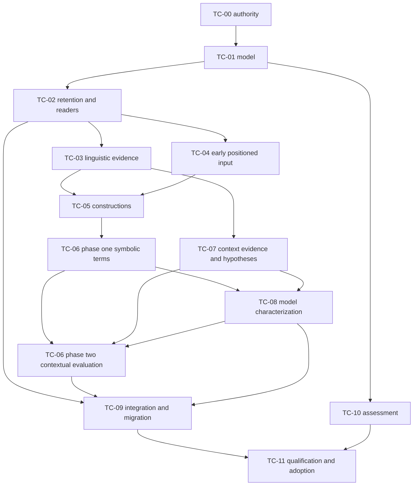

# Enriched-document text characterization implementation series

**Status: Proposed implementation series; authoring complete, execution not started · 2026-11-10.**
This coordinator owns TC-00–TC-11, TC-I01–09, O01–O07 disposition and combined completion.
Supporting plans own package design; this page owns current package state. No package is implemented
or qualified by publishing this series.

## Target and basis

Produce a combined **enriched document**, preserving the source's sections, reading order, pages,
native items, tables, figures, formulas and exact locations while adding identified linguistic,
construction, semantic and contextual layers. Analytics and conceptual enrichment consume that
representation and can add further identified layers. Document containment, annotation membership,
semantic relationships and analytical alternatives remain distinct.

The operator approved this authoring scope on2026-11-10, including the enriched-document framing,
and chose baseline delivery plus triggered conditional branches. The source is the
[functional review](../functional_reviews/text-characterization_2026-11-10.md) at `59eee893c`, O01–O07
and its full feature crosswalk, supported by the
[library collection](../library_leverage/libraries/text-characterization/briefing.md). This plan
refines the review's semantic product into document-owned layers; it does not replace the source
document with a detached text graph. [Coverage](text-characterization/coverage.md) routes every
feature row, including Supporting, Conditional and Rejected entries.

Source baseline: `59eee893c7ed7839a1aaed8a11aa12faf03a232e`, main,2026-11-10. Concurrent CLI/admission
reporting docs and evidence repairs are excluded and preserved. Existing native receipts keep their
original scope; no product/provider test, model fitting, runtime probe or benchmark was run during
plan authoring. Pinned spaCy3.8.18/en_core_web_sm3.8.0, Lark1.3.1 and SymPy1.14.0 remain the starting
selection. Provider artifact/runtime profiles are discovered from current executable declarations and source.

Use [standard.toml](../design_review/design_principles/standard.toml): core3.3, efficient-architecture
heuristics, code-intelligence1.4 and binding. Source fidelity and unknown states constrain the
semantic model; native composition and shared preparation constrain its physical realization.
The proving corpus is all518 Grinstead–Snell physical pages under
[ADR-0070](../adr/0070-full-book-method-development.md), plus the existing second-vocabulary fixture.

## Foundation assessment and shared decisions

Current annotation products retain exact token layout, morphology, dependencies, sentences and
availability; native views reconstruct them without model inference. HanLP/Maverick/Dipo and
GLiNER/d1 have existing provider operation owners. `SourceObservationBatch` and
`SourceContributionOperation` in the released observation model already retain identity, question,
outcome, coverage and zero-output operations. Reuse these owners rather than create another store
or workflow runtime. [Model/retention](text-characterization/model-and-retention.md) develops the
necessary extensions beyond today's frame/cue vocabulary.

Native SQL currently reconstructs candidate roles and reading layout as well as authenticating
source support. This is a consequential foundation change: language-producing policy moves to
primary characterization, while native custody, endpoint, coordinate and declared-invariant checks
remain independently enforced. Producer agreement alone is not an independent semantic oracle.
[Migration](text-characterization/consumer-migration-and-integration.md) owns the cutover.

The full profile attempts every selected characterization family over eligible natural sections.
It preserves native scheme disagreements, partial products, supported readings and unknowns.
Completeness describes operation/profile/scope coverage, never every conceivable English meaning.
The baseline includes new modal, scope, attribution and function tasks; current finite statistics
prompts do not already supply them. Failed required tasks remain failed/partial rather than being
silently replaced by an unselected model. Cheaper boundary-only profiles remain explicitly weaker.

A document view binds an immutable base pin and exact layer revisions. Identified cross-boundary
annotations have separately anchored members, not copied tree parents. One group over pages3–4
has one group ID and two distinct membership/source occurrences. Index membership by qualified
annotation ID; matching IDs retrieves recorded association, while the producing operation establishes
its meaning. A later topic grouping uses the same view mechanism with different semantic authority.

No new default model, graph service, generic constraint solver or task per annotation is selected.
Native Docs/trees/forests are operation-shaped working forms. Persist the useful semantics and
positions under generated released contracts, with native evidence/report bytes retained as needed.

## Reading route and execution dependencies

| Supporting plan | Responsibility |
| --- | --- |
| [Model and retention](text-characterization/model-and-retention.md) | TC-01/02: shared model, identity, release, storage, document/layer reads |
| [Native evidence](text-characterization/native-evidence.md) | TC-03/04: positioned linguistic and formal inputs |
| [Constructions and interpretation](text-characterization/constructions-and-interpretation.md) | TC-05/06: reusable constructions, forests, symbolic and contextual semantics |
| [Contextual characterization](text-characterization/contextual-characterization.md) | TC-07/08: reference/discourse and baseline model tasks |
| [Consumer migration and integration](text-characterization/consumer-migration-and-integration.md) | TC-09: consumers, native admission, ingest scheduling and retirement |
| [Assessment and investigations](text-characterization/assessment-and-investigations.md) | TC-10 and TC-I01–09: independent expectations, native/corpus assessment and conditional decisions |

TC-04's early positioned atom/constituent readers unblock TC-05; ambiguous-formal packing closes
after the TC-06 symbolic slice. TC-07 produces context evidence and hypotheses; TC-06 alone owns
semantic-node/environment evaluation. TC-08 candidate questions use frozen symbols and hypotheses,
not TC-06's final contextual answers. Source-first TC-08 work can run independently from candidate
production. Final TC-06 evaluation consumes these explicit revisions once; unresolved results remain
unknown rather than trigger an automatic fixed-point loop.

This graph describes working integration prerequisites. Independent expectation authoring starts
with settled semantics, and provider preparation can begin from an agreed input contract. TC-09's
consumer changes participate in earlier packages when needed; its completion reconciles the whole
inventory. Documents and graph nodes are not mandatory synchronization or process boundaries.

## Execution queue and current state

All rows are **planned**, with functional implementation and qualification **not_run**.

| Package | Required capability | Delivered behavior and closure |
| --- | --- | --- |
| TC-00 · Target authority | Approved implementation scope; relevant current owners | Record enriched-document authority/choice semantics through ADR and D1/D2/D3/D4/D6/D8 updates; required design/target review includes adjacent consumers. No production starts on an unaccepted boundary. |
| [TC-01](text-characterization/model-and-retention.md#TC-01) | TC-00 decision | Executable document/layer/term/choice/coverage contracts and independent valid/invalid examples |
| [TC-02](text-characterization/model-and-retention.md#TC-02) | TC-01 | Generated storage/publication, indexed membership, bounded combined reads, codecs and detached closure |
| [TC-03](text-characterization/native-evidence.md#TC-03) | Working TC-02 input/layer contract | Source-aligned spaCy/HanLP evidence layers with faithful schemes and morphology |
| [TC-04](text-characterization/native-evidence.md#TC-04) | Working TC-02 | Positioned formal constituents and opaque-atom correspondence, scientific assessment kept distinct |
| [TC-05](text-characterization/constructions-and-interpretation.md#TC-05) | TC-03 plus early TC-04 positioned-input slice | Shared matcher/grammar constructions across all selected linguistic families |
| [TC-06](text-characterization/constructions-and-interpretation.md#TC-06) | TC-05 for symbolic slice; TC-07/08 evidence for contextual closure | Packed symbolic terms, correlated choices and one owned contextual evaluator |
| [TC-07](text-characterization/contextual-characterization.md#TC-07) | TC-03 and context/source maps, relevant constructions | Referential/discourse evidence and hypothesis layers with exact examined coverage and explicit conflicts |
| [TC-08](text-characterization/contextual-characterization.md#TC-08) | TC-06 symbolic slice/TC-07 hypotheses for candidates; source-only route independently | New released GLiNER/d1 characterization tasks, structured proposals and complete family outcomes |
| [TC-09](text-characterization/consumer-migration-and-integration.md#TC-09) | Required primary layers available | Actual consumers/admission/ingest/export use combined views; duplicated language production retired |
| [TC-10](text-characterization/assessment-and-investigations.md#TC-10) | TC-01 semantics; delivered producers for execution | Independent source/output assessment and faithful native/retained controls |
| TC-11 · Assembled qualification | TC-01–10 and selected conditional outcomes | Working native full-profile pipeline, full-book coverage account, named semantic assessments, current-only cutover and complete required check union |

## Review disposition

| Review item | Component and intended correction | Disposition/dependency | Closure evidence |
| --- | --- | --- | --- |
| [O01](../functional_reviews/text-characterization_2026-11-10.md#O01) | Source/document and native-evidence owners preserve positioned units and schemes | Open · TC-01–04 | Exact source/atom maps and native availability through combined reads |
| [O02](../functional_reviews/text-characterization_2026-11-10.md#O02) | Shared primary construction owner replaces scattered recognizers | Open · TC-05/09 | Reused construction outputs and retired duplicate production |
| [O03](../functional_reviews/text-characterization_2026-11-10.md#O03) | Explicit semantic terms, operators and correlated alternatives | Open · TC-01/02/06 | Independent scope/choice expectations, packed retention and replay |
| [O04](../functional_reviews/text-characterization_2026-11-10.md#O04) | Context and model operations enrich the same document | Open · TC-07/08 | Cross-boundary support, source-first discovery and native provider evidence |
| [O05](../functional_reviews/text-characterization_2026-11-10.md#O05) | Released operation/storage/read owners serve retained primary products | Open · TC-02/09 | Indexed membership, partial layers, invalidation and detached reads |
| [O06](../functional_reviews/text-characterization_2026-11-10.md#O06) | Enrichment/admission consumers use primary semantics | Open · TC-09 | Complete migration inventory and independent native support refusals |
| [O07](../functional_reviews/text-characterization_2026-11-10.md#O07) | Evaluation/model lifecycle owners extend granular assessment | Open · TC-10/11; triggered TC-I branches | Source-first/output-first results, task-specific supervision and actual qualification |

The operator directed this series to stand on its own on2026-11-10. Existing plans are not
inputs, prerequisites or sequencing authorities for this series, and none is edited. Current
implementation, architectural contracts, the functional review and library documentation supply
the baseline. TC-00–11 own the complete new target and its implementation dependencies.

## Conditional branch state

TC-I01–09 are conditional and unscheduled at publication; none is silently adopted. Their
[decision contracts](text-characterization/assessment-and-investigations.md) define triggers,
evidence and consequences. A baseline package encountering a stated trigger activates only the
relevant bounded decision, whose outcome and affected prerequisites are recorded here. Baseline
family delivery remains required even when an optional replacement is deferred.

## Rule changes and decision route

The operator explicitly selected the enriched-document target and baseline/conditional split on
2026-11-10; this authorizes this plan's scope, not a waiver of an existing source or admission rule.
No RC-numbered rule reversal is supplied by the review, and this plan selects none. Preserve
observation-versus-knowledge authority, original source custody, protected evaluation, current-only
migration and immutable old evidence. TC-00 records the new primary meaning/producer boundary through
an ADR and owning sections. If implementation reveals an actual rule conflict, present the exact
rule and consequence for explicit disposition before depending on its reversal.

Use [ADR-0067](../adr/0067-witnessed-current-only-cutover.md) for current-contract replacement:
faithfully migrate sufficient evidence, otherwise regenerate derived closures while preserving raw
source and plans/evidence. Do not add legacy semantic execution to simplify transition. Follow the
binding's required design/target reviews before substantial ownership changes and at assembled scope;
focused authoring assessment is not a substitute. No extra recurring audit or alignment gate is added.

## TC-11 completion, adoption and next work

Complete all selected family and consumer obligations, accounting separately for source coverage,
operation settlement, semantic quality and provider failure. Do not certify English completeness
from a successful forest or model call. A full-book run must account for all selected source regions
and each family; unassessed regions remain explicit and cannot count as successful empty. Freeze
independent semantic expectations and permissible alternatives before grading. Native compatibility,
source closure, cross-boundary membership, retained replay, failure/cancellation and model/rule change
invalidation must cover the actual released profile.

Run focused tests during delivery. After complete functional scope and final maintenance, use
`uv run ci test` and `uv run ci check`, plus the applicable real-provider/native selections and
retained test-identity union. A mocked provider never qualifies native behavior. Record rustc context
for Rust results. Use `uv run ci docs check` for publication. Conditional branches close with an
adoption decision or explicit deferral; they do not force every optional producer into the baseline.
Resource experiments address actual ambiguity/residency risks, without an invented numerical target.

TC-11 prepares a qualified candidate release and regeneration from authentic source. Activation or
selection requires explicit effect authority after qualification; private staging and source capture
remain separate outcomes. Unavailable required evidence
keeps qualification open. Publication of this plan does not execute these effects.

**Next for this series:** TC-00 target authority and TC-01 executable model; independent TC-10
expectation design may proceed alongside it. No dependency on another plan is selected. Publication and product-check outcomes for this authoring
are recorded in this series; product/provider checks are not_run.

## Authoring handoff and publication · 2026-11-10

Created this coordinator and seven new supporting documents only. No existing plan or checkpoint
was edited; existing plans supplied no scope/dependency/priority decisions. Source and focused
independent design advice informed the new series. Integration corrections established one
contextual evaluator, early formal-input readiness, mandatory native attachment support checks
and baseline-plus-conditional feature routes. This advice is not the formal TC-00 target review.

- `uv run ci docs check --json`: **passed**, result `b16ad9debdea43e48aca9dc1e9b559ec`,
  866 canonical pages and zero link errors.
- `just turn-end`: **passed**; final receipt-only edits do not change the target or links.
- Read-only feature correspondence: **passed**, all164 source-review feature rows retained in
  [coverage](text-characterization/coverage.md), with package/branch routes.
- Product/provider tests, runtime probes, model training and benchmarks: **not_run**, because this
  engagement creates implementation plans. All implementation and qualification obligations remain
  planned in TC-00–11; conditional branches remain untriggered at publication.
