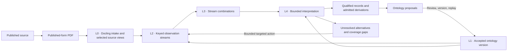

# Target pipeline design

**Proposed repository design package · 2026-11-03.** This package captures [Notion §3 · Target pipeline design](https://app.notion.com/p/40a141b5836981e8bea1fef28ec39471) from [Corpus Intelligence · Extraction models and strategies](https://app.notion.com/p/409141b5836981efb13bdd6595913a27). The November 3 milestone governs the proposed first release. The October architecture, performance audit and nine-tier design supply the broader capability map. Repository implementation references use baseline `12fcb22a4bb12dfda9a707a6c60181dd9579b381`.

| Document | Use it to find |
| --- | --- |
| [First production milestone](first-production-milestone.md) | The first five record families, source custody, shared CPU runtime, inference semantics and delivery order |
| [GLiNER2.5 deployment](gliner-deployment.md) | Checkpoints, seven schema packs, candidate/decoder contracts and runtime qualification |
| [Pipeline foundation](foundation.md) | PDF intake, seed ontology, model streams, join keys and the broader model run plan |
| [Synthesis and interpretation](synthesis-and-interpretation.md) | The nine tiers, qualified records, the worked passage and interpretation contracts |
| [Mathematics](mathematics.md) | Value and interaction, provenance, bounded inference, corpus support and escalation |
| [Rollout and evaluation](rollout-and-evaluation.md) | First-release gates, benchmark design, gap-driven expansion and the nine-stage reference rollout |
| [Design registers](registers/README.md) | Streams, all 84 combinations, interpretation components, decision types, inference templates, stages and open or decided questions |

## End-to-end architecture

L0 preserves published-form layout and evidence addresses. L1 supplies versioned meanings, signatures, roles and unit dimensions. L2 emits immutable annotations, and L3 composes them by shared keys. L4 interprets coherent alternatives, checks grounding and decides what can be accepted or requires further work. Qualified claims carry speaker, participants, modality, polarity, conditions, time and scope where relevant. Keeping those distinctions permits later comparisons between statements made under equivalent conditions, citation-aware support counts, and checks of measurements against applicable requirements. [Architecture overview](https://app.notion.com/p/40b141b5836981be9f4fe5e79d730845)

Model execution follows data dependencies. The nine tiers describe what compositions produce, and the historical stages group build and evaluation work. A tier-3 decision can use later relation evidence within a bounded inference component. Run independent observations in parallel where the inputs permit. Preserve effective inputs for each cache entry, including schema, window, provided mentions and ontology dependencies. Changes to joins can reuse observations, while altered inputs trigger targeted inference. Identical text can reuse context-independent computation with each occurrence retaining its own evidence and attribution. Earlier streams route and gate, condition candidates, corroborate with dependence accounted for, or lift occurrences to higher-level identities and claims. The long dependency chains make alternatives, lineage and precise hard-gate premises essential. [Architecture overview](https://app.notion.com/p/40b141b5836981be9f4fe5e79d730845)

## Design standing and repository boundary

| Standing | What it means here |
| --- | --- |
| Decided in Notion | PDF-only intake through Docling, October 30 performance-based stack decisions and the interpretation-layer contracts. Published-form resolution, rendering choices and other unsettled L0 details retain their question status. |
| Proposed first release | The November 3 milestone downstream of selected Docling/Nemotron views. It starts with the existing spaCy path and one GLiNER2.5 boundary checkpoint. The earlier broader stack and sequential rollout are reference material for expansion. |
| Prototyped | Stage-1 machinery and the numeric/condition template on a reference branch. The prototype's dependence and unit-selection heuristics require the milestone corrections before production use. |
| Repository baseline | The checkout contains owned source-view selection, observation binding, qualification-aware consolidation and finite inference. [STATUS](../../STATUS.md) and the [unified domain model plan](../plans/unified-domain-model_2026-11-01.md) own current implementation and qualification evidence. The first-release CPU interpretation path requires its own qualification. |

The [repository architecture map](../design/README.md), [binding design](../design/DESIGN.md), [ADR index](../adr/README.md) and active plans retain their existing authority. This package is a traceable design proposal for repository review. Evidence labels in the source registers describe their original claims and experiments. They do not promote the package or establish E3 local execution or E4 corpus evaluation for the proposed release. [Notion target design standing](https://app.notion.com/p/40a141b5836981e8bea1fef28ec39471) · [First production milestone](https://app.notion.com/p/40d141b58369818ca7cff992a52c7d6e)
