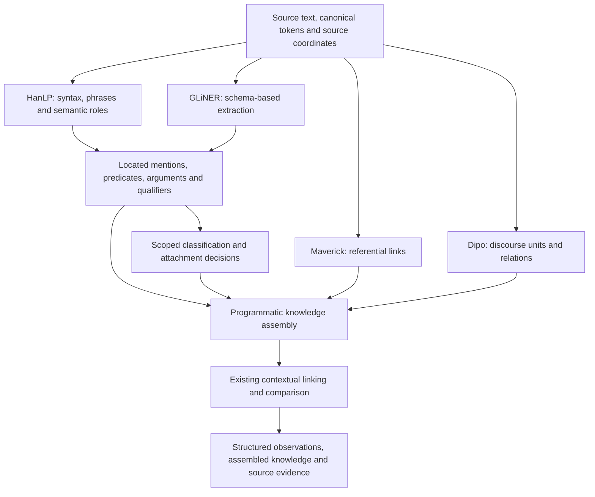
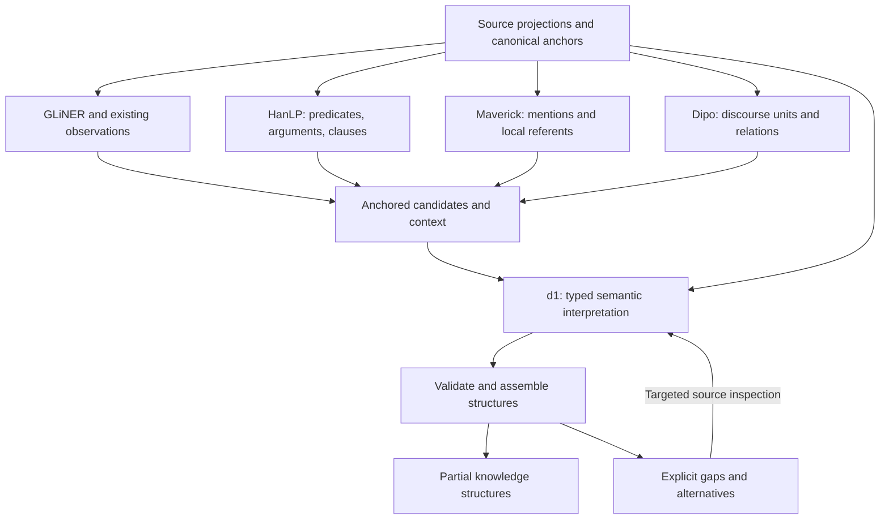

**Yes. I would make HanLP the common linguistic model and target three new production model families: HanLP, Maverick, and Dipo. GLiNER2.5-Decide would be a conditional fourth addition, because your existing GLiNER model already supports classification.**

That gives each addition a distinct job:

- **HanLP:** describe the linguistic structure within sentences.
- **Maverick:** connect references to the same thing across sentences.
- **Dipo:** describe how clauses and passages relate to one another.
- **GLiNER classification, optionally upgraded to Decide:** assign application-specific meanings to passages and proposed structures.

The recent-model research also produced two particularly relevant findings: **UltraBERT is a promising foundation for training the transformations your application specifically needs**, and **KNIV v7 already demonstrates a broader set of trained extraction heads on a shared encoder, including an UltraBERT variant**.

I rechecked the repository; the current head remains [commit `67cbe680`](https://github.com/paul-heyse/corpus-structure/commit/67cbe680e7ab2b9860576f2ed650d4ff22e0f990). The design below builds on its existing source anchoring, observations, contextual retrieval, and granular assessment contracts described in the [method catalog](https://github.com/paul-heyse/corpus-structure/blob/67cbe680e7ab2b9860576f2ed650d4ff22e0f990/docs/design/D4-method-catalog.md).

# Part I — The production milestone-2 target

## 1. The target model set

| Component | Input unit | Additional structure | Normal use |
|---|---|---|---|
| **HanLP English ModernBERT** | Canonically tokenized sentences | Lemmas, POS, dependencies, constituent boundaries, predicate–argument roles; supplementary NER and semantic dependencies | Broadly across eligible English prose |
| **Maverick MES OntoNotes** | Coherent sections represented as sequences of tokenized sentences | Document-local mention clusters and referential links | Connected prose, including repeated names and descriptions |
| **Dipo DMRST with Ettin-400M, trained on GUM** | Connected paragraphs or bounded sections | Elementary discourse units and rhetorical relationships | Explanations, policies, procedures, arguments, and other passages with multiple clauses |
| **Existing GLiNER2.5 classification; optionally Decide** | An anchored passage or proposed proposition plus a classification schema | Information function, procedural status, modality categories, other application labels | Where an explicit interpretation or routing decision is required |
| **Existing GLiNER2.5 extraction** | Source passages plus domain schemas | Domain-specific mentions, attributes, relations, and grouped records | Continues as an existing extraction stream |
| **Existing embedding profiles** | Located occurrences and contextual descriptions | Candidate semantic links and similarity evidence | Continues as an existing linking stream |

The first three are the new production model families. The remaining rows explain how they fit into what you already have.

A useful functional arrangement is:



The streams can run independently where their inputs are available. A sentence that produces no GLiNER record should still receive linguistic analysis, and a passage with unresolved references should still retain its valid predicates and phrases.

## 2. HanLP: the common linguistic model

### Model and deployment choice

I would use the following as the **quality-oriented target checkpoint**:

`EN_TOK_LEM_POS_NER_SRL_UDEP_SDP_CON_MODERNBERT_LARGE`

The corresponding `...MODERNBERT_BASE` checkpoint should be the smaller execution profile when CPU throughput is the determining consideration. Given your RTX 5090, I would qualify Large first for offline corpus enrichment and compare Base against the same structural examples.

Both English checkpoints combine the relevant linguistic tasks in one multitask model. [HanLP Documentation](https://hanlp.hankcs.com/docs/api/hanlp/pretrained/mtl.html?utm_source=chatgpt.com)

The consolidation is substantive. HanLP’s implementation shares an encoder and reuses its representations across requested task decoders within each internal batch. There are still separate decoders and structured inference costs, so “one model” does not mean one cost-free operation over an entire book. See the [multitask implementation](https://github.com/hankcs/HanLP/blob/master/hanlp/components/mtl/multi_task_learning.py).

### Inputs

The application should provide:

- Sentences with the **existing canonical token boundaries**.
- A mapping from every token to its original source coordinates.
- Document, section, and source-view identifiers.
- References to protected formula, identifier, and citation atoms.
- The selected model profile and requested task set.

Use pretokenized sentence input and skip HanLP’s tokenizer:

```python
import hanlp
from hanlp.pretrained import mtl

model = hanlp.load(
    mtl.EN_TOK_LEM_POS_NER_SRL_UDEP_SDP_CON_MODERNBERT_LARGE,
    devices=0,
)

annotations = model(sentence_tokens, skip_tasks="tok*")
```

This illustrates the library entry point. The production adapter should inspect and pin the checkpoint’s task names, then request the configured subset. HanLP documents sentence-level and pretokenized input, along with its output conventions. [HanLP Documentation](https://hanlp.hankcs.com/docs/data_format.html?utm_source=chatgpt.com)

### Outputs and their application roles

I would normalize the results into the following observation families:

| HanLP output | Normalized representation | What it enables in Corpus Structure |
|---|---|---|
| **Lemmas and POS** | Token annotations | Stable lexical forms, candidate heads, distinguishing noun/verb/adjective uses |
| **Dependency parse** | Typed arcs between token IDs | Modifier attachment, complements, coordination, grammatical relationships |
| **Constituency parse** | Nested spans with constituent labels and parent IDs | Complete phrase boundaries, nested clauses, qualifier and argument extents |
| **Semantic-role labeling** | Predicate spans with argument spans and native role labels | Event/state structure and participant candidates |
| **NER** | Typed mention spans | Supplementary general entity evidence alongside GLiNER’s domain schema |
| **Semantic dependency parsing** | Labeled graph arcs with the formalism recorded | Additional semantic relationship candidates |

HanLP’s native dependency heads use a root/index convention that the adapter must normalize. Its SRL output uses predicate-grouped span tuples, while constituency output is a tree whose leaves must be aligned to the supplied tokens. [HanLP Documentation](https://hanlp.hankcs.com/docs/data_format.html?utm_source=chatgpt.com)

The application-level transformations are where much of the value will arise. For example:

- A constituency span proposes the full extent of a definition or argument.
- Dependency arcs suggest which predicate a qualifying clause modifies.
- SRL provides another account of the predicate and its participants.
- GLiNER supplies domain-specific types for those participants.
- Assembly combines those observations into a richer, still source-grounded structure.

**Keep the native linguistic label alongside the application interpretation.** An SRL `ARG0` should not automatically become `owner`, `actor`, or `responsible_team`; its interpretation depends on the predicate and context.

### Conditionality

I would make the core HanLP analysis broad:

- Run on eligible English prose, including prose with inline formulas.
- Consume POS, lemmas, dependencies, constituency, and SRL as the initial standard outputs.
- Retain NER as supplementary evidence where useful.
- Introduce semantic dependency mappings selectively, beginning with a clearly defined use for a formalism such as DM.
- Keep pure equations, code, and nonlinguistic table cells on their existing specialized routes.

A valid constituency observation remains useful even if SRL misses the predicate. Successful production should not require every head to contribute.

### How spaCy fits after this change

Keep spaCy’s tokenization, document structures, matchers, and existing rules where they remain useful.

The important migration is **dependency conventions**. HanLP’s Universal Dependencies output cannot simply be substituted into rules written for spaCy’s current English dependency representation. The differences include head selection as well as labels.

I would therefore:

1. Add HanLP observations alongside the retained annotations.
2. Implement explicit transformations that consume HanLP’s dependency and constituency representations.
3. Migrate existing rules operation by operation.
4. Disable redundant statistical parsing where those migrations have been verified.

This preserves the benefit of consolidation without silently changing the meaning of existing rules.

## 3. Maverick: reference resolution across sentences

### Exact target

**Checkpoint:** `sapienzanlp/maverick-mes-ontonotes`  
**Library:** `maverick-coref`

This is an English coreference model with a released checkpoint and a direct Python inference interface. [Hugging Face](https://huggingface.co/sapienzanlp/maverick-mes-ontonotes?utm_source=chatgpt.com)

### Inputs

Give Maverick a coherent section as:

```text
List of sentences
    → each sentence is a list of canonical tokens
    → every token retains its original source mapping
```

Include speaker information when the source actually provides it, such as a conversation or meeting transcript.

Do not restrict its mention inventory to GLiNER entities. That would risk excluding pronouns, descriptive noun phrases, and other expressions that are essential to reference resolution.

### Outputs

Normalize its clusters into:

```text
Coreference observation
  document/section scope
  cluster identifier
  member mention spans
  model and input provenance
```

Each mention retains its own source span. Assembly can then associate an argument expressed as “it” with a previously mentioned service, request, or document.

**These are document-local referential links.** Cross-document identity and concept equivalence remain separate decisions.

### A specific implementation detail to get right

Maverick’s implementation returns **inclusive token intervals**. Convert them to your canonical interval convention before mapping them to source coordinates.

I would also use its pretokenized-input route. Its raw-text preprocessing reconstructs character offsets using assumptions about sentence separators; supplying your own tokens and source map avoids making those assumptions part of your evidence chain. These behaviors are visible in the [prediction and preprocessing implementation](https://github.com/SapienzaNLP/maverick-coref/blob/main/maverick/models/maverick_model.py).

### Conditionality

Run it on connected prose in coherent section windows. This should include passages without pronouns, because repeated names and descriptions can also refer to the same thing.

For long sections:

- Use overlapping windows with recorded boundaries.
- Reconcile predictions through the **same source mentions** in the overlap.
- Preserve unresolved alternatives when the windows disagree.
- Record which relationships could not have been considered because they crossed the available context.

Coreference should enrich existing observations; unresolved references should not erase them.

## 4. Dipo: relationships between clauses and passages

### Exact target

**Checkpoint:** `larc-iu/dmrst-ettin-400m-gum-12.1.0`  
**Library:** `dipo`

This is a DMRST discourse parser built on Ettin-400M and trained on the multi-genre English GUM corpus. Its training genres include academic material, interviews, textbooks, and how-to content, which makes it a reasonable starting point for your broader company-knowledge objective. [Hugging Face](https://huggingface.co/larc-iu/dmrst-ettin-400m-gum-12.1.0?utm_source=chatgpt.com)

### Inputs

Use the original connected text of a paragraph or bounded section, retaining paragraph boundaries and a map back to the canonical source.

The relevant API is:

```python
from dipo.rst.parsers.dmrst.modeling_dmrst import DMRSTParser

parser = DMRSTParser.from_pretrained(
    "larc-iu/dmrst-ettin-400m-gum-12.1.0",
    device="cuda",
)
tree = parser.predict_from_text(section_text)
```

### Outputs

Dipo produces:

1. **Elementary discourse units:** the clause-like units used by the parser.
2. **A discourse tree:** relationships between those units or groups of units.
3. **Nuclearity:** whether a side is central or supporting within the rhetorical structure.

The model’s relation inventory includes conditions, elaboration, attribution, evidence, purpose, cause/result, and sequence. [Hugging Face](https://huggingface.co/larc-iu/dmrst-ettin-400m-gum-12.1.0?utm_source=chatgpt.com)

I would store:

```text
Discourse relation observation
  left EDU range
  right EDU range
  source spans for both ranges
  native relation
  nuclearity
  model and input provenance
```

This can help assemble:

- A statement with its explanation.
- A procedure step with its purpose.
- A proposition with a condition expressed nearby.
- A claim with the passage presented as its evidence.
- A sequence of described activities.

A rhetorical `cause` or `sequence` label supplies evidence about the text’s organization. The subsequent transformation determines whether that supports a causal assertion or workflow relationship.

### Required adapter work

Dipo already computes mappings through its whitespace normalization, but its standard public result returns the discourse tree and EDU text rather than the original character offsets.

I would make a small wrapper or upstream extension that **returns the existing source-aligned EDU boundaries alongside the tree**. The relevant calculations are already present in [the inference implementation](https://github.com/larc-iu/dipo/blob/master/dipo/rst/parsers/dmrst/modeling_dmrst.py); [the tree API](https://github.com/larc-iu/dipo/blob/master/dipo/rst/data/tree.py) supplies EDU ranges.

This is preferable to searching the source for returned EDU strings, which becomes ambiguous when text repeats.

### Conditionality and expected standing

Apply Dipo to connected explanatory, procedural, argumentative, and policy prose with multiple discourse units. Do not require an explicit connective such as “because” or “however”; implicit relationships are part of the reason to use it.

Its published GUM test results distinguish segmentation F1 of **94.5** from complete raw-text discourse-structure F1 of **45.6**. That difference supports treating segmentation, attachment, nuclearity, and relation labeling as separately assessable outputs. [Hugging Face](https://huggingface.co/larc-iu/dmrst-ettin-400m-gum-12.1.0?utm_source=chatgpt.com)

I would retain useful discourse observations with their standing visible, and promote specific mappings into assembled structures as those mappings prove reliable.

## 5. GLiNER classification and the conditional Decide addition

The existing GLiNER2.5 family already provides classification alongside extraction. **Decide is a separately trained classification specialist**, with caller-supplied label sets and support for multiple classification tasks in one call. [Hugging Face](https://huggingface.co/fastino/GLiNER2.5-Decide?utm_source=chatgpt.com)

### Proposed inputs

An anchored passage or isolated proposition, plus versioned label definitions.

Examples of useful classification tasks:

| Task | Example labels |
|---|---|
| Information function | Definition, explanation, example, instruction, evidence, exception |
| Procedural status | Prescriptive, descriptive, hypothetical, historical |
| Deontic force, where the proposition is sufficiently isolated | Required, permitted, prohibited, unspecified |
| Assembly routing | Candidate policy statement, procedure step, concept description, supporting context |

### Outputs

Store the selected labels, any exposed scores, the classification schema version, and the source span being classified.

A passage label should not establish the scope of a condition or negation. That scope must still be attached to the relevant proposition using the linguistic and structural evidence.

### When to introduce Decide

My concrete sequence would be:

1. Express the required classifications through the GLiNER capability already deployed.
2. Compare `fastino/GLiNER2.5-Decide` on the specific classes that remain problematic.
3. Deploy it for those classes or content slices when the granular results justify it.
4. Expand its routing only when broader use demonstrates additional value.

Use `gliner2[local]` and `AutoExtractor`. Where cross-task constraints are appropriate, use the library’s `Classifier` and `ClassificationSchema` interfaces. Constraints should encode actual schema invariants; linguistic tendencies belong in scores or features. The library documents these classification facilities in its [README](https://github.com/fastino-ai/GLiNER2/blob/main/README.md).

## 6. The shared implementation contract

The important integration work is a common boundary between model outputs and the knowledge representation.

### Inputs to every worker

Each request should carry:

```text
Source document/version and source-view ID
Exact source window and its content hash
Canonical token/sentence map, where applicable
Mappings for protected source atoms
Requested tasks or classification schema
Model checkpoint revision
Adapter/configuration version
```

### Outputs from every worker

Each observation should carry:

```text
Observation kind
Exact source anchors
Native model labels
Normalized fields, where a mapping is defined
Model/input/adapter provenance
Score, only when actually exposed
Alignment and coverage status
```

Keep these outcomes distinct:

- Not applicable.
- Not scheduled.
- Failed.
- Input exceeded the supported scope.
- Ran successfully and found no observations.
- Ran successfully and produced observations.

That distinction prevents missing coverage from masquerading as negative evidence.

Also, standard Maverick clusters and Dipo trees do not expose a calibrated probability for every relationship. A nullable score is preferable to an invented confidence value.

### Assembly should retain multiple useful levels

For the illustrative passage:

> “If Security approves the release, the deployment team may deploy it. The team must record the deployment.”

The desired layers would be:

| Layer | Desired contribution |
|---|---|
| HanLP | Predicates, participant spans, the conditional clause, the modal expressions, phrase boundaries |
| GLiNER | Domain types such as team, release, deployment activity |
| Maverick | Links from “it” to “the release” and “The team” to “the deployment team” |
| Dipo | A condition relationship and other relevant discourse organization |
| Classification and assembly | Permission to deploy, approval as a condition, an obligation to record, each with its supporting spans |

This is an illustration of the target representation, not a prediction I have run.

If the condition attachment remains uncertain, the predicates, participants, mention links, and modal cues should still be available. This preserves the incremental structuring objective you have emphasized.

### A mathematical consequence of consolidation

HanLP’s heads share representations, so their agreements are **correlated evidence**. Three agreeing heads should not be treated as three independent confirmations whose probabilities can simply be multiplied.

I would retain their outputs as distinct features for each assembly operation, then assess or calibrate that operation using its own reviewed cases. The existing fitting machinery can support this progression without requiring a Bayesian model before the structural outputs become useful.

## 7. Libraries and deployment arrangement

| Function | Deployment libraries | Application-specific work |
|---|---|---|
| HanLP linguistic analysis | **`hanlp`, PyTorch, Transformers**; ModernBERT checkpoints document Transformers ≥4.48 | Canonical-token adapter, output normalization, UD-aware transformations |
| Coreference | **`maverick-coref`** and its runtime dependencies | Source-window management, inclusive-span conversion, local cluster integration |
| Discourse parsing | **`dipo`, PyTorch, Transformers** | Expose original EDU offsets; normalize tree edges and nuclearity |
| Schema extraction and classification | Existing **`gliner2[local]`** | Versioned schemas, classification routing, optional Decide profile |
| Embedding and candidate retrieval | Existing **Sentence Transformers** profiles and retrieval infrastructure | Consume richer concept, predicate, and passage descriptions |
| Contracts and persistence | Existing **LinkML/Pydantic, native storage, task and observation infrastructure** | Register the new observation types and transformations |

Use the ordinary HanLP installation for this target; its broader extras bring in unrelated components. Its dependency declarations are in [the package configuration](https://github.com/hankcs/HanLP/blob/master/setup.py).

I would give providers separately pinned environments where their requirements warrant it. Maverick’s [dependency declarations](https://github.com/SapienzaNLP/maverick-coref/blob/main/setup.py), for example, include older fixed packages. That is a concrete reason for worker isolation, rather than changing the main application’s Python version.

For your machine, I would:

- Keep model weights loaded for batches of work.
- Schedule GPU stages so they share the 5090 deliberately.
- Batch sentences for HanLP and coherent sections for the other models.
- Keep context limits and overlap policies explicit.
- Measure latency, memory, coverage, and structural errors before choosing CPU/GPU or quantized profiles.

PyTorch is the initial reference runtime. Exporting the complete structured decoders to another runtime should be a later optimization with output checks.


Yes. **I would make d1-2B a core semantic interpretation component of milestone 2, and expand the design around the structures that the four models can jointly produce.** The documentation supports several meaningful improvements: richer clause and qualification handling from HanLP, better document-level coreference from Maverick, more useful discourse composition from Dipo, and a much broader role for d1 than simply approving or rejecting existing extractions.

The central design goal should be:

> **Produce progressively richer, source-grounded representations of statements, actions, participants, conditions, exceptions, purposes, and references—with explicit uncertainty and granular assessment at every transformation.**

I reviewed all four supplied guides, including the technical addenda, and checked consequential capabilities against implementation code. I also checked the repository at [commit `ffab51d`](https://github.com/paul-heyse/corpus-structure/commit/ffab51d4dbaadff77b3093c54a71760c38084c57). Its recent work on source projections, derivation witnesses, and interpretation admission provides an appropriate foundation for these additions.

The recommendations below draw on the supplied Liquid_AI_d1-2B.md[d1-2B guide](sandbox:/workspace/scratch/a4905f797a7a/upload/Liquid_AI_d1-2B.md), HanLP.md[HanLP guide](sandbox:/workspace/scratch/a4905f797a7a/upload/HanLP.md), maverick-coref.md[Maverick guide](sandbox:/workspace/scratch/a4905f797a7a/upload/maverick-coref.md), and dipo.md[Dipo guide](sandbox:/workspace/scratch/a4905f797a7a/upload/dipo.md). This is a design and source-code review; corpus-specific accuracy, calibration, and RTX 5090 throughput still need to be measured.

## 1. The revised milestone-2 architecture

I would retain the four-model addition:

| Component | Target model | Primary responsibility | Principal output |
|---|---|---|---|
| **HanLP** | English ModernBERT Large multitask checkpoint | Linguistic structure within sentences | Predicates, argument spans, clauses, syntactic attachments, lexical annotations |
| **Maverick** | `sapienzanlp/maverick-mes-ontonotes` | Document-local reference resolution | Mention inventories and proposed local referent clusters |
| **Dipo** | `larc-iu/dmrst-ettin-400m-gum-12.1.0` | Relationships between discourse units | Anchored EDUs, discourse constituents, nuclearity, rhetorical relations |
| **Liquid AI d1** | `LiquidAI/d1-2B` | Bounded semantic interpretation and targeted extraction | Typed decisions, source-grounded values, candidate selections, unresolved outcomes |

Existing GLiNER extraction, spaCy processing, terminology matching, embeddings, and analytical methods remain part of the pipeline. The four additions should consume and enrich that existing evidence.

With d1 included, **I would remove a separate GLiNER Decide addition from the initial M2 target**. Existing GLiNER classification can continue where it is already useful, but another general decision model should require a demonstrated advantage on a specific operation.

The functional architecture becomes:



The direct source-to-d1 connection is deliberate. **d1 must be able to identify missing structure from source material, not merely choose among structures that other parsers already found.**

### What changes materially

I would make six revisions to the previous design:

1. **Make predicate frames, clause scopes, and qualified statements first-class products.** A subject–predicate–object triple is often too small to preserve an operational rule.
2. **Use d1 routinely for semantic interpretation**, including modality, scope, role mapping, and relation meaning—not only on exceptional failures.
3. **Target document-level reference and discourse processing**, using the models’ internal segmentation mechanisms where qualified.
4. **Build explicit composition operations between model outputs.** Merely storing four annotation layers leaves much of their value unused.
5. **Use supplied-mention and supplied-EDU modes to diagnose errors separately.**
6. **Treat source alignment, score access, and supported execution modes as implementation work.** Several useful capabilities exist below the public APIs and need a small, maintained adapter.

---

## 2. Give d1 a substantial, precisely bounded role

The most important addition is a **versioned collection of semantic decision and extraction tasks**.

d1 supports dynamic choices, independent multilabel decisions, ordinal scoring, source-grounded text/number/date extraction, and visual grounding. These are directly relevant to interpreting company knowledge. Its native API returns typed answers rather than requiring the application to parse generated prose. [Liquid AI Docs](https://docs.liquid.ai/lfm/models/d1-2b?utm_source=chatgpt.com)

I would implement the following task families.

### 2.1 The production decision and extraction tasks

| Task family | Inputs | d1 operation | Output and conditionality |
|---|---|---|---|
| **Passage function and missing-structure detection** | Original passage, heading context, content-type metadata | Multilabel classification | Definition, operational instruction, requirement, permission, exception, explanation, example, observation, etc. Run a compact source-only pass over eligible passages, including passages where other extractors found little. |
| **Predicate-frame interpretation** | Source clause, HanLP predicate/arguments, GLiNER spans | Choices and multilabel decisions | Proposed domain roles, statement type, modality, polarity, and whether the frame describes an event, requirement, possibility, or hypothetical situation. Apply to relevant extracted frames. |
| **Qualification and scope attachment** | Qualifier span, candidate host frames, surrounding clauses and discourse context | Candidate choice, with explicit multiple-host options where appropriate | Which action or claim a condition, exception, deadline, restriction, or negation qualifies. Run where qualification exists or competing attachments remain. |
| **Referent disambiguation and repair** | Unresolved mention, candidate antecedents, relevant source context | Candidate choice and optional targeted text extraction | Selected mention/referent ID, rejection of supplied candidates, or unresolved result. Run for ambiguous or structurally important unresolved references. |
| **Relation interpretation** | Two source-backed structures, retrieved context, candidate relation definitions | Choice or independent applicability questions | Same entity, same concept, broader/narrower concept, prerequisite, purpose, support, contrast, or another explicitly defined relation. Use separate task schemas for different relation families. |
| **Targeted extraction and completion** | Source passage plus a narrowly defined missing field | `text`, `number`, or `date` | An anchored candidate value, or a missing/unresolved outcome. Use for absent participants, conditions, evidence spans, attributes, or definition components. |
| **Cross-document link assessment** | Embedding/lexical candidates, their source contexts and scope metadata | Task-specific comparison | Candidate link type and distribution, including no compatible candidate. Run after retrieval; preserve retrieval and decision results separately. |
| **Visual interpretation** | Exact retained page/crop, relevant text, specific question | Choice, `box`, or `boxes` | Candidate visual classification or location. Enable only when a nominated ambiguity actually requires visual evidence. |

These tasks should have stable names and versions—for example, `qualification_scope_v1`, `normative_force_v1`, and `local_referent_choice_v1`—with explicit input contracts, label definitions, and evaluation fixtures.

The taxonomy should remain reasonably orthogonal. For example, these are different dimensions:

- **Statement kind:** instruction, definition, description, observation.
- **Normative force:** required, permitted, prohibited, recommended, unspecified.
- **Polarity:** affirmative, negative.
- **Epistemic status:** asserted, uncertain, hypothetical, attributed.
- **Applicability:** condition, exception, temporal scope, organizational scope.

Combining all of them into one enormous classification label would make both interpretation and evaluation harder.

### 2.2 Preserve source evidence separately from candidate descriptions

This is a particularly important consequence of d1’s typed extraction API.

Its extraction spans refer to the **rendered input state**. For JSON input, it can return a JSON Pointer, but the character offsets belong to the model’s serialization—not automatically to the original document. The released [pointer implementation](https://huggingface.co/LiquidAI/d1-2B/blob/652f920e544ea37f81e4b0ce89b81d4ed0da90b1/pointer.py) also limits each extraction to a bounded contiguous span.

I would construct d1 inputs with two explicitly separated parts:

- **Source evidence:** immutable text segments with source identifiers and reversible mappings.
- **Hypotheses:** candidate IDs, proposed attachments, existing annotations, and their provenance.

Then enforce these rules:

1. An extracted evidence span must map into an allowed **source-evidence field**.
2. Text extracted from a candidate description cannot become independent supporting evidence.
3. Retain the exact rendered state and its mapping.
4. Validate the extracted text against the mapped original slice.
5. Keep a classification decision distinct from the evidence span requested alongside it.

This prevents a subtle circularity: a candidate says “this is an exception,” d1 extracts that candidate description, and the pipeline mistakenly treats it as source evidence for an exception.

### 2.3 Use extraction to improve recall, without implying exhaustive extraction

d1 is useful for questions such as:

- “Which words state the exception to this requirement?”
- “What source phrase identifies the responsible role?”
- “What duration applies to completing this action?”
- “Which passage states why this restriction exists?”

However, one typed text answer is not an exhaustive enumeration of every matching span.

I would therefore use two complementary approaches:

- **Candidate-centered interpretation:** ask focused questions about each known frame or structure.
- **Source-centered discovery:** inspect passages independently for structure that existing extractors missed, then perform targeted extraction where indicated.

For repeated items, operate over explicit clauses or bounded source regions and record which regions were inspected. An omitted value must remain distinguishable from a supported conclusion that the value is unstated.

That aligns with the repository’s current [record assembly behavior](https://github.com/paul-heyse/corpus-structure/blob/ffab51d4dbaadff77b3093c54a71760c38084c57/python/corpus-structure/src/corpus_structure/methods/record_assembly.py), which already distinguishes decoder omission from an explicit source-state assessment.

### 2.4 Preserve the semantics around numbers and dates

Typed numeric and date extraction is useful for company workflows: thresholds, retention periods, deadlines, limits, effective dates, and approval amounts.

The output must preserve more than the normalized value:

```text
original phrase
extracted value and unit
comparison operator
duration or calendar-date interpretation
reference event, if relative
applicable action or claim
source anchors
```

For example, “within one business day after approval” is not adequately represented as `1 day`.

The native reader can find a span while failing to parse its value; that should remain a useful anchored observation. Liquid’s documentation explicitly distinguishes extraction from conversion and computation. [Liquid AI Docs](https://docs.liquid.ai/lfm/models/decision-models?utm_source=chatgpt.com)

### 2.5 Use the multiquestion API correctly

Group independent questions about the same context, and batch separate contexts with `system_one_batch`. The default trained question-group size is 16; larger groups involve an accuracy tradeoff. Questions that depend on previous answers require an explicit subsequent call. [Hugging Face](https://huggingface.co/LiquidAI/d1-2B?utm_source=chatgpt.com)

A practical sequence would be:

1. Interpret the passage and its existing frames.
2. Inspect the returned decisions programmatically.
3. Request missing evidence or resolve particular ambiguities.
4. Assemble the resulting structure.

I would begin with compact local context, adding the parent clause, relevant discourse sibling, section heading, or antecedent passage when needed. The advertised context capacity should not become a reason to send an entire book to every question.

---

## 3. Expand HanLP into a common linguistic observation layer

The English ModernBERT checkpoint supplies substantially more than SRL: lemma, POS, NER, UD dependencies, constituency, and semantic dependencies in DM/PAS/PSD formalisms. These heads are trained on English corpora. [HanLP Documentation](https://hanlp.hankcs.com/docs/api/hanlp/pretrained/mtl.html?utm_source=chatgpt.com)

I would deploy:

`EN_TOK_LEM_POS_NER_SRL_UDEP_SDP_CON_MODERNBERT_LARGE`

The Base checkpoint remains a measured alternative if CPU throughput becomes a priority.

### 3.1 Make constituency a normal part of the useful output

I would elevate constituency from a peripheral feature to a standard part of the ordinary prose profile.

Its value is practical:

- Expand an argument from its head word to the appropriate noun phrase.
- Identify subordinate clauses.
- Preserve nested qualification boundaries.
- Generate competing attachments for coordinated phrases.
- Construct better evidence windows for d1.
- Distinguish a condition attached to one predicate from a clause affecting a larger construction.

The proposed baseline profile is:

**Lemma + POS + UD dependency + SRL + constituency**, with NER retained as supplementary mention evidence.

The worker should choose its profile before inference where possible. HanLP reuses encoder output across heads within one invocation, but a subsequent call for additional heads re-encodes the input. That behavior is visible in its [multitask implementation](https://github.com/hankcs/HanLP/blob/master/hanlp/components/mtl/multi_task_learning.py).

### 3.2 Add explicit transformations from annotations to candidates

These transformations are application code we should build:

| Transformation | Evidence used | Produced structure |
|---|---|---|
| Predicate-frame construction | SRL, lemma, dependencies | Predicate occurrence with native argument/modifier spans |
| Participant attachment | Argument spans, GLiNER/HanLP mentions, phrase boundaries | Links from frame arguments to mention candidates |
| Qualification discovery | Clauses, dependencies, modifiers, lexical cues | Candidate conditions, exceptions, negation, modality, time, attribution |
| Coordination analysis | Coordinated phrases/predicates and their boundaries | Alternatives for shared versus separate participants and qualifiers |
| Referential enrichment | Argument mentions plus Maverick results | Frame participants connected to local referents |
| Semantic-graph augmentation | Selected SDP formalism | Additional or alternative semantic attachment candidates |

**Keep native linguistic roles and domain roles separate.** `ARG0` is not universally “the business actor,” and `ARG1` is not universally “the object being acted upon.” The mapping depends on the predicate and construction.

Likewise, do not replace spaCy dependency labels with HanLP labels inside existing rules without an explicit conversion. Existing rules may encode assumptions about a different dependency scheme.

### 3.3 Use semantic dependencies deliberately

DM, PAS, and PSD should remain separate namespaces. They encode different semantic analyses.

My recommendation is:

- Retain support for all three in the adapter.
- Run them on a stratified diagnostic set.
- Select a named formalism and mapping for each production transformation that proves useful.
- Enable additional heads conditionally for structures where they recover useful missing links.

A useful question is: **Does a particular SDP head recover a correct participant or attachment that SRL plus syntax missed?** Agreement between three heads is less informative if they simply restate the same evidence.

### 3.4 Add terminology evidence without changing canonical token identities

The guide’s trie and dictionary capabilities are useful immediately.

Use overlapping terminology matches to add:

- Company-specific role names.
- Product and system names.
- Multiword business concepts.
- Reviewed aliases and abbreviations.
- Protected technical identifiers.

Store them as separately anchored spans with dictionary provenance.

Avoid merging canonical tokens after other annotations have been created. Similarly, splitting a sentence around a protected formula or identifier and concatenating the parse results does not restore relationships that crossed the removed span.

Hard dictionary overrides should be limited to reviewed, unambiguous cases and remain distinguishable from model predictions.

### 3.5 Record actual checkpoint capabilities

At startup, inspect the loaded task classes, label vocabularies, dependencies, decoding settings, and alignment conventions.

This avoids conflating framework capabilities with trained capabilities. For example:

- The selected English checkpoint does not advertise the separate morphology head found in some other HanLP models.
- Nested NER support in the framework does not mean the selected checkpoint becomes an effective nested recognizer through a flag change.
- Syntactic and semantic constraints need to be appropriate to the particular formalism.

These are useful future adaptation paths, but they are not additional pretrained capabilities we can assume today.

---

## 4. Improve Maverick’s document coverage and controlled inference

Maverick’s job should be **document-local referential structure**: linking names, pronouns, and nominal descriptions that refer to the same discourse entity.

That structure is especially useful when it connects HanLP frame arguments to better identified participants. It should not automatically establish cross-document identity or concept equivalence.

### 4.1 Preserve a complete referential mention inventory

Use sentence-tokenized input with the project’s canonical token mapping. This avoids reconstructing character positions from the wrapper’s raw-text preprocessing.

Preserve overlapping and nested mentions. A coreference mention inventory should not be constrained to nonoverlapping named entities.

The ordinary path should perform both mention discovery and clustering. Do not route only documents containing obvious pronouns: descriptions such as “the approver,” “the affected service,” and “this request” are also important.

The public API supports supplied mentions, speakers, singleton handling, and initial clusters. Their semantics need to be kept distinct. [SapienzaNLP/maverick-coref · GitHub](https://github.com/SapienzaNLP/maverick-coref?utm_source=chatgpt.com)

### 4.2 Target segmented encoding with joint clustering

This is a meaningful correction to a simple chunk-and-merge design.

Maverick’s MES implementation contains a path that:

1. Encodes document segments.
2. Extracts and retains mention representations.
3. Maps mentions into document coordinates.
4. Clusters the collected mentions jointly.

This is a better target for long cohesive documents than independently clustering retrieval chunks.

However, the public `predict()` method does not expose that mode, and the implementation includes incomplete and fragile paths. **M2 should include a qualified adapter, not merely expose an internal flag.** The relevant behavior is in [the MES implementation](https://github.com/SapienzaNLP/maverick-coref/blob/main/maverick/models/model_mes.py).

That adapter needs:

- Sentence-respecting segmentation.
- Exact token and speaker mappings.
- Boundary-mention checks.
- A mention-count budget, because global pair scoring grows with the number of mentions.
- Explicit fallback to coherent sections when a document exceeds the qualified budget.

Until that mode is qualified, section-level clusters can still be useful. Unresolved cross-section references should remain visible.

### 4.3 Use supplied mentions for diagnostics and targeted repair

`predefined_mentions` is particularly valuable for separating:

- A mention the model failed to detect.
- A detected mention assigned to the wrong referent.

Use it immediately in evaluation, and conditionally in production repair.

For repair, supply a validated union of relevant mentions. Feeding only GLiNER named entities would discard pronouns and nominal descriptions that coreference needs.

Do not assume this mode saves mention-extraction computation; the inspected implementation still performs that step before replacing the span inventory.

### 4.4 Keep cluster seeding conditional

The guide’s seeded-cluster feature is useful, but it needs stronger integration controls.

Source inspection and a small isolated decoder check exposed a case where linking two seeded groups can leave a mention in more than one output cluster. Seed positions also cannot reliably be identified by their position in the returned list.

Therefore:

- Identify seeds by stable member IDs.
- Ensure seed mentions are present in the scoring inventory.
- Validate cluster partitions.
- Keep original and revised resolution views separately.
- Do not feed d1 predictions into `add_gold_clusters` as though they were reviewed truth.

A d1 antecedent choice should become a new observation that participates in resolution—not an unconditional transitive merge.

### 4.5 Add score diagnostics explicitly

The public output does not expose calibrated confidence.

Add a compact diagnostic interface for:

- Mention boundary scores.
- Selected antecedent and runner-up.
- Null/new-referent alternatives.
- Relevant score margins.
- MES linguistic category.

These should initially be labeled **model scores**. The MES channels are parts of one scoring mechanism, not independent confirmations.

Speaker-aware processing should be enabled for messages and transcripts with real speaker metadata. It does not justify inventing speaker identities or treating every quoted “I” as the document author.

---

## 5. Make Dipo a discourse composition layer

Dipo should provide more than a stored RST tree. Its output should help attach context to existing statements and actions.

The selected GUM checkpoint has a useful inventory covering condition, purpose, means, evidence, attribution, concession, elaboration, and sequence. It already includes a trained BIE/CRF segmenter; “adding a CRF” would therefore not be a new enhancement. [Hugging Face](https://huggingface.co/larc-iu/dmrst-ettin-400m-gum-12.1.0?utm_source=chatgpt.com)

### 5.1 Parse coherent scopes and expose their original coordinates

Use raw running text from the retained source projection. Dipo can encode overlapping windows and decode one tree over the complete parsing scope.

That is useful document-level behavior, but it is not unlimited streaming: the current encoder implementation batches the windows together. Ordinary documents can be parsed as a whole where feasible; oversized material should use logical sections with explicit boundaries and coverage records. See [Dipo’s encoder implementation](https://github.com/larc-iu/dipo/blob/v0.2.1/dipo/rst/parsers/common/encoding.py).

The most important adapter change is to expose the original source mappings already available internally.

Retain:

- Final EDU token ranges.
- Exact original source slices.
- Normalized model/display strings.
- Mapping through the analysis text into retained source blocks.
- Whether boundaries were learned or forced from layout.

Do not recover positions by searching for returned EDU strings. Dipo’s native boundary handling includes whitespace normalization and segment merging, so naïve first-token/last-token reconstruction can be wrong. Its [DMRST implementation](https://github.com/larc-iu/dipo/blob/v0.2.1/dipo/rst/parsers/dmrst/modeling_dmrst.py) is the correct place to expose those mappings.

### 5.2 Convert rhetorical relations into explicit composition candidates

| Discourse evidence | Composition to add | Meaning to preserve |
|---|---|---|
| Condition | Attach a condition span to a candidate action or claim | A stated applicability condition |
| Purpose, means, manner | Attach goal or method descriptions | The source’s stated purpose or method |
| Evidence, justification, motivation | Attach supporting or explanatory passages | Rhetorical support, with its attribution |
| Attribution | Link a statement to its reporting context | Who or what is represented as asserting it |
| Concession or contrast | Retain qualifications and contrasting context | A discourse relationship requiring interpretation |
| List or sequence | Group items or textually ordered spans | Organization or order expressed in the source |
| Elaboration or background | Attach explanatory context to a focal structure | Context with a specific attachment scope |

Several distinctions matter:

- Rhetorical evidence is not independent verification.
- A contrast is not automatically a logical contradiction.
- Textual sequence is not automatically a workflow dependency.
- Nuclearity is rhetorical centrality, not factual confidence or business importance.

d1 is well suited to interpreting these distinctions over bounded candidates.

### 5.3 Build source-preserving statement-and-context packages

For each focal statement or action, assemble a bounded package containing:

- Its predicate/frame and original source.
- Relevant condition, exception, purpose, rationale, and attribution spans.
- Local referent links.
- Explicit unresolved attachments.
- References to context outside the package.

Use the anchored tree to select context. Preserve singleton EDUs and external references.

Dipo’s subtree helpers are useful, but they are not lossless production packaging utilities: some modes drop singleton regions or reconstruct trees without all source metadata. Similarly, keep the original binary tree; debinarized and RS4 views can omit distinctions or metadata. These behaviors are visible in [the tree implementation](https://github.com/larc-iu/dipo/blob/v0.2.1/dipo/rst/data/tree.py).

### 5.4 Let d1 interpret discourse before trying to rewrite trees

For M2, the default d1 operation should interpret a bounded relationship:

> “Does this condition qualify action A, action B, both, neither, or is the evidence insufficient?”

That can improve the assembled knowledge representation without modifying the raw RST parse.

If evaluation later justifies tree revision, separate two cases:

- **Label changes on fixed topology:** select among valid relation/nuclearity alternatives.
- **Attachment or split changes:** select among complete valid trees or perform controlled redecoding.

Independent edge edits can invalidate a tree or conflict with the decoder’s recurrent state. Also, DMRST does not currently expose a ready-made calibrated confidence or n-best interface. Score retention and alternative generation would be explicit extensions.

d1’s `system_one` API should not be connected to Dipo’s generative ICL/grammar backend as though they were interchangeable.

---

## 6. Assemble useful knowledge at the right level

The combined output should include at least five product families:

| Product | Contents |
|---|---|
| **Entity and concept occurrences** | Source mentions, types, terminology matches, local referents, candidate corpus links |
| **Predicate and action frames** | Predicate occurrence, participants, native roles, proposed domain roles |
| **Qualified statements** | Claim/action plus polarity, modality, conditions, exceptions, time, attribution |
| **Procedural relationships** | Explicit ordering, prerequisites, permissions, responsibilities, outputs—where supported |
| **Statement-and-context packages** | Focal structure with its relevant source-backed explanation, qualification, and references |

These products should permit field-level incompleteness. A correctly extracted requirement with an unresolved actor is still a useful requirement candidate.

### An illustrative example

Consider this invented passage:

> If a purchase request exceeds $10,000, its department manager must approve it before Procurement issues the purchase order. The approver must record that decision in the request. Procurement must hold the order while the supplier is unverified, unless Compliance records a supplier exception.

The intended composition would be:

| Structure | Contribution |
|---|---|
| Approval requirement | HanLP identifies the approval predicate and arguments; d1 interprets the obligation and threshold condition. |
| Local references | Maverick proposes links for “it,” “the approver,” and “the order”; ambiguous links remain candidates. |
| Recording requirement | The second sentence becomes a separate action frame. “That decision” remains an event-reference problem if ordinary entity coreference cannot resolve it. |
| Hold requirement | The action retains its actor, object, supplier-status condition, and exception candidate. |
| Context attachments | Dipo contributes condition and related discourse structure; d1 identifies the relevant host actions. |
| Ordering | “Before” supports a scoped precedence relationship between approval and issuance. |

This is an illustrative target, not tested model output.

The resulting representation does not need to invent a complete purchasing process. It can preserve these three useful rules while leaving unresolved role bindings, event references, and omitted branches explicit.

### Reuse the repository’s existing distinction between evidence and admission

The current [domain-model alignment plan](https://github.com/paul-heyse/corpus-structure/blob/ffab51d4dbaadff77b3093c54a71760c38084c57/docs/plans/domain-model-alignment_2026-11-08.md) distinguishes source occurrences, candidate evidence, selected structure, and independently supported assertions.

Extend those existing contracts. In particular:

- A genuine source span establishes location.
- A model decision establishes a proposed interpretation.
- A valid composition establishes that the result obeys the declared structural rules.
- Stronger semantic standing requires the evidence appropriate to that standing.

**No unresolved downstream layer should erase useful upstream observations.**

---

## 7. Combine uncertainty without inventing independent evidence

The richer pipeline creates more evidence, but also more dependence:

- HanLP heads share an encoder.
- Maverick’s channels contribute to one model score.
- d1 may read candidates proposed by HanLP, Maverick, or Dipo.
- Several methods may point to exactly the same source sentence.

Therefore, I would not multiply confidence values across these outputs or interpret agreement as independent corroboration.

### Define the event before attaching a probability

Each probability should refer to something specific:

- This mention refers to candidate A.
- This qualifier attaches to frame B.
- This passage expresses a requirement.
- This pair denotes the same entity in the stated scope.

Those are different events and need separate assessment.

For d1, retain the full returned distribution and its question/candidate definitions. Distinguish:

- Single-choice distributions.
- Independent multilabel probabilities.
- Extraction `found` values.
- Ordinal distributions.
- Application acceptance or abstention decisions.

The `score` readout has an additional implementation subtlety: its default returned level is the median, while its `confidence` field reflects the largest individual level probability. It should not be treated as confidence in the returned median. See the released [answer interpretation code](https://huggingface.co/LiquidAI/d1-2B/blob/652f920e544ea37f81e4b0ce89b81d4ed0da90b1/api.py).

### Use constraints for consistency, and calibration for probability meaning

Deterministic constraints are appropriate for matters such as:

- An attachment names an existing candidate.
- A source span maps to the inspected source.
- An RST tree has valid ordered coverage.
- A selected referent view has consistent membership.
- Mutually exclusive interpretations are not simultaneously selected.
- Partial results preserve unresolved fields.

They do not prove the semantic interpretation correct.

For more sophisticated fusion, start with bounded interpretation problems and fit models using the combined features when sufficient reviewed data exists. Before that, a combined score should remain a ranking score.

The existing finite interpreter can be useful when the modeled assignments and their probabilities are well defined. An event’s probability is then the mass of assignments satisfying it:

\[
P(A)=\sum_{h:A(h)=1}P(h).
\]

Multiple derivations of the same assignment should not count its mass repeatedly. The repository’s recent [displayed-support consistency work](https://github.com/paul-heyse/corpus-structure/blob/ffab51d4dbaadff77b3093c54a71760c38084c57/docs/plans/domain-model-alignment/semantic-admission.md) is directly relevant here.

pgmpy or Pyro can later support explicit dependency models or hierarchical reliability estimation. They do not need to become a prerequisite for obtaining useful M2 structure. Splink remains relevant to appropriately defined identity-linkage problems; it should not become a generic scorer for every semantic relation.

---

## 8. Make granular evaluation part of the implementation

The guides reveal unusually useful controls for the evaluation approach you want.

### 8.1 Separate the operations being assessed

| Layer | Assessment |
|---|---|
| Source preparation | Required text coverage, exact mappings, handling of exclusions and unsupported regions |
| HanLP predicate discovery | Missed or spurious predicates |
| HanLP argument extraction | Span boundaries and native role correctness |
| Domain-role projection | Correct mapping from linguistic arguments to application roles |
| Qualification handling | Correct qualifier span, type, host, direction, and scope |
| Maverick mention discovery | Missed names, pronouns, descriptions, and boundary errors |
| Maverick clustering | False merges, split chains, wrong antecedents, unresolved references |
| Dipo segmentation | EDU split/merge errors and layout-forced boundaries |
| Dipo structure | Attachment topology, nuclearity, and relation labeling separately |
| d1 candidate decisions | Candidate availability, selected answer, abstention, calibration |
| d1 extraction | Correct field, exact span, normalization, missing-value behavior |
| Assembly | Correct participant binding, qualifier attachment, grouping, and preserved incompleteness |
| Corpus linking | Candidate retrieval recall separately from link classification |

Alongside metrics, maintain a source-backed case ledger showing:

**Source → native observations → proposed transformation → selected result → reviewer finding.**

This allows a domain-role error to be attributed to the projection step rather than incorrectly counted as an SRL error.

### 8.2 Use the native controlled-input modes

**Maverick: predicted mentions versus reviewed mentions.**

Run clustering on a reviewed mention inventory to isolate reference-resolution quality. Compare that with ordinary end-to-end processing.

**Dipo: predicted EDUs versus reviewed EDUs.**

`predict_both()` shares an encoder pass while producing parses under both segmentation conditions. This is directly useful for separating segmentation failures from structural failures. Its reconstructed input path differs from raw-text paragraph forcing, so record that distinction in the experiment. The API is documented in the [DMRST source](https://github.com/larc-iu/dipo/blob/v0.2.1/dipo/rst/parsers/dmrst/modeling_dmrst.py).

**d1: candidate generation versus candidate selection.**

Measure whether the correct candidate was available before assessing the choice among candidates. Also retain source-only discovery cases so correlated omissions across the upstream parsers are visible.

### 8.3 Adapt the evaluation helpers carefully

Two Dipo features deserve adoption, with project-specific wrappers:

- **Error-cascade analysis:** distinguish a locally missed parent attachment from a failure inherited from missing child structure. The supplied script does not directly support the chosen DMRST parser, so port the diagnostic to retained DMRST trees.
- **Paired comparisons:** compare changes over the same documents and preserve document-level dependence.

The current [comparison script](https://github.com/larc-iu/dipo/blob/v0.2.1/scripts/compare_runs.py) intersects available prediction files. Our evaluation must instead retain the full prespecified population, including missing or failed predictions. Otherwise, selective failures can improve the apparent result.

For Maverick, independently validate reused metric wrappers and singleton conventions. The guide and source review expose evaluation-path inconsistencies that should not be copied into the project unquestioned.

### 8.4 Evaluate d1 independently

d1 can prioritize cases for inspection, but its own judgments should not become the reference labels certifying its release.

Use reviewed cases covering:

- Ambiguous antecedents.
- Multiple plausible qualifier hosts.
- Requirements versus permissions.
- Examples versus general rules.
- Attribution versus endorsement.
- Different document versions or applicability scopes.
- Missing evidence.
- Candidate-order and wording variation.
- Cases where all upstream extractors missed the relevant structure.

Include company policies, procedures, engineering documentation, incident reports, tickets, and messages. Textbooks remain useful, but should no longer dominate the evaluation population.

The success criterion is **additional correct, distinct structure with understood errors**, assessed at the operation that produced it.

---

## 9. Deployment and concrete engineering work

### 9.1 Use the full reference runtime for d1

| Component | Deployment libraries/API |
|---|---|
| HanLP | `hanlp`, PyTorch, compatible Transformers; multitask model API |
| Maverick | `maverick-coref`, `Maverick`, pinned PyTorch/Transformers environment |
| Dipo | `dipo==0.2.1`, `DMRSTParser`, package-declared dependencies |
| d1 | PyTorch, `transformers>=5.19`, `torchvision`, Pillow; `AutoModel` and `system_one` |

The initial d1 deployment should use the native Transformers implementation. The documented llama.cpp interface supports a narrower set of answers and would omit capabilities central to this design, including typed extraction and multilabel decisions. ONNX is a later optimization path requiring equivalent preprocessing and readout behavior. [Liquid AI Docs](https://docs.liquid.ai/lfm/models/d1-2b?utm_source=chatgpt.com)

Keep the application’s Python 3.14 baseline. Qualify the exact environment for each new worker. Separate worker environments are useful for dependency compatibility and GPU lifecycle management; they do not imply changing the confirmed GLiNER environment.

On the 5090, I would use controlled GPU scheduling and length-aware batches. Do not assume all models should remain resident simultaneously or that published latency on another accelerator transfers to this workload.

### 9.2 Add these implementation components

| Component to implement | Concrete responsibility |
|---|---|
| **Capability manifests** | Actual loaded heads, supported modes, runtime/checkpoint revisions, label schemes |
| **Coordinate adapters** | Canonical tokens, Maverick inclusive offsets, Dipo normalized text/EDUs, d1 rendered-state spans |
| **Linguistic candidate builders** | Predicates, participants, clause scopes, coordination, qualification candidates |
| **Coreference adapter** | Stable mention identities, joint segmented mode, supplied-mention mode, diagnostic scores |
| **Discourse adapter/composer** | Anchored EDUs, raw trees, typed context attachments, bounded context packages |
| **d1 task registry** | Question definitions, source/candidate rendering, outputs, conditional execution, calibration identity |
| **Assembly extensions** | Partial frames, qualified statements, procedural links, alternatives, gap records |
| **Evaluation adapters** | Controlled-input comparisons, full population accounting, granular review artifacts |

Keep these within the existing method, source, observation, and release machinery rather than introducing a parallel persistence system.

### 9.3 Make inference reusable at the correct boundary

Retain sufficient determinants to distinguish:

- A source change.
- A model/checkpoint change.
- A tokenizer or alignment change.
- A task-profile change.
- A d1 question or candidate-set change.
- A mapping/composition change.
- An acceptance-policy change.

That allows, for example, a revised qualifier-composition rule to reuse native HanLP and Dipo observations, or a changed d1 acceptance threshold to reuse its retained distributions.

Some library execution details need qualification: HanLP’s extra prediction kwargs are not a reliable way to control batching in the inspected implementation, and Dipo’s whole-document window encoder is not automatically memory bounded. These belong in small adapter tests tied to actual deployment risks.

---

## 10. Which advanced capabilities should enter now, and which should follow evidence?

The guides contain valuable future capabilities, but several require training or new inference machinery. I would make their disposition explicit:

| Capability group | Disposition |
|---|---|
| HanLP constituency, native task selection, terminology spans, source-preserving long-input handling | **Include in M2.** |
| HanLP SDP formalisms and decoder constraints | **Conditional M2 features**, enabled for transformations with demonstrated value. |
| Maverick supplied mentions and speaker-aware inference | **Include diagnostics now; use production modes where inputs support them.** |
| Maverick joint segmented clustering and score access | **M2 adapter work**, with section fallback until qualified. |
| Maverick seeded clusters | **Conditional**, after partition validation and stable member tracking. |
| Dipo source mappings, full discourse structure, context composition, paired diagnostics | **Include in M2.** |
| Dipo alternative topology generation and structural redecoding | **Add only if attachment errors justify it.** |
| d1 classification, scope decisions, typed extraction, semantic link assessment | **Core M2 functionality.** |
| d1 visual grounding | **Conditional M2 functionality**, using existing visual evidence custody. |
| d1 ordinal scoring and quantity estimation | **Narrow optional uses.** Use deterministic counts and explicit structural checks where available; estimates must remain labeled estimates. |
| HanLP custom heads, nested NER training, distillation | **Gap-driven adaptation.** Framework support does not supply trained domain capability. |
| Maverick domain adaptation, alternative architectures/checkpoints | **Gap-driven experiments**, with mention and clustering errors measured separately. |
| Dipo LoRA/DoRA adaptation, curricula, alternative parsers | **Gap-driven training/comparison**, after separating segmentation and attachment failures. |
| Dipo generative grammars/ICL and d1 video workflows | **Later scope extensions**, with their own source and evaluation contracts. |
| d1 fine-tuning | **Research track.** General language-model SFT instructions do not establish a complete typed-decision training and recalibration procedure. |

The development sequence should follow the diagnosed failure:

1. Repair source alignment or segmentation.
2. Add a missing deterministic transformation.
3. Improve task definitions, context selection, or candidate generation.
4. Apply an appropriate constrained decoding or terminology rule.
5. Adapt an existing model on reviewed examples.
6. Add another model only when the remaining gap requires it.

### The milestone I would commit to

I would define M2 completion around these deliverables:

- The four model adapters produce reproducible, anchored observations.
- HanLP frames are enriched with local referents and discourse context.
- d1 performs versioned semantic interpretation and targeted extraction.
- The system assembles qualified statements and partial workflow structures.
- Missing fields, unsupported scopes, and competing interpretations remain inspectable.
- Each major extraction, linking, and composition operation has its own reviewed evaluation cases.
- More sophisticated modes can be enabled individually as their evidence supports them.

**The first implementation slice should focus on predicate frames, participant references, and condition/exception/modality attachment.** That slice exercises the complementary strengths of all four models and produces structures directly relevant to company knowledge. It also creates the granular evidence needed to decide whether the next investment should be better candidate construction, a model-specific adapter, fine-tuning, or another parser.